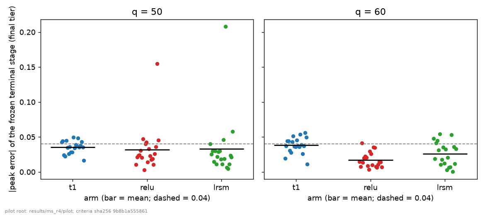
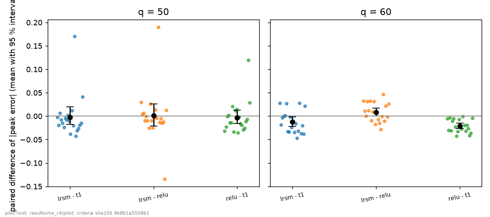
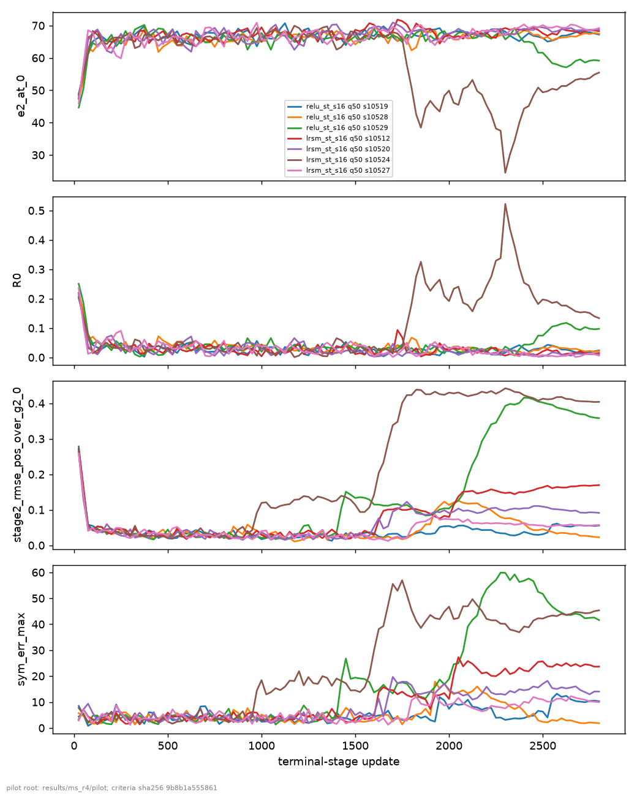
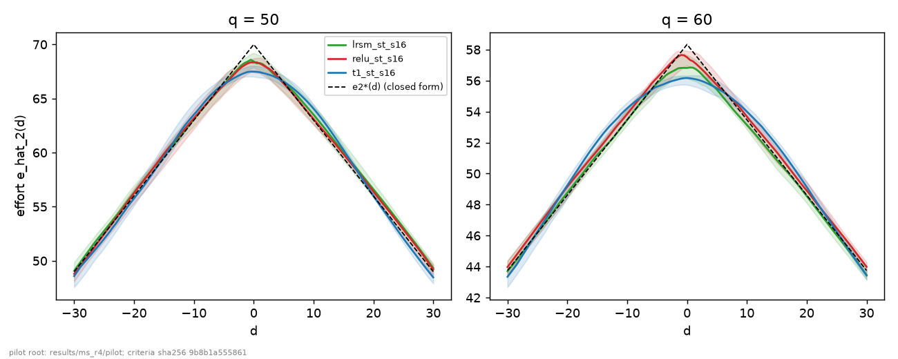
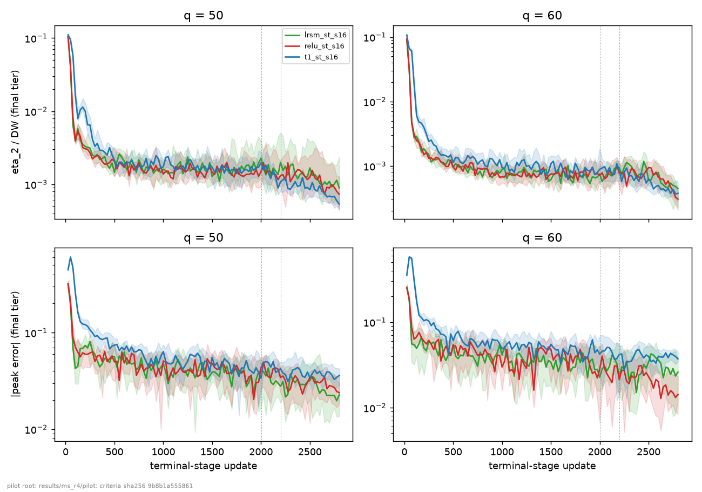

# MS-R4 E1: the `lrsm` actor against the controls

Date: 2026-10-14. Branch `ms-r4`; launch commit `2f618531`. Wave `r4`, E1 part: `t1_st_s16` and `relu_st_s16` (controls) and `lrsm_st_s16` (candidate) x q in {50, 60} x seeds 10511-10530: 120 runs. Everything below is read from `results/ms_r4/analysis/e1/` (written by `tools/ms/r4_e1_analysis.py`; its criterion table is recomputed independently by `tools/ms/r4_blind_e1.py`, 0 differences at 1e-12), `results/ms_r4/curves/`, `results/ms_r4/pilot/` and the launch files. Every table is printed by `python reports/ms/r4/report_scripts/pilot_tables.py --block <name> [key=value]`; the block name is given above each table. The figures are the PNG files of `results/ms_r4/analysis/e1/figures/`. Blocks and paragraphs marked *post hoc* are descriptive supplements (D5 itself calls the hidden-unit counts post hoc; the others are outside D5 and D6); they add no test to the pre-registered ones. The pre-registration is `02_preregistration.md` (Addendum 2: the PI's decision at gate G1).

## 0. Result

**E1 is not met** (`criterion_e1.csv`; D6: the line stops, and no other slope, map or variant follows).

- **q = 60: all three parts hold.** The mean |peak error| of `lrsm_st_s16` is 0.0259 (<= 0.04), its paired difference to `t1_st_s16` is -0.0122 [-0.0219, -0.0016], and none of its 20 runs fails a gate.
- **q = 50: part (a) holds, parts (b) and (c) fail.** The mean |peak error| is 0.0329 (<= 0.04). The paired difference to `t1_st_s16` is -0.0025 [-0.0175, +0.0196], an interval that contains 0. Four of 20 `lrsm` runs fail a gate (G-A and G-F in all four, G-N and G-S in one of them); `t1_st_s16` has 0 of 20 failing runs, `relu_st_s16` 3 of 20.
- **The effect is that of the combined change** (LeakyReLU hidden units and the smooth, unclamped mean map). No part of it is attributed to either (adjustment, D6 "Attribution").
- **Against `relu_st_s16`** (descriptive): the paired difference of |peak error| is +0.0008 [-0.0212, +0.0263] at q = 50 and +0.0086 [-0.0000, +0.0174] at q = 60 (lower end -3e-6): no detectable difference at q = 50, and a higher mean at q = 60 whose interval just contains 0. `lrsm` did not fail fewer runs than `relu` (4 against 3).
- **What the mean hides at q = 50:** three of the four `lrsm` runs that fail have a small peak error (0.011-0.025) while their eta_2/DW (0.014-0.073) and RMSE_pos (0.057-0.169) exceed the G-A thresholds; the fourth (seed 10524) has a peak error of 0.208 (section 5).

## 1. Checks

All deterministic checks of section 3.2 of the prompt pass; the statistical start-share flags are reported against their chance expectation, as in MS-R1..R3. Block `checks`:

| check | result | status |
|---|---|---|
| runs done with exit code 0 (`status.json`) | 280 / 280 | pass |
| manifest at the launch commit, clean tree | 280 / 280 | pass |
| files complete | 280 / 280 | pass |
| global-RNG assertions | 280 / 280 | pass |
| tail share equals lambda_T at every update (coverage) | 280 / 280 | pass |
| tail mass equals lambda_T to 1e-12 at every update (deterministic) | 280 / 280 | pass |
| near-tie and middle masses equal the design to 1e-12 in the within-stratum arms `fb_a0`, `fb_r`, `fb_rg` | 120 / 120 | pass |
| applied concentration scale equals the D2 schedule | 280 / 280 | pass |
| C-INIT: initial weights identical across `t1`, `relu`, `lrsm` | 40 / 40 | pass |
| C-FB25: the four E2 arms bit-identical through local update 25 | 120 / 120 | pass |
| C-X2: `fb_rx` equals `t1_st_s16` through local update 1201 | 40 / 40 | pass |
| sampling weights consistent with `p_digest_next` | 160 / 160 | pass |
| C-OFF: development tier offline equals the online checks, runs | 280 / 280 | pass |
| C-OFF: comparisons / mismatches / max abs difference | 260,480 / 0 / 0.0 | pass |
| offline curve points written | 23,680 (280 / 280 runs) | done |
| blind recomputation of `criterion_e1.csv` (1e-12) | 0 differences | agree |
| blind recomputation of `criterion_e2.csv` and the decision (1e-12) | 0 differences | agree |
| statistical start-share flags (|z| > 3), reported, not a failure | 8 of 840 tests (chance expectation 2.27) | reported |

The eight flagged start-share tests are (block `start_flags`):

| run | stage | stratum | updates | observed starts | expected | z |
|---|---|---|---|---|---|---|
| `q50/seed10522/fb_rx` | 2 | near | 1600 | 188188 | 186952.6 | +3.26 |
| `q60/seed10520/t1_st_s16` | 2 | near | 2800 | 328045 | 330054.2 | -3.99 |
| `q60/seed10520/t1_st_s16` | 2 | mid | 2800 | 454118 | 451909.4 | +3.97 |
| `q60/seed10520/relu_st_s16` | 2 | near | 2800 | 323132 | 325185.0 | -4.10 |
| `q60/seed10520/relu_st_s16` | 2 | mid | 2800 | 459031 | 456778.6 | +4.04 |
| `q60/seed10520/lrsm_st_s16` | 2 | near | 2800 | 319185 | 320906.7 | -3.45 |
| `q60/seed10520/lrsm_st_s16` | 2 | mid | 2800 | 462978 | 461056.9 | +3.44 |
| `q60/seed10525/fb_a0` | 2 | mid | 1600 | 161283 | 160116.4 | +3.25 |

Reading: the flags are reported, not failures (prompt 3.2). Eight of 840 tests are flagged against 2.27 expected by chance, an excess over the chance expectation, but the tests are not independent: the near-tie and middle counts of a run are complementary (the tail share is fixed), so the eight flags come from five runs, and three of the five are the three E1 arms of one (q, seed) (q = 60, seed 10520), with z of the same sign and similar size. The largest deviation of a realised count from the probabilities in force is 4.1 standard errors (one run); five runs have a flagged test. This report does not test whether the deviations matter; none of the five flagged runs fails a gate (section 3 for the three E1 arms; `04_e2_feedback.md` section 3 for `fb_rx` and `fb_a0`).

The launch (block `launch`, shared with `04_e2_feedback.md`):

| item | value |
|---|---|
| launch record | `results/ms_r4/pilot/launch_20261013_235029.json` |
| wave, workers, state | `r4`, 40 workers (single-threaded), `done` |
| started (stamp) | 20261013_235029 |
| `nproc` | 64 |
| load average at start (1, 5, 15 min) | 11.10, 11.61, 11.70 |
| load average at end (1, 5, 15 min) | 16.16, 32.16, 43.07 |
| free disk at start | 924 GB of 5952 GB |
| HEAD at the launch | `2f618531be7c8a9a1a9e30c79014650416b945f3` |
| code commit (`--code-commit`) | `2f618531be7c8a9a1a9e30c79014650416b945f3` |
| `git diff --stat <code commit> HEAD` | empty |
| `git diff --stat` on the run code paths | empty |
| `git status --porcelain` | 840 entries, 0 of them outside `results/ms_r4/` (the entries are the untracked C-MS6 and C-R7 results of the same worktree) |
| parameter file SHA-256 | `0fbfc01857c5abe339ab1926361cd57d6e988da20e754fd6dea3ffa4e076b406` |
| runs planned / finished / nonzero exit | 280 / 280 / 0 |

The wall time per arm (block `launch_wall`):

| arm | q | runs | median wall (s) | min (s) | max (s) |
|---|---|---|---|---|---|
| `t1_st_s16` | 50 | 20 | 630 | 584 | 661 |
| `t1_st_s16` | 60 | 20 | 607 | 482 | 667 |
| `relu_st_s16` | 50 | 20 | 629 | 583 | 658 |
| `relu_st_s16` | 60 | 20 | 605 | 489 | 704 |
| `lrsm_st_s16` | 50 | 20 | 622 | 588 | 666 |
| `lrsm_st_s16` | 60 | 20 | 597 | 468 | 666 |
| `fb_a0` | 50 | 20 | 446 | 405 | 493 |
| `fb_a0` | 60 | 20 | 433 | 362 | 480 |
| `fb_r` | 50 | 20 | 444 | 400 | 482 |
| `fb_r` | 60 | 20 | 431 | 353 | 501 |
| `fb_rg` | 50 | 20 | 444 | 414 | 487 |
| `fb_rg` | 60 | 20 | 420 | 351 | 488 |
| `fb_rx` | 50 | 20 | 447 | 429 | 479 |
| `fb_rx` | 60 | 20 | 427 | 355 | 492 |

## 2. Per arm: configuration and code version

The configurations are the `ms_run_config/1` files `results/ms_r4/pilot/q{q}/seed{s}/<arm>/run_config.json`; their SHA-256 are in `run_config_hashes.csv`, and the plan regenerated at the launch matched all 280 `r4` rows (Addendum 2). Block `config_arms` (read from `q50/seed10511`; the other runs differ in q and seed only):

| arm | role | actor | alpha | focus scope | focus map | stage-2 updates | landing | stage-1 updates | code commit |
|---|---|---|---|---|---|---|---|---|---|
| `t1_st_s16` | E1 control | t1 | 0.5 | cross-stratum (existing) | residual | 2800 | s 1 -> 16 over local 2001-2200 | 600 | `2f618531` |
| `relu_st_s16` | E1 control | relu | 0.5 | cross-stratum (existing) | residual | 2800 | s 1 -> 16 over local 2001-2200 | 600 | `2f618531` |
| `lrsm_st_s16` | E1 candidate | lrsm | 0.5 | cross-stratum (existing) | residual | 2800 | s 1 -> 16 over local 2001-2200 | 600 | `2f618531` |
| `fb_a0` | E2 arm (1) | t1 | 0.0 | none (alpha 0) | - | 1600 | none (s = 1) | 600 | `2f618531` |
| `fb_r` | E2 arm (2) | t1 | 0.5 | within_strata | residual | 1600 | none (s = 1) | 600 | `2f618531` |
| `fb_rg` | E2 arm (3) | t1 | 0.5 | within_strata | residual_gain | 1600 | none (s = 1) | 600 | `2f618531` |
| `fb_rx` | E2 descriptive | t1 | 0.5 | cross-stratum (existing) | residual | 1600 | none (s = 1) | 600 | `2f618531` |

The keys in which an arm differs from its comparator (block `config_diffs`, q = 50; q = 60 is the same pattern):

| arm | against | purpose | config keys that differ (besides arm / run / output labels) |
|---|---|---|---|
| `relu_st_s16` | `t1_st_s16` | E1 control relu against control t1 | actor_variant |
| `lrsm_st_s16` | `t1_st_s16` | E1 candidate against control t1 (the criterion's comparison) | actor_variant |
| `lrsm_st_s16` | `relu_st_s16` | E1 candidate against control relu (descriptive) | actor_variant |
| `fb_r` | `fb_a0` | E2 arm (2) against arm (1) | focus_scope, start_weights.alpha_global |
| `fb_rg` | `fb_a0` | E2 arm (3) against arm (1) | focus_map, focus_scope, start_weights.alpha_global |
| `fb_rx` | `fb_a0` | E2 descriptive arm against arm (1) | start_weights.alpha_global |
| `fb_rg` | `fb_r` | E2 arm (3) against arm (2) | focus_map |
| `fb_rx` | `t1_st_s16` | check C-X2: fb_rx against t1_st_s16 (same sampler, different budget / landing) | conc_scale_schedule.local_first, conc_scale_schedule.local_last, conc_scale_schedule.scale_first, conc_scale_schedule.scale_last, conc_scale_schedule.stage, pipeline.budgets.2, pipeline.lr_windows.2[0].first, pipeline.lr_windows.2[0].last |

In E1 the three arms differ in `actor_variant` only. Code version: every manifest records commit `2f618531`, clean tree (check `checks`); the run code (`agents/`, `run/`, `utils/`, `envs/`, `protocols/`) is that of `4c654d34`, which launched C-MS6 (the controls on MS-R3's seeds: 40 of 40 identical to MS-R3, `03_checks.md` section 5), and the launch record shows an empty `git diff --stat` on those paths. C-INIT holds (40 of 40): within a (q, seed) the three arms start from identical actor and critic weights, so the first differences between them arise from the forward of the actor.

## 3. Per-seed results

|peak error| of the frozen terminal stage (final tier) of every run; a run that fails a gate shows the failed gates. Block `e1_per_seed` for q = 50, then q = 60:

| seed | `t1_st_s16` | `relu_st_s16` | `lrsm_st_s16` |
|---|---|---|---|
| 10511 | 0.0424 | 0.0106 | 0.0402 |
| 10512 | 0.0444 | 0.0212 | 0.0251 **fails G-A, G-F** |
| 10513 | 0.0239 | 0.0235 | 0.0301 |
| 10514 | 0.0221 | 0.0242 | 0.0144 |
| 10515 | 0.0450 | 0.0308 | 0.0299 |
| 10516 | 0.0348 | 0.0207 | 0.0112 |
| 10517 | 0.0260 | 0.0472 | 0.0215 |
| 10518 | 0.0362 | 0.0029 | 0.0287 |
| 10519 | 0.0280 | 0.0398 **fails G-A, G-F** | 0.0303 |
| 10520 | 0.0283 | 0.0426 | 0.0179 **fails G-A, G-F** |
| 10521 | 0.0493 | 0.0138 | 0.0113 |
| 10522 | 0.0344 | 0.0328 | 0.0462 |
| 10523 | 0.0390 | 0.0230 | 0.0185 |
| 10524 | 0.0370 | 0.0178 | 0.2078 **fails G-A, G-F, G-N, G-S** |
| 10525 | 0.0482 | 0.0188 | 0.0061 |
| 10526 | 0.0354 | 0.0102 | 0.0049 |
| 10527 | 0.0376 | 0.0259 | 0.0113 **fails G-A, G-F** |
| 10528 | 0.0431 | 0.0360 **fails G-A** | 0.0236 |
| 10529 | 0.0355 | 0.1549 **fails G-A, G-F, G-S** | 0.0211 |
| 10530 | 0.0164 | 0.0451 | 0.0578 |
| **mean** | **0.0354** | **0.0321** | **0.0329** |

| seed | `t1_st_s16` | `relu_st_s16` | `lrsm_st_s16` |
|---|---|---|---|
| 10511 | 0.0197 | 0.0147 | 0.0475 |
| 10512 | 0.0371 | 0.0073 | 0.0186 |
| 10513 | 0.0444 | 0.0411 | 0.0411 |
| 10514 | 0.0445 | 0.0132 | 0.0449 |
| 10515 | 0.0304 | 0.0197 | 0.0315 |
| 10516 | 0.0276 | 0.0226 | 0.0546 |
| 10517 | 0.0432 | 0.0203 | 0.0107 |
| 10518 | 0.0510 | 0.0087 | 0.0175 |
| 10519 | 0.0365 | 0.0035 | 0.0353 |
| 10520 | 0.0361 | 0.0297 | 0.0124 |
| 10521 | 0.0452 | 0.0259 | 0.0322 |
| 10522 | 0.0371 | 0.0098 | 0.0030 |
| 10523 | 0.0359 | 0.0354 | 0.0205 |
| 10524 | 0.0536 | 0.0345 | 0.0066 |
| 10525 | 0.0391 | 0.0076 | 0.0071 |
| 10526 | 0.0256 | 0.0063 | 0.0533 |
| 10527 | 0.0370 | 0.0108 | 0.0002 |
| 10528 | 0.0563 | 0.0145 | 0.0362 |
| 10529 | 0.0497 | 0.0139 | 0.0120 |
| 10530 | 0.0112 | 0.0069 | 0.0328 |
| **mean** | **0.0381** | **0.0173** | **0.0259** |

Overview per arm and q (block `e1_overview`; the gap is in effort units):

| q | arm | runs | mean abs peak error | median | mean gap (effort units) | median gap | mean RMSE_pos / e2*(0) | median eta_2/DW | runs failing a gate |
|---|---|---|---|---|---|---|---|---|---|
| 50 | `t1_st_s16` | 20 | 0.0354 | 0.0359 | 2.48 | 2.51 | 0.0155 | 0.000536 | 0 |
| 50 | `relu_st_s16` | 20 | 0.0321 | 0.0239 | 2.23 | 1.67 | 0.0346 | 0.000729 | 3 |
| 50 | `lrsm_st_s16` | 20 | 0.0329 | 0.0226 | 2.15 | 1.57 | 0.0487 | 0.000891 | 4 |
| 60 | `t1_st_s16` | 20 | 0.0381 | 0.0371 | 2.22 | 2.16 | 0.016 | 0.000374 | 0 |
| 60 | `relu_st_s16` | 20 | 0.0173 | 0.0142 | 0.90 | 0.83 | 0.0131 | 0.000306 | 0 |
| 60 | `lrsm_st_s16` | 20 | 0.0259 | 0.0260 | 1.47 | 1.52 | 0.0139 | 0.000443 | 0 |

## 4. The target and the controls

The three parts of the target (block `e1_criterion`; thresholds 0.04, the 95 % interval below 0 and no gate failure, `prereg_criteria.json`, SHA-256 `9b8b1a55...`):

| q | (E1-a) mean abs peak error, `lrsm_st_s16` | a | (E1-b) paired difference vs `t1_st_s16`, 95 % CI | b | (E1-c) runs failing a gate | c | met at q |
|---|---|---|---|---|---|---|---|
| 50 | 0.0329 (<= 0.04) | True | -0.0025 [-0.0175, +0.0196] | False | 4 of 20 (G-A 4, G-F 4, G-N 1, G-S 1; nonzero exits 0) | False | False |
| 60 | 0.0259 (<= 0.04) | True | -0.0122 [-0.0219, -0.0016] | True | 0 of 20 (G-A 0, G-F 0, G-N 0, G-S 0; nonzero exits 0) | True | True |

Verdict (`criterion_e1.csv`, row `both`): **NOT MET (the line stops; no other slope, map or variant follows)**

The paired statistics of |peak error| for the criterion comparison and the two descriptive ones (block `e1_paired_peak`; 10,000 bootstrap resamples of the 20 seeds, seed 20261013, D6):

| comparison (a - b) | q | mean a | mean b | mean diff | 95 % CI | median diff | pairs a < b / a > b |
|---|---|---|---|---|---|---|---|
| lrsm - t1 | 50 | 0.0329 | 0.0354 | -0.0025 | [-0.0175, +0.0196] | -0.0124 | 15 / 5 |
| lrsm - t1 | 60 | 0.0259 | 0.0381 | -0.0122 | [-0.0219, -0.0016] | -0.0169 | 14 / 6 |
| lrsm - relu | 50 | 0.0329 | 0.0321 | +0.0008 | [-0.0212, +0.0263] | -0.0049 | 13 / 7 |
| lrsm - relu | 60 | 0.0259 | 0.0173 | +0.0086 | [-0.0000, +0.0174] | +0.0076 | 9 / 11 |
| relu - t1 | 50 | 0.0321 | 0.0354 | -0.0033 | [-0.0157, +0.0127] | -0.0129 | 14 / 6 |
| relu - t1 | 60 | 0.0173 | 0.0381 | -0.0207 | [-0.0265, -0.0149] | -0.0211 | 20 / 0 |

Reading, as a description of the table:

- **The controls partly reproduce MS-R3.** At q = 60 `relu_st_s16` - `t1_st_s16` is -0.0207 [-0.0265, -0.0149] (all 20 pairs negative) against -0.0206 [-0.0309, -0.0068] on seeds 10501-10510; at q = 50 the effect is smaller here, -0.0033 [-0.0157, +0.0127] against -0.0104 [-0.0162, -0.0047] there, and its interval contains 0. `t1_st_s16` has no failing run in 40 (Clopper-Pearson 95 % upper limit 0.088); `relu_st_s16` fails 3 of 20 at q = 50 (seeds 10519, 10528, 10529), none at q = 60.
- **`lrsm_st_s16` lowers the mean |peak error| against `t1_st_s16` in 15 of 20 pairs at q = 50 (median pair -0.0124) and 14 of 20 at q = 60 (median -0.0169).** The mean difference at q = 50 is small and its interval wide because one pair (seed 10524, +0.171) is an outlier; the other four positive pairs are +0.002 to +0.041. Its improvement at q = 60 (-0.0122) is smaller than that of `relu_st_s16` (-0.0207).
- **Post hoc: passing and failing runs separately** (block `e1_pass_fail_split`). At q = 50 the 16 `lrsm` runs that pass all four gates have a mean |peak error| of 0.0247 (`t1`: 0.0354 over 20 passing runs) and the four that fail 0.0655; for `relu` 0.0242 over 17 and 0.0769 over 3. This split is conditional on the outcome and is not a test; it shows that the typical successful run is closer to the closed form at the tie than a `t1` run, and that failures decide the criterion.

| q | arm | runs passing all four gates | their mean abs peak error | runs failing a gate | their mean abs peak error | max |
|---|---|---|---|---|---|---|
| 50 | `t1_st_s16` | 20 | 0.0354 | 0 | - | - |
| 50 | `relu_st_s16` | 17 | 0.0242 | 3 | 0.0769 | 0.1549 |
| 50 | `lrsm_st_s16` | 16 | 0.0247 | 4 | 0.0655 | 0.2078 |
| 60 | `t1_st_s16` | 20 | 0.0381 | 0 | - | - |
| 60 | `relu_st_s16` | 20 | 0.0173 | 0 | - | - |
| 60 | `lrsm_st_s16` | 20 | 0.0259 | 0 | - | - |

## 5. Failures, the decomposition and stage 1

### 5.1 Failures

Gate failures and nonzero exits per arm and q with exact Clopper-Pearson intervals (block `e1_failure_rates`; no run exited nonzero):

| arm | q | runs | failing | rate | Clopper-Pearson 95 % |
|---|---|---|---|---|---|
| `t1_st_s16` | 50 | 20 | 0 | 0.000 | [0.000, 0.168] |
| `t1_st_s16` | 60 | 20 | 0 | 0.000 | [0.000, 0.168] |
| `t1_st_s16` | both | 40 | 0 | 0.000 | [0.000, 0.088] |
| `relu_st_s16` | 50 | 20 | 3 | 0.150 | [0.032, 0.379] |
| `relu_st_s16` | 60 | 20 | 0 | 0.000 | [0.000, 0.168] |
| `relu_st_s16` | both | 40 | 3 | 0.075 | [0.016, 0.204] |
| `lrsm_st_s16` | 50 | 20 | 4 | 0.200 | [0.057, 0.437] |
| `lrsm_st_s16` | 60 | 20 | 0 | 0.000 | [0.000, 0.168] |
| `lrsm_st_s16` | both | 40 | 4 | 0.100 | [0.028, 0.237] |

The seven failing runs (block `e1_failed_runs`; G-A requires eta_2/DW <= 0.005, RMSE_pos/e2*(0) <= 0.05 and tail mean/e2*(0) <= 0.02, G-F requires Gmax_full/DW <= 0.01, G-N a development-final difference <= 0.001, G-S a stage-1 relative error <= 0.05, `protocols/v2_T2_locked_v2_0.json`):

| arm | q | seed | gates failed | abs peak error | e_hat_2(0) / e2*(0) | eta_2/DW | RMSE_pos/e2*(0) | tie mean at the bound of the mean map |
|---|---|---|---|---|---|---|---|---|
| `relu_st_s16` | 50 | 10519 | G-A, G-F | 0.0398 | 67.21 / 70.00 | 0.0104 | 0.0557 | no |
| `relu_st_s16` | 50 | 10528 | G-A | 0.0360 | 67.48 / 70.00 | 0.00584 | 0.0228 | no |
| `relu_st_s16` | 50 | 10529 | G-A, G-F, G-S | 0.1549 | 59.16 / 70.00 | 0.168 | 0.358 | no |
| `lrsm_st_s16` | 50 | 10512 | G-A, G-F | 0.0251 | 68.25 / 70.00 | 0.0734 | 0.169 | no |
| `lrsm_st_s16` | 50 | 10520 | G-A, G-F | 0.0179 | 68.75 / 70.00 | 0.0287 | 0.0913 | no |
| `lrsm_st_s16` | 50 | 10524 | G-A, G-F, G-N, G-S | 0.2078 | 55.45 / 70.00 | 0.201 | 0.404 | no |
| `lrsm_st_s16` | 50 | 10527 | G-A, G-F | 0.0113 | 69.21 / 70.00 | 0.014 | 0.0571 | no |

- **All seven failures are at q = 50.** For `lrsm`: G-A fails in all four, G-F in all four, G-N and G-S in seed 10524. For `relu`: G-A fails in all three, G-F in two (10519, 10529), G-S in one (10529).
- **The tie mean is at the bound of the mean map in none of the seven runs** (column `tie mean at the bound of the mean map`; D5 asks for it; the mean map of both variants is limited to mu in [1e-6, 1 - 1e-6], that is to efforts in [1e-4, 100 - 1e-4]).
- **Three of the four `lrsm` failures are not tie failures.** Seeds 10512, 10520 and 10527 have |peak error| of 0.025, 0.018 and 0.011, but eta_2/DW of 0.073, 0.029 and 0.014 and RMSE_pos/e2*(0) of 0.169, 0.091 and 0.057 (all above the G-A thresholds). Seed 10524 has a peak error of 0.208 (e_hat_2(0) = 55.5 against e2*(0) = 70).

The trajectories of the failed runs (block `e1_failure_traj`: e_hat_2(0), RMSE_pos, R0 and the symmetry error at selected updates; the full 112-point trajectories are in `failure_trajectories.csv`):

| arm | q | seed | quantity | u100 | u400 | u1200 | u1600 | u2000 | u2200 | u2800 |
|---|---|---|---|---|---|---|---|---|---|---|
| `lrsm_st_s16` | 50 | 10512 | e_hat_2(0) | 67.2 | 64.6 | 64.2 | 70.2 | 67.0 | 67.8 | 68.2 |
|  |  |  | RMSE_pos / e2*(0) | 0.045 | 0.040 | 0.033 | 0.029 | 0.080 | 0.152 | 0.169 |
|  |  |  | R0 | 0.024 | 0.047 | 0.051 | 0.010 | 0.026 | 0.019 | 0.015 |
|  |  |  | symmetry error (max, effort units) | 3.3 | 2.8 | 6.0 | 4.3 | 11.2 | 21.4 | 23.7 |
| `lrsm_st_s16` | 50 | 10520 | e_hat_2(0) | 67.7 | 67.9 | 64.4 | 69.5 | 67.5 | 68.5 | 68.7 |
|  |  |  | RMSE_pos / e2*(0) | 0.043 | 0.020 | 0.029 | 0.052 | 0.091 | 0.099 | 0.091 |
|  |  |  | R0 | 0.019 | 0.018 | 0.049 | 0.003 | 0.021 | 0.012 | 0.011 |
|  |  |  | symmetry error (max, effort units) | 5.7 | 2.4 | 3.3 | 5.4 | 14.8 | 15.9 | 14.0 |
| `lrsm_st_s16` | 50 | 10524 | e_hat_2(0) | 68.3 | 67.4 | 69.2 | 65.8 | 49.9 | 45.4 | 55.5 |
|  |  |  | RMSE_pos / e2*(0) | 0.042 | 0.027 | 0.129 | 0.142 | 0.430 | 0.429 | 0.404 |
|  |  |  | R0 | 0.014 | 0.022 | 0.006 | 0.036 | 0.192 | 0.242 | 0.134 |
|  |  |  | symmetry error (max, effort units) | 3.4 | 3.1 | 21.9 | 29.9 | 46.8 | 42.1 | 45.4 |
| `lrsm_st_s16` | 50 | 10527 | e_hat_2(0) | 67.8 | 66.3 | 66.7 | 69.9 | 66.6 | 68.4 | 69.2 |
|  |  |  | RMSE_pos / e2*(0) | 0.049 | 0.033 | 0.032 | 0.016 | 0.074 | 0.063 | 0.057 |
|  |  |  | R0 | 0.019 | 0.031 | 0.028 | 0.002 | 0.029 | 0.014 | 0.006 |
|  |  |  | symmetry error (max, effort units) | 2.0 | 3.6 | 6.5 | 4.3 | 9.1 | 6.8 | 10.0 |
| `relu_st_s16` | 50 | 10519 | e_hat_2(0) | 65.1 | 65.5 | 65.2 | 66.8 | 67.4 | 67.5 | 67.2 |
|  |  |  | RMSE_pos / e2*(0) | 0.055 | 0.042 | 0.022 | 0.034 | 0.054 | 0.043 | 0.056 |
|  |  |  | R0 | 0.042 | 0.039 | 0.041 | 0.028 | 0.022 | 0.021 | 0.024 |
|  |  |  | symmetry error (max, effort units) | 2.0 | 6.1 | 3.2 | 4.4 | 7.4 | 7.7 | 10.3 |
| `relu_st_s16` | 50 | 10528 | e_hat_2(0) | 62.0 | 66.6 | 67.2 | 69.3 | 66.7 | 66.7 | 67.5 |
|  |  |  | RMSE_pos / e2*(0) | 0.043 | 0.027 | 0.013 | 0.024 | 0.114 | 0.106 | 0.023 |
|  |  |  | R0 | 0.071 | 0.029 | 0.024 | 0.005 | 0.028 | 0.028 | 0.022 |
|  |  |  | symmetry error (max, effort units) | 1.7 | 5.3 | 2.9 | 3.0 | 14.3 | 13.2 | 1.8 |
| `relu_st_s16` | 50 | 10529 | e_hat_2(0) | 64.6 | 66.7 | 67.5 | 69.0 | 66.1 | 66.7 | 59.2 |
|  |  |  | RMSE_pos / e2*(0) | 0.044 | 0.020 | 0.034 | 0.115 | 0.104 | 0.316 | 0.358 |
|  |  |  | R0 | 0.047 | 0.028 | 0.021 | 0.008 | 0.034 | 0.028 | 0.097 |
|  |  |  | symmetry error (max, effort units) | 4.7 | 2.8 | 5.4 | 13.7 | 18.9 | 53.5 | 41.6 |

The e_hat_2(0), RMSE_pos and R0 rows are read from the online development-tier checks (`ms_checks_stage2.csv`); e_hat_2(0) and RMSE_pos do not depend on the verifier tier (section 5.3), the R0 row is the development-tier value (the final-tier R0 at the freeze is the column `t2_R0_final` of `per_run.csv`); the symmetry-error row is read from the offline final-tier curve (`failure_trajectories` in `tools/ms/r4_e1_analysis.py`).

Description (no cause is tested): in two of the seven failures the RMSE_pos is already above 0.1 at update 1200 or 1600 (`lrsm` 10524: 0.129 and 0.142; `relu` 10529: 0.034 and 0.115), and it rises further in both later (to 0.430 at update 2000 for `lrsm` 10524, to 0.316 at update 2200 for `relu` 10529). In the other five it is below 0.06 from update 75 to update 1600 and has risen by update 2000: `lrsm` 10512 (0.029 at 1600, 0.080 at 2000), 10520 (0.052, 0.091), 10527 (0.016, 0.074), `relu` 10528 (0.024, 0.114; it falls back to 0.023 at 2800 and fails G-A on eta_2/DW = 0.0058 only) and `relu` 10519 (0.034, 0.054). Updates 1-2000 run at a constant learning rate of 3e-4 and concentration scale 1; the ramp to scale 16 covers updates 2001-2200. *Post hoc* comparison with the passing runs (block `e1_rmse_rise`, from `curves_all.csv`; the threshold 2.294 is the smallest ratio among the seven failing runs, chosen after seeing them): the RMSE_pos at update 2000 is 2.3 to 8.7 times its value at update 1200 in all seven failing runs (median 3.1), and in 2 of the 113 passing runs (both `relu` at q = 60: 2.49 and 2.72; a third `relu` run at q = 60 has 2.29, just below the threshold; none of `t1` or `lrsm`; median ratio of the passing runs 1.00). A rise of RMSE_pos in the constant-rate phase therefore marks the failing runs of this pilot, but it is a description selected after the fact, not a predictor tested on other runs, and nothing was varied to learn whether it is related to the cause.

| group (all three E1 arms, both q) | runs | median ratio RMSE_pos(u2000) / RMSE_pos(u1200) | min | max | runs with ratio >= 2.294 (the smallest ratio among the failing runs) | runs with ratio > 1 |
|---|---|---|---|---|---|---|
| runs passing all four gates | 113 | 1.00 | 0.36 | 2.72 | 2 | 56 |
| runs failing a gate | 7 | 3.07 | 2.29 | 8.67 | 7 | 7 |

Passing runs that reach the threshold: `relu_st_s16` q = 60 seed 10521: 2.49, `relu_st_s16` q = 60 seed 10522: 2.72.

The post hoc hidden-unit counts of D5 (block `e1_units`; per unit, the share of the development nodes of D_2 with a positive pre-activation at the freeze; the table covers the failed runs only, as D5 asks, so no comparison with passing runs is possible here):

| arm | q | seed | layer 1: never / always / mixed positive | layer 2: never / always / mixed |
|---|---|---|---|---|
| `lrsm_st_s16` | 50 | 10512 | 12 / 14 / 38 | 22 / 26 / 16 |
| `lrsm_st_s16` | 50 | 10520 | 10 / 9 / 45 | 9 / 22 / 33 |
| `lrsm_st_s16` | 50 | 10524 | 11 / 2 / 51 | 10 / 26 / 28 |
| `lrsm_st_s16` | 50 | 10527 | 16 / 11 / 37 | 16 / 25 / 23 |
| `relu_st_s16` | 50 | 10519 | 18 / 14 / 32 | 17 / 22 / 25 |
| `relu_st_s16` | 50 | 10528 | 21 / 13 / 30 | 15 / 16 / 33 |
| `relu_st_s16` | 50 | 10529 | 21 / 6 / 37 | 14 / 15 / 35 |

Reading: in each failed run of both variants 10-21 of the 64 first-layer units and 9-22 of the 64 second-layer units are never positive on D_2; whether passing runs differ was not measured. For `lrsm` a never-positive unit still passes a slope of 0.01.

### 5.2 The decomposition at the freeze

The gap between the closed form and the learned effort at the tie splits into the smoothing part and a remainder (MS-R2). Paired changes of every D5 quantity for the three comparisons (blocks `e1_decomp a=lrsm b=t1`, `a=lrsm b=relu`, `a=relu b=t1`; 95 % bootstrap intervals; descriptive, outside the criterion):

`lrsm_st_s16` - `t1_st_s16`:

| q | quantity | mean `lrsm` | mean `t1` | mean diff | 95 % CI | pairs a < b / a > b |
|---|---|---|---|---|---|---|
| 50 | signed peak error (relative) | -0.0307 | -0.0354 | +0.00462 | [-0.0177, +0.0206] | 5 / 15 |
| 50 | peak gap (effort units) | 2.15 | 2.48 | -0.324 | [-1.44, +1.24] | 15 / 5 |
| 50 | smoothing part | 0.458 | 0.49 | -0.0324 | [-0.0479, -0.0178] | 17 / 3 |
| 50 | remainder | 1.69 | 1.99 | -0.291 | [-1.4, +1.26] | 15 / 5 |
| 50 | sigma_2(0) | 0.58 | 0.621 | -0.0411 | [-0.0607, -0.0226] | 17 / 3 |
| 50 | RMSE_pos / e2*(0) | 0.0487 | 0.0155 | +0.0332 | [+0.00281, +0.0793] | 9 / 11 |
| 50 | tail mean / e2*(0) | 0.00157 | 0.00773 | -0.00616 | [-0.00666, -0.00555] | 20 / 0 |
| 50 | eta_2 / DW | 0.0165 | 0.00065 | +0.0159 | [+0.0011, +0.0394] | 7 / 13 |
| 50 | R0 | 0.0232 | 0.0211 | +0.00208 | [-0.00944, +0.0172] | 14 / 6 |
| 50 | w_eff | 3.07 | 3.54 | -0.462 | [-2.06, +1.77] | 15 / 5 |
| 50 | stage-1 abs relative error | 0.0241 | 0.0133 | +0.0108 | [-0.00388, +0.0345] | 9 / 11 |
| 50 | Gmax_full / DW | 0.0165 | 0.00065 | +0.0159 | [+0.0011, +0.0394] | 7 / 13 |
| 60 | signed peak error (relative) | -0.0252 | -0.0381 | +0.0129 | [+0.00208, +0.0231] | 6 / 14 |
| 60 | peak gap (effort units) | 1.47 | 2.22 | -0.751 | [-1.35, -0.121] | 14 / 6 |
| 60 | smoothing part | 0.313 | 0.368 | -0.0549 | [-0.065, -0.0446] | 20 / 0 |
| 60 | remainder | 1.16 | 1.85 | -0.696 | [-1.29, -0.0701] | 14 / 6 |
| 60 | sigma_2(0) | 0.571 | 0.671 | -0.1 | [-0.119, -0.0814] | 20 / 0 |
| 60 | RMSE_pos / e2*(0) | 0.0139 | 0.016 | -0.00203 | [-0.00454, +0.000243] | 12 / 8 |
| 60 | tail mean / e2*(0) | 0.00195 | 0.00911 | -0.00716 | [-0.00774, -0.00658] | 20 / 0 |
| 60 | eta_2 / DW | 0.000433 | 0.000418 | +1.45e-05 | [-0.000105, +0.000133] | 11 / 9 |
| 60 | R0 | 0.018 | 0.026 | -0.00791 | [-0.0146, -0.000693] | 14 / 6 |
| 60 | w_eff | 3.02 | 4.57 | -1.55 | [-2.77, -0.249] | 14 / 6 |
| 60 | stage-1 abs relative error | 0.0132 | 0.00942 | +0.00375 | [-0.000647, +0.00809] | 8 / 12 |
| 60 | Gmax_full / DW | 0.000433 | 0.000418 | +1.45e-05 | [-0.000105, +0.000133] | 11 / 9 |

`lrsm_st_s16` - `relu_st_s16`:

| q | quantity | mean `lrsm` | mean `relu` | mean diff | 95 % CI | pairs a < b / a > b |
|---|---|---|---|---|---|---|
| 50 | signed peak error (relative) | -0.0307 | -0.0318 | +0.00106 | [-0.025, +0.0239] | 7 / 13 |
| 50 | peak gap (effort units) | 2.15 | 2.23 | -0.0745 | [-1.67, +1.75] | 13 / 7 |
| 50 | smoothing part | 0.458 | 0.459 | -0.000991 | [-0.0254, +0.0189] | 9 / 11 |
| 50 | remainder | 1.69 | 1.77 | -0.0735 | [-1.65, +1.73] | 13 / 7 |
| 50 | sigma_2(0) | 0.58 | 0.582 | -0.00126 | [-0.0322, +0.024] | 9 / 11 |
| 50 | RMSE_pos / e2*(0) | 0.0487 | 0.0346 | +0.0141 | [-0.0396, +0.0702] | 8 / 12 |
| 50 | tail mean / e2*(0) | 0.00157 | 0.00174 | -0.000167 | [-0.000801, +0.000523] | 12 / 8 |
| 50 | eta_2 / DW | 0.0165 | 0.00991 | +0.00663 | [-0.0198, +0.0344] | 7 / 13 |
| 50 | R0 | 0.0232 | 0.0198 | +0.00343 | [-0.0112, +0.0204] | 12 / 8 |
| 50 | w_eff | 3.07 | 3.18 | -0.106 | [-2.39, +2.5] | 13 / 7 |
| 50 | stage-1 abs relative error | 0.0241 | 0.0163 | +0.00775 | [-0.0177, +0.0367] | 7 / 13 |
| 50 | Gmax_full / DW | 0.0165 | 0.00991 | +0.00663 | [-0.0198, +0.0344] | 7 / 13 |
| 60 | signed peak error (relative) | -0.0252 | -0.0154 | -0.00981 | [-0.0188, -0.000868] | 12 / 8 |
| 60 | peak gap (effort units) | 1.47 | 0.897 | +0.572 | [+0.0506, +1.09] | 8 / 12 |
| 60 | smoothing part | 0.313 | 0.315 | -0.00192 | [-0.0102, +0.00614] | 10 / 10 |
| 60 | remainder | 1.16 | 0.582 | +0.574 | [+0.0532, +1.1] | 7 / 13 |
| 60 | sigma_2(0) | 0.571 | 0.574 | -0.00351 | [-0.0186, +0.0112] | 10 / 10 |
| 60 | RMSE_pos / e2*(0) | 0.0139 | 0.0131 | +0.000796 | [-0.000937, +0.00247] | 7 / 13 |
| 60 | tail mean / e2*(0) | 0.00195 | 0.00253 | -0.000587 | [-0.00108, -0.000141] | 12 / 8 |
| 60 | eta_2 / DW | 0.000433 | 0.000331 | +0.000101 | [-4.37e-06, +0.000209] | 7 / 13 |
| 60 | R0 | 0.018 | 0.0129 | +0.00511 | [-0.00135, +0.0116] | 9 / 11 |
| 60 | w_eff | 3.02 | 1.84 | +1.18 | [+0.104, +2.25] | 8 / 12 |
| 60 | stage-1 abs relative error | 0.0132 | 0.0107 | +0.00244 | [-0.00218, +0.00678] | 6 / 14 |
| 60 | Gmax_full / DW | 0.000433 | 0.000331 | +0.000101 | [-4.37e-06, +0.000209] | 7 / 13 |

`relu_st_s16` - `t1_st_s16`:

| q | quantity | mean `relu` | mean `t1` | mean diff | 95 % CI | pairs a < b / a > b |
|---|---|---|---|---|---|---|
| 50 | signed peak error (relative) | -0.0318 | -0.0354 | +0.00356 | [-0.0125, +0.0161] | 6 / 14 |
| 50 | peak gap (effort units) | 2.23 | 2.48 | -0.249 | [-1.13, +0.872] | 14 / 6 |
| 50 | smoothing part | 0.459 | 0.49 | -0.0314 | [-0.0468, -0.0114] | 18 / 2 |
| 50 | remainder | 1.77 | 1.99 | -0.218 | [-1.09, +0.888] | 13 / 7 |
| 50 | sigma_2(0) | 0.582 | 0.621 | -0.0398 | [-0.0593, -0.0145] | 18 / 2 |
| 50 | RMSE_pos / e2*(0) | 0.0346 | 0.0155 | +0.0191 | [-0.000973, +0.0548] | 9 / 11 |
| 50 | tail mean / e2*(0) | 0.00174 | 0.00773 | -0.00599 | [-0.00653, -0.00542] | 20 / 0 |
| 50 | eta_2 / DW | 0.00991 | 0.00065 | +0.00926 | [+0.000165, +0.0264] | 7 / 13 |
| 50 | R0 | 0.0198 | 0.0211 | -0.00136 | [-0.00891, +0.00854] | 14 / 6 |
| 50 | w_eff | 3.18 | 3.54 | -0.356 | [-1.61, +1.25] | 14 / 6 |
| 50 | stage-1 abs relative error | 0.0163 | 0.0133 | +0.003 | [-0.01, +0.0222] | 11 / 9 |
| 50 | Gmax_full / DW | 0.00991 | 0.00065 | +0.00926 | [+0.000165, +0.0264] | 7 / 13 |
| 60 | signed peak error (relative) | -0.0154 | -0.0381 | +0.0227 | [+0.0157, +0.0298] | 0 / 20 |
| 60 | peak gap (effort units) | 0.897 | 2.22 | -1.32 | [-1.74, -0.917] | 20 / 0 |
| 60 | smoothing part | 0.315 | 0.368 | -0.053 | [-0.0642, -0.0418] | 20 / 0 |
| 60 | remainder | 0.582 | 1.85 | -1.27 | [-1.69, -0.865] | 19 / 1 |
| 60 | sigma_2(0) | 0.574 | 0.671 | -0.0966 | [-0.117, -0.0763] | 20 / 0 |
| 60 | RMSE_pos / e2*(0) | 0.0131 | 0.016 | -0.00282 | [-0.00519, -0.000404] | 13 / 7 |
| 60 | tail mean / e2*(0) | 0.00253 | 0.00911 | -0.00657 | [-0.00721, -0.00594] | 20 / 0 |
| 60 | eta_2 / DW | 0.000331 | 0.000418 | -8.68e-05 | [-0.000177, +2.06e-06] | 13 / 7 |
| 60 | R0 | 0.0129 | 0.026 | -0.013 | [-0.0169, -0.00919] | 20 / 0 |
| 60 | w_eff | 1.84 | 4.57 | -2.72 | [-3.58, -1.89] | 20 / 0 |
| 60 | stage-1 abs relative error | 0.0107 | 0.00942 | +0.00132 | [-0.00377, +0.00613] | 8 / 12 |
| 60 | Gmax_full / DW | 0.000331 | 0.000418 | -8.68e-05 | [-0.000177, +2.06e-06] | 13 / 7 |

Reading, as a description of the three tables:

- **Smoothing part, sigma_2(0) and the tail mean are lower under `lrsm` and under `relu` than under `t1`** at both q (for example sigma_2(0) -0.0411 and -0.1001 for `lrsm` - `t1`, intervals below 0 at both q; the tail mean -0.0062 and -0.0072, 20 of 20 pairs negative at both q). `lrsm` and `relu` do not differ in the smoothing part (-0.0010 and -0.0019) or in sigma_2(0) (-0.0013 and -0.0035), all four intervals contain 0; the tail mean differs only at q = 60 (-0.00059 [-0.00108, -0.00014]).
- **The remainder is the larger part of the gap** in all six arm x q cells (0.58-1.99 of 0.90-2.48 effort units in the means). At q = 60 it is lower under `lrsm` than under `t1` (-0.696 [-1.29, -0.0701]) and higher than under `relu` (+0.574 [+0.053, +1.096]); at q = 50 no comparison of the three has an interval that excludes 0.
- **RMSE_pos and eta_2/DW at q = 50 are higher under `lrsm`** than under `t1` (+0.0332 [+0.0028, +0.0793] and +0.0159 [+0.0011, +0.0394]); most of both comes from the failing runs, which contribute 0.0158 of the mean eta_2/DW of 0.0165 and 0.0361 of the mean RMSE_pos of 0.0487 (section 5.1). At q = 60 neither differs (eta_2/DW +1.45e-5 [-0.000105, +0.000133]; RMSE_pos -0.0020 [-0.0045, +0.0002]).
- **Stage 1** (D5: G-S, the stage-1 error, G-F and G-N): the stage-1 absolute relative error is higher under `lrsm` than under `t1` in the mean at both q (+0.0108 [-0.0039, +0.0345] and +0.0038 [-0.0006, +0.0081]; no interval excludes 0); one `lrsm` run fails G-S (seed 10524, section 5.1). Gmax_full/DW equals eta_2/DW in every run of the pilot (block `gmax_equality` in `04_e2_feedback.md` section 7): the maximum over the stages is always attained at stage 2 (the stage-1 deviation gain Delta_1/DW is at most 4.1e-4 in the E1 runs), so G-F is a second threshold (0.01) on the stage-2 quantity.

The location-free peak error, its argmax and the symmetry error at the freeze (D5; block `e1_locfree`, descriptive, final tier):

| q | arm | mean location-free peak error (signed, relative) | median | median argmax d of the location-free peak | mean symmetry error (relative) | median |
|---|---|---|---|---|---|---|
| 50 | `t1_st_s16` | -0.0350 | -0.0354 | +0.00 | 0.0290 | 0.0280 |
| 50 | `relu_st_s16` | -0.0256 | -0.0221 | +0.50 | 0.0734 | 0.0413 |
| 50 | `lrsm_st_s16` | -0.0247 | -0.0171 | -0.25 | 0.0938 | 0.0339 |
| 60 | `t1_st_s16` | -0.0377 | -0.0369 | -0.50 | 0.0298 | 0.0294 |
| 60 | `relu_st_s16` | -0.0113 | -0.0088 | -0.25 | 0.0339 | 0.0319 |
| 60 | `lrsm_st_s16` | -0.0234 | -0.0249 | -0.50 | 0.0406 | 0.0393 |

Per-stratum errors of the learned effort relative to e2*(d) (D5; block `e1_strata`, final tier, means over the 20 runs; `near` = near-tie, `mid` = middle, `tail` = tail stratum of `StartSampler.strata`; the development tier is in `strata_summary.csv`):

| q | arm | stratum | side | mean signed error / e2* | RMSE / e2* | mean max abs error / e2* |
|---|---|---|---|---|---|---|
| 50 | `t1_st_s16` | near | d<0 | +0.00270 | 0.01745 | 0.03525 |
| 50 | `relu_st_s16` | near | d<0 | -0.01821 | 0.03679 | 0.06447 |
| 50 | `lrsm_st_s16` | near | d<0 | -0.02980 | 0.05148 | 0.07097 |
| 50 | `t1_st_s16` | near | d>0 | +0.00405 | 0.01497 | 0.03220 |
| 50 | `relu_st_s16` | near | d>0 | -0.00897 | 0.02070 | 0.03375 |
| 50 | `lrsm_st_s16` | near | d>0 | -0.00982 | 0.02683 | 0.03833 |
| 50 | `t1_st_s16` | mid | d<0 | -0.00303 | 0.01752 | 0.03174 |
| 50 | `relu_st_s16` | mid | d<0 | -0.02500 | 0.04322 | 0.08457 |
| 50 | `lrsm_st_s16` | mid | d<0 | -0.03473 | 0.06073 | 0.12236 |
| 50 | `t1_st_s16` | mid | d>0 | -0.00124 | 0.01074 | 0.02721 |
| 50 | `relu_st_s16` | mid | d>0 | -0.01360 | 0.02292 | 0.04212 |
| 50 | `lrsm_st_s16` | mid | d>0 | -0.01576 | 0.02878 | 0.05321 |
| 50 | `t1_st_s16` | tail | d<0 | +0.00777 | 0.00909 | 0.02944 |
| 50 | `relu_st_s16` | tail | d<0 | +0.00150 | 0.00392 | 0.01990 |
| 50 | `lrsm_st_s16` | tail | d<0 | +0.00153 | 0.00394 | 0.02042 |
| 50 | `t1_st_s16` | tail | d>0 | +0.00769 | 0.00915 | 0.03041 |
| 50 | `relu_st_s16` | tail | d>0 | +0.00198 | 0.00460 | 0.02188 |
| 50 | `lrsm_st_s16` | tail | d>0 | +0.00162 | 0.00410 | 0.02058 |
| 60 | `t1_st_s16` | near | d<0 | +0.00440 | 0.01875 | 0.03734 |
| 60 | `relu_st_s16` | near | d<0 | +0.00299 | 0.01213 | 0.01881 |
| 60 | `lrsm_st_s16` | near | d<0 | -0.00049 | 0.01372 | 0.02660 |
| 60 | `t1_st_s16` | near | d>0 | +0.00178 | 0.01713 | 0.03544 |
| 60 | `relu_st_s16` | near | d>0 | +0.00194 | 0.01152 | 0.01888 |
| 60 | `lrsm_st_s16` | near | d>0 | -0.00561 | 0.01423 | 0.02679 |
| 60 | `t1_st_s16` | mid | d<0 | +0.00014 | 0.01737 | 0.03480 |
| 60 | `relu_st_s16` | mid | d<0 | +0.00008 | 0.01511 | 0.03150 |
| 60 | `lrsm_st_s16` | mid | d<0 | +0.00098 | 0.01430 | 0.03125 |
| 60 | `t1_st_s16` | mid | d>0 | -0.00074 | 0.01219 | 0.03172 |
| 60 | `relu_st_s16` | mid | d>0 | +0.00096 | 0.01024 | 0.02897 |
| 60 | `lrsm_st_s16` | mid | d>0 | -0.00366 | 0.01225 | 0.02796 |
| 60 | `t1_st_s16` | tail | d<0 | +0.00879 | 0.01085 | 0.03196 |
| 60 | `relu_st_s16` | tail | d<0 | +0.00191 | 0.00486 | 0.02339 |
| 60 | `lrsm_st_s16` | tail | d<0 | +0.00137 | 0.00369 | 0.01895 |
| 60 | `t1_st_s16` | tail | d>0 | +0.00942 | 0.01161 | 0.03415 |
| 60 | `relu_st_s16` | tail | d>0 | +0.00316 | 0.00656 | 0.02766 |
| 60 | `lrsm_st_s16` | tail | d>0 | +0.00253 | 0.00553 | 0.02429 |

### 5.3 Both tiers and the start shares

The final tier is the primary tier of this report; the development tier of the same frozen candidates (block `tiers exp=e1`; the G-N difference is |development - final| of eta_2/DW and of Gmax_full/DW, limit 0.001):

| q | arm | mean eta_2/DW, final tier | development tier | mean |dev - final| of eta_2/DW | max | mean |dev - final| of Gmax_full/DW | max | runs failing G-N |
|---|---|---|---|---|---|---|---|---|
| 50 | `t1_st_s16` | 0.00065 | 0.00062 | 3.03e-05 | 0.000165 | 3.03e-05 | 0.000165 | 0 |
| 50 | `relu_st_s16` | 0.00991 | 0.00986 | 5.29e-05 | 0.000426 | 5.29e-05 | 0.000426 | 0 |
| 50 | `lrsm_st_s16` | 0.0165 | 0.0164 | 0.000143 | 0.00118 | 0.000143 | 0.00118 | 1 |
| 60 | `t1_st_s16` | 0.000418 | 0.000403 | 1.51e-05 | 0.000125 | 1.51e-05 | 0.000125 | 0 |
| 60 | `relu_st_s16` | 0.000331 | 0.00032 | 1.09e-05 | 4.02e-05 | 1.09e-05 | 4.02e-05 | 0 |
| 60 | `lrsm_st_s16` | 0.000433 | 0.000406 | 2.61e-05 | 0.000129 | 2.61e-05 | 0.000129 | 0 |

The development tier tracks the final tier: the mean |development - final| of eta_2/DW is at most 1.43e-4 in every arm and q, and one run fails G-N (`lrsm_st_s16`, q = 50, seed 10524: 0.00118 against 0.001). The development-tier values of every stratum are in `strata_summary.csv` (tier = development).

The five recovery metrics (abs peak error, e_hat_2(0), RMSE_pos, tail mean and symmetry error) are evaluated on the closed-form recovery grid with state spacing 0.5 (`utils/v2_metrics.py`, `recovery_metrics`), not on the verifier grid, so their development-tier and final-tier values are the same function of the policy: the largest |final - development| over all 23,680 curve points of `curves_all.csv` is 0. Only the verifier-based quantities (eta_2/DW, Gmax_full/DW, Delta, s, R, C) differ between the tiers (block `tiers`).

Realised start shares of the E1 arms over all updates (prompt 3.2; block `e1_shares`; the E1 arms use the cross-stratum focus, so the near-tie and middle shares move with the feedback and the tail share is fixed):

| q | arm | design near-tie / middle | realised near-tie / middle (mean of 20 runs, all updates) |
|---|---|---|---|
| 50 | `t1_st_s16` | 0.350 / 0.150 | 0.2322 / 0.2678 |
| 50 | `relu_st_s16` | 0.350 / 0.150 | 0.2250 / 0.2750 |
| 50 | `lrsm_st_s16` | 0.350 / 0.150 | 0.2236 / 0.2764 |
| 60 | `t1_st_s16` | 0.350 / 0.195 | 0.2341 / 0.3114 |
| 60 | `relu_st_s16` | 0.350 / 0.195 | 0.2274 / 0.3181 |
| 60 | `lrsm_st_s16` | 0.350 / 0.195 | 0.2263 / 0.3192 |

## 6. Learning curves and cost

The final-tier eta_2/DW and |peak error| on every stage-2 export u25 ... u2800 (112 points) are in `learning_curves_e1.csv` (seed median and inter-quartile band; the closed form enters the evaluation only, check C-OFF: 260,480 comparisons, 0 mismatches). Seed medians at selected updates (blocks `e1_curves metric=eta` and `metric=peak`):

| q | arm | u25 | u50 | u100 | u200 | u400 | u800 | u1600 | u2000 | u2400 | u2800 |
|---|---|---|---|---|---|---|---|---|---|---|---|
| 50 | `t1_st_s16` | 0.111 | 0.0951 | 0.0163 | 0.0101 | 0.00275 | 0.00181 | 0.00181 | 0.00196 | 0.000962 | 0.000536 |
| 50 | `relu_st_s16` | 0.105 | 0.0413 | 0.00389 | 0.00305 | 0.00188 | 0.00148 | 0.00184 | 0.00149 | 0.00156 | 0.000729 |
| 50 | `lrsm_st_s16` | 0.105 | 0.0399 | 0.00389 | 0.00329 | 0.00239 | 0.00141 | 0.0017 | 0.00228 | 0.00136 | 0.000891 |
| 60 | `t1_st_s16` | 0.107 | 0.0656 | 0.0183 | 0.00397 | 0.00149 | 0.00124 | 0.00111 | 0.000887 | 0.000572 | 0.000374 |
| 60 | `relu_st_s16` | 0.093 | 0.0309 | 0.00304 | 0.00149 | 0.00112 | 0.000894 | 0.000688 | 0.000716 | 0.000669 | 0.000306 |
| 60 | `lrsm_st_s16` | 0.0929 | 0.0318 | 0.00274 | 0.00185 | 0.00106 | 0.000673 | 0.000535 | 0.000755 | 0.000731 | 0.000443 |

| q | arm | u25 | u50 | u100 | u200 | u400 | u800 | u1600 | u2000 | u2400 | u2800 |
|---|---|---|---|---|---|---|---|---|---|---|---|
| 50 | `t1_st_s16` | 0.447 | 0.606 | 0.254 | 0.121 | 0.0868 | 0.0565 | 0.0454 | 0.0336 | 0.0409 | 0.0359 |
| 50 | `relu_st_s16` | 0.321 | 0.208 | 0.0705 | 0.0597 | 0.064 | 0.0399 | 0.0494 | 0.0432 | 0.0277 | 0.0239 |
| 50 | `lrsm_st_s16` | 0.319 | 0.194 | 0.0424 | 0.0736 | 0.0539 | 0.0399 | 0.0503 | 0.0405 | 0.029 | 0.0226 |
| 60 | `t1_st_s16` | 0.356 | 0.579 | 0.306 | 0.104 | 0.0716 | 0.0603 | 0.0327 | 0.0422 | 0.0477 | 0.0371 |
| 60 | `relu_st_s16` | 0.254 | 0.186 | 0.0632 | 0.0597 | 0.0449 | 0.0407 | 0.0354 | 0.0283 | 0.0307 | 0.0142 |
| 60 | `lrsm_st_s16` | 0.255 | 0.181 | 0.0547 | 0.0498 | 0.0411 | 0.0401 | 0.032 | 0.0226 | 0.024 | 0.026 |

The learned tie effort e_hat_2(0) (median over the seeds; e2*(0) = 70 at q = 50 and 58.33 at q = 60; block `e1_curves metric=e2`):

| q | arm | u25 | u50 | u100 | u200 | u400 | u800 | u1600 | u2000 | u2400 | u2800 |
|---|---|---|---|---|---|---|---|---|---|---|---|
| 50 | `t1_st_s16` | 38.73 | 27.58 | 52.19 | 61.54 | 63.92 | 66.05 | 66.82 | 67.65 | 67.14 | 67.49 |
| 50 | `relu_st_s16` | 47.55 | 55.43 | 65.07 | 65.82 | 65.52 | 67.21 | 66.54 | 66.98 | 68.08 | 68.33 |
| 50 | `lrsm_st_s16` | 47.68 | 56.45 | 67.03 | 64.85 | 66.22 | 67.21 | 66.48 | 67.17 | 67.97 | 68.43 |
| 60 | `t1_st_s16` | 37.57 | 24.54 | 40.50 | 52.29 | 54.16 | 54.81 | 56.42 | 55.87 | 55.55 | 56.17 |
| 60 | `relu_st_s16` | 43.49 | 47.46 | 54.65 | 54.85 | 55.72 | 55.96 | 56.27 | 56.68 | 56.54 | 57.50 |
| 60 | `lrsm_st_s16` | 43.45 | 47.79 | 55.14 | 55.43 | 55.94 | 55.99 | 56.47 | 57.02 | 57.08 | 56.82 |

Description (not pre-registered): `relu` and `lrsm` are ahead of `t1` in the first 200 updates (median eta_2/DW at update 100: 0.0039 and 0.0039 against 0.0163 at q = 50, 0.0030 and 0.0027 against 0.0183 at q = 60) and have the lower median |peak error| at the end of the stage (update 2800: 0.0239 and 0.0226 against 0.0359 at q = 50; 0.0142 and 0.0260 against 0.0371 at q = 60) and at 44-52 of the 57 exports from update 1400 on (the median of `t1` is the lower one at updates 1600 and 2000 at q = 50). At the end of the stage the median eta_2/DW is of the same order for the three arms (0.00054-0.00089 at q = 50, 0.00031-0.00044 at q = 60).

Cost (block `cost exp=e1`; medians over the 20 runs; the offline evaluation of the curves is not training and is reported in `results/ms_r4/curves/curves_info.json`: 625 s final tier and 314 s development tier summed over the 280 runs; `01b_curve_tool.md` has the MS-R3 validation):

| q | arm | total wall (s) | stage 1 (s) | stage 2 (s) | stage-2 rollouts (s) | stage-2 updates (s) | stage-2 dev. verifier (s) | stage-1 dev. verifier (s) | verifier share of stage 2 (median) | (max over runs) |
|---|---|---|---|---|---|---|---|---|---|---|
| 50 | `t1_st_s16` | 623 | 88 | 417 | 9.7 | 400 | 1.68 | 0.35 | 0.40 % | 0.41 % |
| 50 | `relu_st_s16` | 623 | 87 | 417 | 9.7 | 401 | 1.70 | 0.34 | 0.40 % | 0.42 % |
| 50 | `lrsm_st_s16` | 616 | 87 | 405 | 9.6 | 389 | 1.64 | 0.32 | 0.40 % | 0.42 % |
| 60 | `t1_st_s16` | 600 | 86 | 413 | 9.6 | 397 | 1.69 | 0.35 | 0.41 % | 0.43 % |
| 60 | `relu_st_s16` | 598 | 92 | 414 | 9.5 | 398 | 1.69 | 0.36 | 0.40 % | 0.41 % |
| 60 | `lrsm_st_s16` | 590 | 83 | 414 | 9.7 | 398 | 1.69 | 0.33 | 0.41 % | 0.42 % |

The `lrsm` forward costs nothing measurable: the median total wall time is 616 s and 590 s against 623 s and 600 s for `t1`. The development verifier takes 0.40-0.41 % of the stage-2 wall time in every arm (maximum over runs 0.43 %).

## 7. Predictions against the outcome

Predictions E1-P1 and E1-P2 were written before the launch (D7; expectations, not tests; nothing was selected by them). Block `e1_predictions`:

| prediction | q | statement | prior | observed | outcome |
|---|---|---|---|---|---|
| E1-P1 | 50 | `lrsm_st_s16` has a lower mean abs peak error than `t1_st_s16` | prior `relu` - `t1` on 10501-10510: -0.0104 [-0.0162, -0.0047] | `lrsm` - `t1` -0.0025 [-0.0175, +0.0196]; `relu` - `t1` -0.0033 | lrsm lower than t1 |
| E1-P1 | 60 | `lrsm_st_s16` has a lower mean abs peak error than `t1_st_s16` | prior `relu` - `t1` on 10501-10510: -0.0206 [-0.0309, -0.0068] | `lrsm` - `t1` -0.0122 [-0.0219, -0.0016]; `relu` - `t1` -0.0207 | lrsm lower than t1 |
| E1-P2 | 50 | `relu` fails at least one gate at q = 50 and `lrsm` fails fewer | 10501-10510: 5 of 40 `relu` runs at q = 50 failed G-A (two cases) | `relu` 3, `lrsm` 4 failing runs of 20 | relu fails >= 1, lrsm not fewer |

- **E1-P1 held in direction and fell short in size.** `lrsm` has a lower mean |peak error| than `t1` at both q, but by -0.0025 and -0.0122 where the prior `relu` effect on 10501-10510 was -0.0104 and -0.0206; "about as `relu` had" is not borne out at q = 50, and `relu` itself showed -0.0033 and -0.0207 on the new seeds.
- **E1-P2 held for `relu` and failed for `lrsm`.** `relu_st_s16` fails a gate at q = 50 on the new seeds (3 of 20), but `lrsm_st_s16` does not fail fewer (4 of 20). At q = 60 neither fails.

## 8. The combined-change caveat and the power caveat

- **Combined change (D6, "Attribution").** `lrsm` differs from `relu` in two things at once: the hidden-unit nonlinearity (LeakyReLU with slope 0.01 instead of ReLU) and the mean map (`m + (1 - 2m) sigmoid(z0)` without a clamp instead of the clamped map). It differs from `t1` in two things as well: tanh against LeakyReLU hidden units, and the clamped against the unclamped mean map. This round cannot say which of the two changes, if any, makes the difference between `lrsm` and `relu` (here: none detectable at q = 50, a higher mean |peak error| for `lrsm` at q = 60), nor why the `relu` failures of MS-R3 recur. It supports the statement "this combined change did not meet the target", nothing more.
- **Power (adjustment 6).** Zero failures in 40 runs bound the per-run failure rate by 8.8 % (exact 95 % upper limit); a candidate with `relu_st_s16`'s earlier q = 50 rate (1 of 10) would pass all 20 q = 50 runs with probability 0.9^20 = 0.12. Passing E1 would have screened out `relu`-sized failure rates; it would not have established robustness. The observed `lrsm` rate at q = 50 is 4 of 20 (Clopper-Pearson 95 % [0.057, 0.437]); the interval overlaps that of `t1_st_s16` (0 of 20, [0.000, 0.168]), so the pilot does not show that `lrsm` is less robust than `t1` either, only that it did not meet the pre-registered zero-failure requirement.
- **Seeds.** Twenty seeds per q: an interval that contains 0 does not show the absence of an effect, and one failed run moves a mean of twenty by about 0.01 (seed 10524 of `lrsm`: 0.2078 / 20 = 0.0104).
- **What is not tested:** the reason for the failures (sections 5.1 and 5.2 are descriptions), the learning rate and the length of the constant-rate phase, and any other actor. D6 stops this line.
