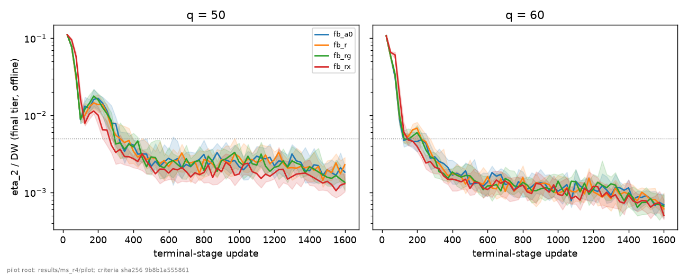
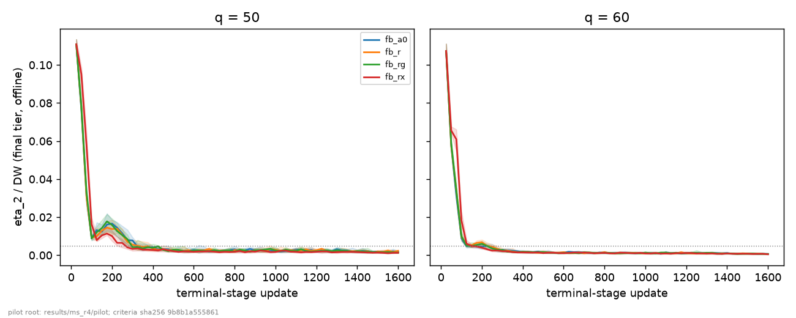
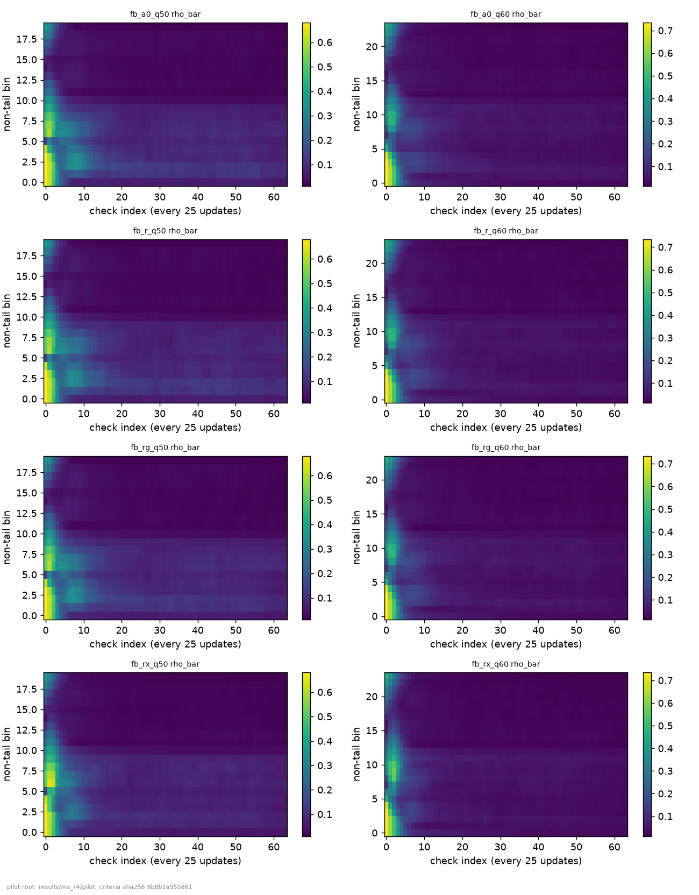
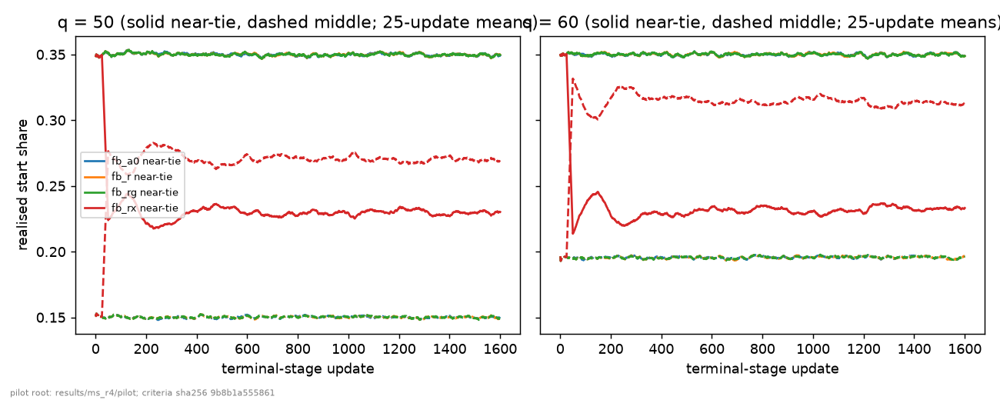

# MS-R4 E2: does the development DP-BR help PPO training?

Date: 2026-10-14. Branch `ms-r4`; launch commit `2f618531`. Wave `r4`, E2 part: `fb_a0` = (1), `fb_r` = (2), `fb_rg` = (3) and `fb_rx` (descriptive) x q in {50, 60} x seeds 10511-10530: 160 runs. Everything below is read from `results/ms_r4/analysis/e2/` (written by `tools/ms/r4_e2_analysis.py`; the criterion table and the decision are recomputed independently by `tools/ms/r4_blind_e2.py`, 0 differences at 1e-12), `results/ms_r4/curves/`, `results/ms_r4/pilot/` and the launch files. Every table is printed by `python reports/ms/r4/report_scripts/pilot_tables.py --block <name> [key=value]`; the block name is given above each table. The figures are the PNG files of `results/ms_r4/analysis/e2/figures/`. Blocks and paragraphs marked *post hoc* are supplements outside D5 and D6. The pre-registration is `02_preregistration.md` (Addendum 2: the PI's decision at gate G1). `rho` is the reduction of the area, so a positive `rho` means a smaller area than `fb_a0`.

## 0. Result

**Neither `fb_r` nor `fb_rg` meets the E2 target** (`criterion_e2.csv`, D6 order step 3): the development DP-BR is kept as a verifier only, and no training improvement is claimed.

- **(E2-a) fails for both arms at both q.** The reduction of the area under the stage-2 eta_2/DW curve is `fb_r` +0.020 [-0.014, +0.051] at q = 50 and -0.020 [-0.048, +0.008] at q = 60; `fb_rg` +0.013 [-0.024, +0.049] and -0.009 [-0.038, +0.023]. The target is rho >= 0.20 with the lower end above 0. Every 95 % interval (and every 97.5 % interval) lies entirely below 0.06, far below 0.20, so the pilot excludes a 20 % reduction of the area for these two sampling arms at this budget; it does not show that the arms are equal to `fb_a0`.
- **(E2-b) fails for `fb_r` at q = 50** (one (q, seed): seed 10517 passes all four gates under `fb_a0` and fails G-A under `fb_r`, eta_2/DW = 0.00516 against the limit 0.005); it holds for `fb_rg`.
- **(E2-c) holds for both arms at both q** (upper end of the paired Gmax_full/DW difference <= +0.00079 against the margin +0.001). Gmax_full/DW equals eta_2/DW in every run of the pilot, so (E2-c) is a non-inferiority test on the stage-2 deviation gain at the end of the pipeline, not on the stage-1 deviation gain (section 7).
- **Descriptive, outside the decision:** `fb_rx`, the existing cross-stratum sampler, has a smaller area than `fb_a0` at q = 50 (rho +0.054 [+0.014, +0.094]) and a larger one at q = 60 (rho -0.126 [-0.166, -0.085]), as predicted (E2-P1). In the window of updates 200-1600 its area is smaller at both q (rho +0.312 and +0.153). Its strata shares differ from the other arms by about 0.12 of the sampling mass (section 6), so this comparison mixes the feedback with a change of the shares.
- **What the statement covers:** sampling feedback only (section 9). The stop rule and polishing were not tested again.

## 1. Checks

All deterministic checks of section 3.2 of the prompt pass; the statistical start-share flags are reported against their chance expectation. Block `checks` (the table is the same as in `04_e1_actor.md`; the E2 rows are C-FB25, C-X2, the strata masses and the sampling weights):

| check | result | status |
|---|---|---|
| runs done with exit code 0 (`status.json`) | 280 / 280 | pass |
| manifest at the launch commit, clean tree | 280 / 280 | pass |
| files complete | 280 / 280 | pass |
| global-RNG assertions | 280 / 280 | pass |
| tail share equals lambda_T at every update (coverage) | 280 / 280 | pass |
| tail mass equals lambda_T to 1e-12 at every update (deterministic) | 280 / 280 | pass |
| near-tie and middle masses equal the design to 1e-12 in the within-stratum arms `fb_a0`, `fb_r`, `fb_rg` | 120 / 120 | pass |
| applied concentration scale equals the D2 schedule | 280 / 280 | pass |
| C-INIT: initial weights identical across `t1`, `relu`, `lrsm` | 40 / 40 | pass |
| C-FB25: the four E2 arms bit-identical through local update 25 | 120 / 120 | pass |
| C-X2: `fb_rx` equals `t1_st_s16` through local update 1201 | 40 / 40 | pass |
| sampling weights consistent with `p_digest_next` | 160 / 160 | pass |
| C-OFF: development tier offline equals the online checks, runs | 280 / 280 | pass |
| C-OFF: comparisons / mismatches / max abs difference | 260,480 / 0 / 0.0 | pass |
| offline curve points written | 23,680 (280 / 280 runs) | done |
| blind recomputation of `criterion_e1.csv` (1e-12) | 0 differences | agree |
| blind recomputation of `criterion_e2.csv` and the decision (1e-12) | 0 differences | agree |
| statistical start-share flags (|z| > 3), reported, not a failure | 8 of 840 tests (chance expectation 2.27) | reported |

The flagged start-share tests of the E2 arms are `q50/seed10522/fb_rx` (near-tie stratum, z = +3.26) and `q60/seed10525/fb_a0` (middle stratum, z = +3.25); the full list is in `04_e1_actor.md` section 1. Neither run fails a gate (section 3). Block `launch` is printed in `04_e1_actor.md` section 1.

## 2. Per arm: configuration and code version

Block `config_arms` (read from `q50/seed10511`; the other runs differ in q and seed only):

| arm | role | actor | alpha | focus scope | focus map | stage-2 updates | landing | stage-1 updates | code commit |
|---|---|---|---|---|---|---|---|---|---|
| `t1_st_s16` | E1 control | t1 | 0.5 | cross-stratum (existing) | residual | 2800 | s 1 -> 16 over local 2001-2200 | 600 | `2f618531` |
| `relu_st_s16` | E1 control | relu | 0.5 | cross-stratum (existing) | residual | 2800 | s 1 -> 16 over local 2001-2200 | 600 | `2f618531` |
| `lrsm_st_s16` | E1 candidate | lrsm | 0.5 | cross-stratum (existing) | residual | 2800 | s 1 -> 16 over local 2001-2200 | 600 | `2f618531` |
| `fb_a0` | E2 arm (1) | t1 | 0.0 | none (alpha 0) | - | 1600 | none (s = 1) | 600 | `2f618531` |
| `fb_r` | E2 arm (2) | t1 | 0.5 | within_strata | residual | 1600 | none (s = 1) | 600 | `2f618531` |
| `fb_rg` | E2 arm (3) | t1 | 0.5 | within_strata | residual_gain | 1600 | none (s = 1) | 600 | `2f618531` |
| `fb_rx` | E2 descriptive | t1 | 0.5 | cross-stratum (existing) | residual | 1600 | none (s = 1) | 600 | `2f618531` |

The keys in which an arm differs from its comparator (block `config_diffs`, q = 50):

| arm | against | purpose | config keys that differ (besides arm / run / output labels) |
|---|---|---|---|
| `relu_st_s16` | `t1_st_s16` | E1 control relu against control t1 | actor_variant |
| `lrsm_st_s16` | `t1_st_s16` | E1 candidate against control t1 (the criterion's comparison) | actor_variant |
| `lrsm_st_s16` | `relu_st_s16` | E1 candidate against control relu (descriptive) | actor_variant |
| `fb_r` | `fb_a0` | E2 arm (2) against arm (1) | focus_scope, start_weights.alpha_global |
| `fb_rg` | `fb_a0` | E2 arm (3) against arm (1) | focus_map, focus_scope, start_weights.alpha_global |
| `fb_rx` | `fb_a0` | E2 descriptive arm against arm (1) | start_weights.alpha_global |
| `fb_rg` | `fb_r` | E2 arm (3) against arm (2) | focus_map |
| `fb_rx` | `t1_st_s16` | check C-X2: fb_rx against t1_st_s16 (same sampler, different budget / landing) | conc_scale_schedule.local_first, conc_scale_schedule.local_last, conc_scale_schedule.scale_first, conc_scale_schedule.scale_last, conc_scale_schedule.stage, pipeline.budgets.2, pipeline.lr_windows.2[0].first, pipeline.lr_windows.2[0].last |

The four E2 configs differ in the sampler keys only: `fb_a0` has alpha 0 (the probabilities are bitwise those of `StartSampler.stratified_bin_probs` at alpha 0, and the arm runs the same checks), `fb_r` and `fb_rg` use the within-stratum focus (D4: the tail, near-tie and middle shares are exactly lambda_T, lambda_P, lambda_M at every update) with the residual map and the residual + gain map, `fb_rx` the existing cross-stratum focus. Code version: every manifest records commit `2f618531`, clean tree; the run code is that of `4c654d34` (C-MS6 and C-R7; empty `git diff --stat` on `agents run utils envs protocols` at the launch). C-FB25 (120 of 120): within every (q, seed) the four arms are bit-identical through local update 25 and differ at u50, so every difference between arms arises from the weights chosen after the first check. C-X2 (40 of 40): `fb_rx` equals `t1_st_s16` bit for bit through local update 1201. The E2 arms have no `conc_scale_schedule` (s = 1), stage 2 runs 1600 updates and stage 1 600, as v2.0.

## 3. Per-seed results and learning curves

The area A (x 1e-3) is (1 / 1575) x the trapezoidal area of the final-tier eta_2/DW over the 64 exports u25 ... u1600; a run that fails a gate shows the failed gates. Block `e2_area_seed` for q = 50, then q = 60:

| seed | `fb_a0` | `fb_r` | `fb_rg` | `fb_rx` |
|---|---|---|---|---|
| 10511 | 7.895 | 8.067 | 7.315 | 8.280 |
| 10512 | 7.354 **fails G-A** | 6.748 | 7.408 | 6.171 |
| 10513 | 6.009 | 6.577 | 7.059 | 6.064 |
| 10514 | 6.711 | 6.633 | 7.181 | 6.213 |
| 10515 | 8.524 | 7.322 | 7.097 | 6.418 |
| 10516 | 7.411 | 7.222 | 6.919 | 6.481 |
| 10517 | 6.697 | 6.371 **fails G-A** | 6.183 | 6.488 |
| 10518 | 6.263 | 6.400 | 6.405 | 6.521 |
| 10519 | 7.514 | 7.214 | 6.523 | 6.638 |
| 10520 | 6.756 | 6.357 | 6.872 | 6.587 |
| 10521 | 6.735 | 6.523 | 5.965 | 5.583 |
| 10522 | 6.732 | 7.849 | 6.795 | 6.631 |
| 10523 | 7.015 | 6.260 | 6.899 | 6.696 |
| 10524 | 6.613 | 6.636 | 6.385 | 6.365 |
| 10525 | 6.958 | 6.270 | 7.078 | 7.039 |
| 10526 | 5.679 **fails G-A, G-S** | 5.515 | 5.703 | 5.224 |
| 10527 | 5.974 | 6.493 | 6.323 | 6.438 |
| 10528 | 6.545 | 6.831 | 7.370 | 6.183 |
| 10529 | 6.623 | 6.000 | 6.969 | 7.471 |
| 10530 | 7.226 | 7.185 | 6.937 | 6.291 |
| **mean** | **6.862** | **6.724** | **6.769** | **6.489** |

| seed | `fb_a0` | `fb_r` | `fb_rg` | `fb_rx` |
|---|---|---|---|---|
| 10511 | 4.409 | 4.295 | 4.513 | 5.184 |
| 10512 | 4.402 | 4.110 | 3.602 | 4.048 |
| 10513 | 4.215 | 3.916 | 4.069 | 4.709 |
| 10514 | 4.063 | 4.344 | 3.874 | 4.265 |
| 10515 | 4.110 | 4.151 | 4.236 | 4.516 |
| 10516 | 3.853 | 3.914 | 3.787 | 3.911 |
| 10517 | 3.870 | 4.111 | 4.097 | 4.203 |
| 10518 | 5.008 | 4.714 | 4.938 | 5.223 |
| 10519 | 3.777 | 4.121 | 4.042 | 4.747 |
| 10520 | 3.851 | 3.934 | 3.844 | 4.096 |
| 10521 | 4.108 | 4.338 | 4.047 | 4.329 |
| 10522 | 4.232 | 4.256 | 4.572 | 4.968 |
| 10523 | 3.585 | 4.162 | 3.864 | 4.778 |
| 10524 | 5.177 | 5.338 | 5.109 | 5.659 |
| 10525 | 4.425 | 3.927 | 4.005 | 4.754 |
| 10526 | 3.713 | 4.060 | 3.905 | 4.565 |
| 10527 | 3.792 | 4.177 | 4.132 | 4.741 |
| 10528 | 3.801 | 3.892 | 3.819 | 4.603 |
| 10529 | 4.589 | 4.773 | 4.819 | 5.221 |
| 10530 | 3.994 | 4.101 | 4.467 | 4.867 |
| **mean** | **4.149** | **4.232** | **4.187** | **4.669** |

|peak error| of every run at the stage-2 freeze (final tier; block `e2_peak_seed`):

| seed | `fb_a0` | `fb_r` | `fb_rg` | `fb_rx` |
|---|---|---|---|---|
| 10511 | 0.0536 | 0.0205 | 0.0344 | 0.0417 |
| 10512 | 0.0655 | 0.0172 | 0.0546 | 0.0298 |
| 10513 | 0.0491 | 0.0454 | 0.0411 | 0.0616 |
| 10514 | 0.0470 | 0.0621 | 0.0441 | 0.0611 |
| 10515 | 0.0301 | 0.0481 | 0.0239 | 0.0153 |
| 10516 | 0.0469 | 0.0470 | 0.0348 | 0.0596 |
| 10517 | 0.0639 | 0.0751 | 0.0319 | 0.0621 |
| 10518 | 0.0434 | 0.0605 | 0.0321 | 0.0614 |
| 10519 | 0.0715 | 0.0356 | 0.0504 | 0.0299 |
| 10520 | 0.0348 | 0.0462 | 0.0301 | 0.0539 |
| 10521 | 0.0569 | 0.0714 | 0.0571 | 0.0682 |
| 10522 | 0.0650 | 0.0645 | 0.0328 | 0.0480 |
| 10523 | 0.0534 | 0.0399 | 0.0552 | 0.0091 |
| 10524 | 0.0220 | 0.0203 | 0.0445 | 0.0387 |
| 10525 | 0.0382 | 0.0563 | 0.0221 | 0.0529 |
| 10526 | 0.0306 | 0.0058 | 0.0377 | 0.0382 |
| 10527 | 0.0518 | 0.0379 | 0.0536 | 0.0470 |
| 10528 | 0.0392 | 0.0777 | 0.0368 | 0.0626 |
| 10529 | 0.0427 | 0.0534 | 0.0517 | 0.0786 |
| 10530 | 0.0280 | 0.0306 | 0.0257 | 0.0493 |
| **mean** | **0.0467** | **0.0458** | **0.0397** | **0.0485** |

| seed | `fb_a0` | `fb_r` | `fb_rg` | `fb_rx` |
|---|---|---|---|---|
| 10511 | 0.0134 | 0.0205 | 0.0528 | 0.0309 |
| 10512 | 0.0484 | 0.0319 | 0.0600 | 0.0467 |
| 10513 | 0.0705 | 0.0622 | 0.0409 | 0.0447 |
| 10514 | 0.0449 | 0.0440 | 0.0186 | 0.0506 |
| 10515 | 0.0280 | 0.0374 | 0.0402 | 0.0382 |
| 10516 | 0.0425 | 0.0399 | 0.0577 | 0.0471 |
| 10517 | 0.0416 | 0.0526 | 0.0267 | 0.0502 |
| 10518 | 0.0597 | 0.0363 | 0.0499 | 0.0567 |
| 10519 | 0.0400 | 0.0177 | 0.0573 | 0.0634 |
| 10520 | 0.0343 | 0.0576 | 0.0208 | 0.0381 |
| 10521 | 0.0555 | 0.0586 | 0.0668 | 0.0548 |
| 10522 | 0.0748 | 0.0712 | 0.0558 | 0.0630 |
| 10523 | 0.0357 | 0.0445 | 0.0390 | 0.0443 |
| 10524 | 0.0726 | 0.0578 | 0.0681 | 0.0433 |
| 10525 | 0.0635 | 0.0325 | 0.0439 | 0.0492 |
| 10526 | 0.0309 | 0.0266 | 0.0339 | 0.0430 |
| 10527 | 0.0675 | 0.0435 | 0.0551 | 0.0245 |
| 10528 | 0.0484 | 0.0328 | 0.0256 | 0.0471 |
| 10529 | 0.0489 | 0.0656 | 0.0410 | 0.0272 |
| 10530 | 0.0596 | 0.0728 | 0.0339 | 0.0415 |
| **mean** | **0.0490** | **0.0453** | **0.0444** | **0.0452** |

Final gates per arm and q (block `e2_gate_counts`; exact Clopper-Pearson intervals of the share of runs passing all four gates):

| q | arm | runs passing all four gates | Clopper-Pearson 95 % | gate failures |
|---|---|---|---|---|
| 50 | `fb_a0` | 18 / 20 | [0.683, 0.988] | G-A 2, G-F 0, G-N 0, G-S 1 |
| 50 | `fb_r` | 19 / 20 | [0.751, 0.999] | G-A 1, G-F 0, G-N 0, G-S 0 |
| 50 | `fb_rg` | 20 / 20 | [0.832, 1.000] | G-A 0, G-F 0, G-N 0, G-S 0 |
| 50 | `fb_rx` | 20 / 20 | [0.832, 1.000] | G-A 0, G-F 0, G-N 0, G-S 0 |
| 60 | `fb_a0` | 20 / 20 | [0.832, 1.000] | G-A 0, G-F 0, G-N 0, G-S 0 |
| 60 | `fb_r` | 20 / 20 | [0.832, 1.000] | G-A 0, G-F 0, G-N 0, G-S 0 |
| 60 | `fb_rg` | 20 / 20 | [0.832, 1.000] | G-A 0, G-F 0, G-N 0, G-S 0 |
| 60 | `fb_rx` | 20 / 20 | [0.832, 1.000] | G-A 0, G-F 0, G-N 0, G-S 0 |

The three G-A failures of the E2 arms (`fb_a0` seeds 10512 and 10526, `fb_r` seed 10517, all at q = 50) are marginal exceedances of eta_2/DW <= 0.005 at update 1600: 0.00507, 0.00521 and 0.00516, that is 1.3-4.2 % above the limit; the RMSE_pos and tail-mean parts of G-A hold in all three. Seed 10526 under `fb_a0` also fails G-S (stage-1 error 0.0505 against 0.05).

The development tier of the same frozen candidates (block `tiers exp=e2`; the G-N difference is |development - final| of eta_2/DW and of Gmax_full/DW, limit 0.001; no E2 run fails G-N). The development-tier values of the online checks enter the secondary area `A_dev_online` (section 5) and, per update, the online check files that C-OFF ties to the offline curves:

| q | arm | mean eta_2/DW, final tier | development tier | mean |dev - final| of eta_2/DW | max | mean |dev - final| of Gmax_full/DW | max | runs failing G-N |
|---|---|---|---|---|---|---|---|---|
| 50 | `fb_a0` | 0.00213 | 0.00212 | 1.85e-05 | 0.000142 | 1.85e-05 | 0.000142 | 0 |
| 50 | `fb_r` | 0.00239 | 0.00237 | 2.34e-05 | 0.000147 | 2.34e-05 | 0.000147 | 0 |
| 50 | `fb_rg` | 0.00139 | 0.00138 | 1.11e-05 | 6.25e-05 | 1.11e-05 | 6.25e-05 | 0 |
| 50 | `fb_rx` | 0.00152 | 0.00148 | 4.02e-05 | 0.000291 | 4.02e-05 | 0.000291 | 0 |
| 60 | `fb_a0` | 0.000727 | 0.000669 | 5.87e-05 | 0.000196 | 5.87e-05 | 0.000196 | 0 |
| 60 | `fb_r` | 0.000722 | 0.000686 | 3.62e-05 | 0.000203 | 3.62e-05 | 0.000203 | 0 |
| 60 | `fb_rg` | 0.000686 | 0.000651 | 3.58e-05 | 0.000198 | 3.58e-05 | 0.000198 | 0 |
| 60 | `fb_rx` | 0.000685 | 0.000655 | 2.98e-05 | 0.000168 | 2.98e-05 | 0.000168 | 0 |

The five recovery metrics (abs peak error, e_hat_2(0), RMSE_pos, tail mean and symmetry error) are evaluated on the closed-form recovery grid with state spacing 0.5 (`utils/v2_metrics.py`, `recovery_metrics`), not on the verifier grid, so their development-tier and final-tier values are the same function of the policy: the largest |final - development| over all 23,680 curve points of `curves_all.csv` is 0. Only the verifier-based quantities (eta_2/DW, Gmax_full/DW, Delta, s, R, C) differ between the tiers (block `tiers`).

Overview per arm and q (block `e2_overview`; the gap is in effort units):

| q | arm | mean A x 1e3 | median A x 1e3 | median eta_2/DW at u1600 | mean abs peak error | median gap | mean RMSE_pos / e2*(0) | mean tail mean / e2*(0) | mean stage-1 abs rel. error | runs passing all four gates |
|---|---|---|---|---|---|---|---|---|---|---|
| 50 | `fb_a0` | 6.862 | 6.733 | 0.00183 | 0.0467 | 3.29 | 0.0276 | 0.00947 | 0.0171 | 18 |
| 50 | `fb_r` | 6.724 | 6.605 | 0.00229 | 0.0458 | 3.26 | 0.0289 | 0.00991 | 0.0178 | 19 |
| 50 | `fb_rg` | 6.769 | 6.909 | 0.00135 | 0.0397 | 2.61 | 0.0228 | 0.00981 | 0.018 | 20 |
| 50 | `fb_rx` | 6.489 | 6.460 | 0.0013 | 0.0485 | 3.57 | 0.0227 | 0.00912 | 0.018 | 20 |
| 60 | `fb_a0` | 4.149 | 4.085 | 0.00069 | 0.0490 | 2.83 | 0.0221 | 0.0106 | 0.015 | 20 |
| 60 | `fb_r` | 4.232 | 4.136 | 0.00061 | 0.0453 | 2.55 | 0.0236 | 0.0111 | 0.0156 | 20 |
| 60 | `fb_rg` | 4.187 | 4.058 | 0.000664 | 0.0444 | 2.47 | 0.0224 | 0.0108 | 0.0135 | 20 |
| 60 | `fb_rx` | 4.669 | 4.725 | 0.000505 | 0.0452 | 2.67 | 0.0213 | 0.011 | 0.0118 | 20 |

The final-tier eta_2/DW on every export u25 ... u1600 (64 points; seed median and inter-quartile band in `learning_curves_e2.csv`). Seed medians at selected updates (block `e2_curves`):

| arm | u25 | u50 | u75 | u100 | u150 | u200 | u300 | u400 | u600 | u800 | u1200 | u1600 |
|---|---|---|---|---|---|---|---|---|---|---|---|---|
| `fb_a0` | 0.111 | 0.0763 | 0.0311 | 0.00881 | 0.0124 | 0.0166 | 0.00778 | 0.00412 | 0.00277 | 0.00311 | 0.00221 | 0.00183 |
| `fb_r` | 0.111 | 0.0772 | 0.0304 | 0.00915 | 0.013 | 0.0138 | 0.00553 | 0.00343 | 0.00217 | 0.00267 | 0.00265 | 0.00229 |
| `fb_rg` | 0.111 | 0.078 | 0.0332 | 0.00884 | 0.0142 | 0.0159 | 0.00425 | 0.00389 | 0.00244 | 0.00194 | 0.00211 | 0.00135 |
| `fb_rx` | 0.111 | 0.0951 | 0.0578 | 0.0163 | 0.0104 | 0.0101 | 0.0033 | 0.00275 | 0.00178 | 0.00181 | 0.00179 | 0.0013 |

| arm | u25 | u50 | u75 | u100 | u150 | u200 | u300 | u400 | u600 | u800 | u1200 | u1600 |
|---|---|---|---|---|---|---|---|---|---|---|---|---|
| `fb_a0` | 0.107 | 0.0574 | 0.0314 | 0.00888 | 0.00501 | 0.00457 | 0.0029 | 0.00168 | 0.00137 | 0.00123 | 0.00109 | 0.00069 |
| `fb_r` | 0.107 | 0.0574 | 0.0338 | 0.00954 | 0.00529 | 0.00683 | 0.0026 | 0.00175 | 0.00161 | 0.00156 | 0.00102 | 0.00061 |
| `fb_rg` | 0.107 | 0.0586 | 0.0338 | 0.00996 | 0.00487 | 0.00597 | 0.00273 | 0.00184 | 0.00121 | 0.00135 | 0.0011 | 0.000664 |
| `fb_rx` | 0.107 | 0.0656 | 0.0609 | 0.0183 | 0.00479 | 0.00397 | 0.00213 | 0.00149 | 0.00109 | 0.00124 | 0.0012 | 0.000505 |

Description: the medians of `fb_a0`, `fb_r` and `fb_rg` lie within about 12 % of each other over updates 25-100; `fb_rx` is slower than the other three at updates 50-100 (median eta_2/DW at update 100: 0.0163 against 0.0088 for `fb_a0` at q = 50, 0.0183 against 0.0089 at q = 60) and has the lowest median of the four at 46 of the 53 exports from update 300 on at q = 50 (update 300: 0.0033 against 0.0078 for `fb_a0`). The early window carries a large part of the area, as the pre-registration expected (adjustment 5; block `e2_early_share`, *post hoc*, from A and the area over updates 200-1600):

| q | arm | mean share of the area in updates 25-200 | min over runs | max |
|---|---|---|---|---|
| 50 | `fb_a0` | 0.524 | 0.474 | 0.600 |
| 50 | `fb_r` | 0.524 | 0.484 | 0.591 |
| 50 | `fb_rg` | 0.539 | 0.466 | 0.625 |
| 50 | `fb_rx` | 0.652 | 0.606 | 0.734 |
| 60 | `fb_a0` | 0.656 | 0.583 | 0.719 |
| 60 | `fb_r` | 0.665 | 0.600 | 0.712 |
| 60 | `fb_rg` | 0.673 | 0.580 | 0.725 |
| 60 | `fb_rx` | 0.740 | 0.671 | 0.812 |

## 4. The target and the decision by the order of D6

Block `e2_criterion` (A in units of 1e-3; the interval of rho is the paired bootstrap of the ratio of means, 10,000 resamples of the 20 seeds, seed 20261014; the 97.5 % interval is descriptive, two arms had a chance at the statement):

| arm | role | q | mean A x 1e3 (arm / `fb_a0`) | rho | 95 % CI | 97.5 % CI | (a) rho >= 0.20, lower > 0 | (b) gate violations | b | (c) Gmax_full/DW paired diff | c | met at q |
|---|---|---|---|---|---|---|---|---|---|---|---|---|
| `fb_r` | decision | 50 | 6.724 / 6.862 | +0.0201 | [-0.0138, +0.0505] | [-0.0193, +0.0544] | False | 1 (seed 10517) | False | +0.000258, upper +0.000788 | True | False |
| `fb_r` | decision | 60 | 4.232 / 4.149 | -0.0200 | [-0.0483, +0.0083] | [-0.0526, +0.0123] | False | 0 | True | -5.27e-06, upper +0.000167 | True | False |
| `fb_rg` | decision | 50 | 6.769 / 6.862 | +0.0135 | [-0.0245, +0.0495] | [-0.0299, +0.0545] | False | 0 | True | -0.00074, upper -0.000285 | True | False |
| `fb_rg` | decision | 60 | 4.187 / 4.149 | -0.0093 | [-0.0381, +0.0228] | [-0.0415, +0.0278] | False | 0 | True | -4.1e-05, upper +0.000133 | True | False |
| `fb_rx` | descriptive | 50 | 6.489 / 6.862 | +0.0543 | [+0.0135, +0.0943] | [+0.0078, +0.1002] | False | 0 | True | -0.000617, upper +4.51e-05 | True | False |
| `fb_rx` | descriptive | 60 | 4.669 / 4.149 | -0.1255 | [-0.1664, -0.0853] | [-0.1725, -0.0793] | False | 0 | True | -4.25e-05, upper +0.000143 | True | False |

Decision (`criterion_e2.csv`, row `DECISION`): **neither fb_r nor fb_rg meets the target: the development DP-BR is kept as a verifier only and no training improvement is claimed**

- **Order step 1:** `fb_r` is evaluated first; it fails (a) at both q and (b) at q = 50. The statement "development-DP-BR sampling feedback lowers the area under the stage-2 eta_2/DW curve at this budget" does not rest on `fb_r`.
- **Order step 2:** `fb_rg` is evaluated; it fails (a) at both q. The statement does not rest on `fb_rg` either.
- **Order step 3:** the development DP-BR stays a verifier only, and no training improvement is claimed. Both arms stay in the reports as descriptive arms.
- The sign of rho changes with q for all three feedback arms (positive at q = 50 and negative at q = 60 for `fb_r` and `fb_rg`; the same for `fb_rx`): at q = 60 the point estimates of the area under the feedback arms are larger than under `fb_a0`, with intervals that contain 0 for `fb_r` and `fb_rg`.

## 5. `fb_rx` and the secondary statistics

All secondary statistics are descriptive (D6) and outside the decision. Paired differences against `fb_a0`; 95 % bootstrap intervals; `rho` for the two area statistics. The development-tier area is the area of the online values on the same 64 updates; the primary area uses the final tier offline.

`fb_rx` - `fb_a0` (block `e2_secondary arm=fb_rx`):

| statistic | q | mean `fb_rx` | mean `fb_a0` | mean diff | 95 % CI | pairs < / > | reduction rho of the mean (95 % CI) |
|---|---|---|---|---|---|---|---|
| area over local 200-1600 (normalised by 1400) | 50 | 0.00254 | 0.00369 | -0.00115 | [-0.00139, -0.000922] | 20 / 0 | +0.312 [+0.262, +0.359] |
|  | 60 | 0.00137 | 0.00161 | -0.000247 | [-0.000368, -0.000132] | 15 / 5 | +0.153 [+0.0847, +0.22] |
| area of the development-tier online values | 50 | 0.00645 | 0.00683 | -0.000377 | [-0.000668, -9.69e-05] | 14 / 6 | +0.055 [+0.0145, +0.0956] |
|  | 60 | 0.00463 | 0.00412 | +0.000507 | [+0.000346, +0.000662] | 1 / 19 | -0.123 [-0.164, -0.083] |
| mean log10(eta_2/DW) over the 64 points | 50 | -2.55 | -2.44 | -0.117 | [-0.143, -0.0913] | 20 / 0 |  |
|  | 60 | -2.8 | -2.76 | -0.0414 | [-0.0721, -0.0124] | 14 / 6 |  |
| first export with eta_2/DW <= 0.005 | 50 | 265 | 311 | -46.2 | [-70, -22.5] | 13 / 3 |  |
|  | 60 | 161 | 149 | +12.5 | [-7.5, +30] | 3 / 9 |  |
| eta_2/DW at u1600 | 50 | 0.00152 | 0.00213 | -0.000617 | [-0.00133, +4.51e-05] | 13 / 7 |  |
|  | 60 | 0.000685 | 0.000727 | -4.25e-05 | [-0.000226, +0.000143] | 12 / 8 |  |
| abs peak error at the freeze | 50 | 0.0485 | 0.0467 | +0.00178 | [-0.00802, +0.0112] | 8 / 12 |  |
|  | 60 | 0.0452 | 0.049 | -0.00383 | [-0.0114, +0.00311] | 11 / 9 |  |
| peak gap at the freeze | 50 | 3.39 | 3.27 | +0.125 | [-0.562, +0.783] | 8 / 12 |  |
|  | 60 | 2.64 | 2.86 | -0.223 | [-0.664, +0.181] | 11 / 9 |  |
| RMSE_pos / e2*(0) | 50 | 0.0227 | 0.0276 | -0.00485 | [-0.00934, -0.000492] | 14 / 6 |  |
|  | 60 | 0.0213 | 0.0221 | -0.000852 | [-0.00423, +0.00254] | 11 / 9 |  |
| tail mean / e2*(0) | 50 | 0.00912 | 0.00947 | -0.000344 | [-0.000647, -2.48e-05] | 15 / 5 |  |
|  | 60 | 0.011 | 0.0106 | +0.000325 | [-0.000212, +0.000864] | 9 / 11 |  |
| stage-1 abs relative error | 50 | 0.018 | 0.0171 | +0.000829 | [-0.00779, +0.00875] | 8 / 12 |  |
|  | 60 | 0.0118 | 0.015 | -0.00321 | [-0.0082, +0.00207] | 11 / 9 |  |

`fb_r` - `fb_a0`:

| statistic | q | mean `fb_r` | mean `fb_a0` | mean diff | 95 % CI | pairs < / > | reduction rho of the mean (95 % CI) |
|---|---|---|---|---|---|---|---|
| area over local 200-1600 (normalised by 1400) | 50 | 0.00361 | 0.00369 | -7.52e-05 | [-0.000293, +0.000158] | 13 / 7 | +0.020 [-0.0441, +0.0771] |
|  | 60 | 0.0016 | 0.00161 | -1.53e-05 | [-0.000116, +7.84e-05] | 7 / 13 | +0.010 [-0.0511, +0.0693] |
| area of the development-tier online values | 50 | 0.00669 | 0.00683 | -0.00014 | [-0.000354, +8.83e-05] | 13 / 7 | +0.020 [-0.0132, +0.0506] |
|  | 60 | 0.0042 | 0.00412 | +8.4e-05 | [-3.19e-05, +0.000194] | 5 / 15 | -0.020 [-0.0484, +0.00757] |
| mean log10(eta_2/DW) over the 64 points | 50 | -2.44 | -2.44 | -0.00621 | [-0.0258, +0.0163] | 12 / 8 |  |
|  | 60 | -2.76 | -2.76 | -0.00617 | [-0.0302, +0.0164] | 9 / 11 |  |
| first export with eta_2/DW <= 0.005 | 50 | 315 | 311 | +3.75 | [-23.8, +33.8] | 8 / 8 |  |
|  | 60 | 169 | 149 | +20 | [-6.25, +47.5] | 4 / 9 |  |
| eta_2/DW at u1600 | 50 | 0.00239 | 0.00213 | +0.000258 | [-0.000307, +0.000788] | 8 / 12 |  |
|  | 60 | 0.000722 | 0.000727 | -5.27e-06 | [-0.000174, +0.000167] | 10 / 10 |  |
| abs peak error at the freeze | 50 | 0.0458 | 0.0467 | -0.000902 | [-0.0107, +0.00811] | 9 / 11 |  |
|  | 60 | 0.0453 | 0.049 | -0.00375 | [-0.0104, +0.00286] | 12 / 8 |  |
| peak gap at the freeze | 50 | 3.2 | 3.27 | -0.0631 | [-0.75, +0.568] | 9 / 11 |  |
|  | 60 | 2.64 | 2.86 | -0.219 | [-0.606, +0.167] | 12 / 8 |  |
| RMSE_pos / e2*(0) | 50 | 0.0289 | 0.0276 | +0.00138 | [-0.00223, +0.00496] | 8 / 12 |  |
|  | 60 | 0.0236 | 0.0221 | +0.00144 | [-0.00115, +0.00411] | 9 / 11 |  |
| tail mean / e2*(0) | 50 | 0.00991 | 0.00947 | +0.000446 | [+5.18e-05, +0.000845] | 6 / 14 |  |
|  | 60 | 0.0111 | 0.0106 | +0.000457 | [+0.000113, +0.000822] | 6 / 14 |  |
| stage-1 abs relative error | 50 | 0.0178 | 0.0171 | +0.000641 | [-0.00939, +0.0105] | 7 / 13 |  |
|  | 60 | 0.0156 | 0.015 | +0.000581 | [-0.00525, +0.00658] | 10 / 10 |  |

`fb_rg` - `fb_a0`:

| statistic | q | mean `fb_rg` | mean `fb_a0` | mean diff | 95 % CI | pairs < / > | reduction rho of the mean (95 % CI) |
|---|---|---|---|---|---|---|---|
| area over local 200-1600 (normalised by 1400) | 50 | 0.00352 | 0.00369 | -0.000163 | [-0.000463, +0.000124] | 12 / 8 | +0.044 [-0.0348, +0.121] |
|  | 60 | 0.00155 | 0.00161 | -6.41e-05 | [-0.000198, +5.12e-05] | 12 / 8 | +0.040 [-0.0329, +0.118] |
| area of the development-tier online values | 50 | 0.00673 | 0.00683 | -9.46e-05 | [-0.000351, +0.000159] | 9 / 11 | +0.014 [-0.024, +0.0497] |
|  | 60 | 0.00416 | 0.00412 | +3.99e-05 | [-9.03e-05, +0.000155] | 9 / 11 | -0.010 [-0.038, +0.0217] |
| mean log10(eta_2/DW) over the 64 points | 50 | -2.46 | -2.44 | -0.0187 | [-0.0493, +0.0117] | 12 / 8 |  |
|  | 60 | -2.77 | -2.76 | -0.012 | [-0.0439, +0.0166] | 10 / 10 |  |
| first export with eta_2/DW <= 0.005 | 50 | 310 | 311 | -1.25 | [-28.8, +26.2] | 9 / 8 |  |
|  | 60 | 152 | 149 | +3.75 | [-20, +27.5] | 6 / 6 |  |
| eta_2/DW at u1600 | 50 | 0.00139 | 0.00213 | -0.00074 | [-0.00124, -0.000285] | 16 / 4 |  |
|  | 60 | 0.000686 | 0.000727 | -4.1e-05 | [-0.000222, +0.000133] | 10 / 10 |  |
| abs peak error at the freeze | 50 | 0.0397 | 0.0467 | -0.00695 | [-0.0127, -0.00128] | 14 / 6 |  |
|  | 60 | 0.0444 | 0.049 | -0.00464 | [-0.0124, +0.00342] | 12 / 8 |  |
| peak gap at the freeze | 50 | 2.78 | 3.27 | -0.486 | [-0.886, -0.0895] | 14 / 6 |  |
|  | 60 | 2.59 | 2.86 | -0.271 | [-0.721, +0.199] | 12 / 8 |  |
| RMSE_pos / e2*(0) | 50 | 0.0228 | 0.0276 | -0.00472 | [-0.00867, -0.00106] | 13 / 7 |  |
|  | 60 | 0.0224 | 0.0221 | +0.000221 | [-0.00313, +0.00363] | 11 / 9 |  |
| tail mean / e2*(0) | 50 | 0.00981 | 0.00947 | +0.000342 | [-1.34e-05, +0.000717] | 8 / 12 |  |
|  | 60 | 0.0108 | 0.0106 | +0.000206 | [-0.000157, +0.00057] | 9 / 11 |  |
| stage-1 abs relative error | 50 | 0.018 | 0.0171 | +0.00082 | [-0.00816, +0.00989] | 8 / 12 |  |
|  | 60 | 0.0135 | 0.015 | -0.00152 | [-0.00728, +0.00395] | 11 / 9 |  |

15 of 60 descriptive secondary intervals (95 %, `secondary_e2.csv`, without the strata shares, the cost rows and `gmax_final`) exclude zero: `fb_r` 2 of 20; `fb_rg` 4 of 20; `fb_rx` 9 of 20. If no arm differed from `fb_a0`, about 3.0 of 60 would exclude zero by chance at 95 % (the statistics are correlated, so this is only a rough scale).

Description (nothing here is a test, and the statistics are many and correlated):

- **`fb_rx`** shows the clearest pattern: a smaller late-window area (rho +0.312 [+0.262, +0.359] at q = 50 and +0.153 [+0.085, +0.220] at q = 60, 20 of 20 and 15 of 20 pairs), a lower mean log10(eta_2/DW), and at q = 60 a larger area over the whole curve (rho -0.126) and a larger development-tier area. The development-tier online area at q = 60 is larger by +0.00051 [+0.00035, +0.00066] (19 of 20 pairs); the final-tier and the online curves agree on the sign there. `fb_rx` is the only arm that moves sampling mass between strata, and no arm has the cross-stratum shares without the feedback, so this pilot cannot separate a share effect from a feedback effect for `fb_rx`.
- **`fb_rg`** has end-of-stage differences at q = 50 whose intervals exclude 0: eta_2/DW at update 1600 -0.00074 [-0.00124, -0.00029] (16 of 20 pairs), |peak error| -0.0069 [-0.0127, -0.0013], the peak gap -0.49 [-0.89, -0.09] effort units and RMSE_pos -0.0047 [-0.0087, -0.0011]; at q = 60 none of these differs. Its gate count at q = 50 is 20 of 20 against 18 of 20 for `fb_a0`.
- **`fb_r`** has no secondary interval at 95 % that favours it; its tail mean is higher than that of `fb_a0` at both q (+0.00045 at q = 50 and +0.00046 at q = 60, 14 of 20 pairs each).
- **Multiplicity (post hoc count):** 15 of the 60 secondary intervals exclude 0 (nine of them for `fb_rx`, four for `fb_rg`, two for `fb_r`), against about 3 expected by chance if no arm differed from `fb_a0`. The four `fb_rg` intervals are all at q = 50 and are end-of-stage values (eta_2/DW at update 1600, the peak, the gap, RMSE_pos), not the area that the target is about.

## 6. The sampling weights and the strata shares

The weights in force after every check are recorded in `ms_binmaps_stage2.npz` (`probs_next`, `focus_within`, and for `fb_rg` `gain` and `gain_bar`); the per-check summary of all 10,240 checks is `sampling_weights.csv`. The check `sampling weights consistent with p_digest_next` holds in 160 of 160 runs. Block `e2_weights` (TV = 0.5 sum |p - p_alpha0| of the weights in force against the alpha-0 weights; the last check of the stage has no next update and is left out of the TV and ratio statistics):

| q | arm | checks (20 runs x 64) | TV from the alpha-0 weights: median | max | largest bin probability / stratum mean, near-tie: median / max | middle: median / max | tail mass | near-tie mass | middle mass |
|---|---|---|---|---|---|---|---|---|---|
| 50 | `fb_a0` | 1280 | 0.000 | 0.000 | 1.00 / 1.00 | 1.00 / 1.00 | 0.5000-0.5000 | 0.350-0.350 | 0.150-0.150 |
| 50 | `fb_r` | 1280 | 0.063 | 0.097 | 1.32 / 1.82 | 1.69 / 2.40 | 0.5000-0.5000 | 0.350-0.350 | 0.150-0.150 |
| 50 | `fb_rg` | 1280 | 0.057 | 0.104 | 1.27 / 1.82 | 1.77 / 2.65 | 0.5000-0.5000 | 0.350-0.350 | 0.150-0.150 |
| 50 | `fb_rx` | 1280 | 0.125 | 0.151 | 1.14 / 1.36 | 1.94 / 2.63 | 0.5000-0.5000 | 0.207-0.265 | 0.235-0.293 |
| 60 | `fb_a0` | 1280 | 0.000 | 0.000 | 1.00 / 1.00 | 1.00 / 1.00 | 0.4545-0.4545 | 0.350-0.350 | 0.195-0.195 |
| 60 | `fb_r` | 1280 | 0.050 | 0.088 | 1.24 / 1.59 | 1.52 / 2.06 | 0.4545-0.4545 | 0.350-0.350 | 0.195-0.195 |
| 60 | `fb_rg` | 1280 | 0.053 | 0.104 | 1.23 / 1.74 | 1.63 / 2.75 | 0.4545-0.4545 | 0.350-0.350 | 0.195-0.195 |
| 60 | `fb_rx` | 1280 | 0.122 | 0.155 | 1.12 / 1.33 | 1.70 / 2.70 | 0.4545-0.4545 | 0.206-0.270 | 0.276-0.339 |

Block `e2_strata` (realised start shares of all updates against the design; the per-update means are in `strata_shares_by_update.csv`):

| q | arm | design near-tie / middle | realised near-tie / middle (mean of 20 runs, all updates) |
|---|---|---|---|
| 50 | `fb_a0` | 0.350 / 0.150 | 0.3500 / 0.1501 |
| 50 | `fb_r` | 0.350 / 0.150 | 0.3499 / 0.1501 |
| 50 | `fb_rg` | 0.350 / 0.150 | 0.3499 / 0.1502 |
| 50 | `fb_rx` | 0.350 / 0.150 | 0.2314 / 0.2687 |
| 60 | `fb_a0` | 0.350 / 0.195 | 0.3500 / 0.1956 |
| 60 | `fb_r` | 0.350 / 0.195 | 0.3500 / 0.1955 |
| 60 | `fb_rg` | 0.350 / 0.195 | 0.3500 / 0.1956 |
| 60 | `fb_rx` | 0.350 / 0.195 | 0.2328 / 0.3127 |

Description: in `fb_a0`, `fb_r` and `fb_rg` the tail, near-tie and middle masses equal the design to 1e-12 at every check (the strata-mass check passes in 280 of 280 runs: the tail mass in every run, and also the near-tie and middle masses in the 120 runs of those three arms), so the feedback arms move probability only inside the strata (adjustment 1); their realised shares equal the design to within 0.0003. The within-stratum focus moved the weights by a median TV of 0.050-0.063 from the alpha-0 weights (maximum 0.088-0.104) and raised the largest middle-stratum bin to 1.5-1.8 times the stratum mean in the median check (maximum 2.1-2.8); the cross-stratum sampler of `fb_rx` moved a median TV of 0.122-0.125 (maximum 0.151-0.155), most of it the move of about 0.12 of the mass from the near-tie to the middle stratum (the realised near-tie / middle shares are 0.231 / 0.269 at q = 50 and 0.233 / 0.313 at q = 60, against the design 0.350 / 0.150 and 0.350 / 0.195). That is, the lever of `fb_r` and `fb_rg` was about half that of `fb_rx` in total variation; the pilot does not show whether a stronger within-stratum focus (a larger alpha) would help, and D6 does not allow another arm in this round.

## 7. Post hoc: what E2-c measured, and the stage-1 deviation gain

`Gmax_full/DW` is the maximum over the stages of the final-tier best-response value gap (v_br - v_mean) / DW (`utils/v2_metrics.py`, `Gmax_full_over_dw`). In every one of the 280 runs of the pilot it equals eta_2/DW exactly: the maximum is attained at stage 2, where the best-response gap is the deviation gain, so the stage-1 best-response gap is at most eta_2/DW in every run. The table (block `gmax_equality`) shows the one-step stage-1 deviation gain Delta_1/DW, which is at most 0.49 of eta_2/DW in every E1 run and 0.45 in every E2 run:

| experiment | runs | runs with Gmax_full/DW != eta_2/DW | stage-1 one-step deviation gain Delta_1/DW: median | max | smallest eta_2/DW | largest Delta_1 / eta_2 of a run |
|---|---|---|---|---|---|---|
| E1 | 120 | 0 | 2.27e-05 | 0.000414 | 8.81e-05 | 0.49 |
| E2 | 160 | 0 | 3.6e-05 | 0.000535 | 0.000288 | 0.45 |

So (E2-c) as pre-registered compares the stage-2 deviation gain at the end of the pipeline, a quantity E2-a already measures through the curve, and it does not test the stage-1 deviation gain that the note's "stage-1 deviation gains do not become worse" asks for. The same holds for G-F, which is a second threshold (0.01) on eta_2/DW. This does not change any verdict of this round: (E2-a) fails for both decision arms at both q whatever (E2-c) says. The stage-1 deviation gain Delta_1/DW (column `t1_Delta_final`, already divided by DW) is at most 5.4e-4 in any E2 run (4.1e-4 in E1), about half of the margin of 0.001; its paired mean differences against `fb_a0` are at most +5.6e-5, 18 times below the margin. A paired descriptive table of Delta_1/DW (block `e2_stage1_gain`; no interval was computed for this quantity, post hoc):

| q | arm | mean Delta_1/DW | max over runs | mean paired diff vs `fb_a0` | pairs < / > |
|---|---|---|---|---|---|
| 50 | `fb_a0` | 5.76e-05 | 0.000241 | - | - |
| 50 | `fb_r` | 6.34e-05 | 0.000266 | +5.83e-06 | 8 / 12 |
| 50 | `fb_rg` | 9.12e-05 | 0.000251 | +3.37e-05 | 5 / 15 |
| 50 | `fb_rx` | 0.000113 | 0.000535 | +5.55e-05 | 10 / 10 |
| 60 | `fb_a0` | 3.95e-05 | 0.000131 | - | - |
| 60 | `fb_r` | 4.03e-05 | 0.000124 | +7.24e-07 | 8 / 12 |
| 60 | `fb_rg` | 3.98e-05 | 0.00013 | +2.56e-07 | 9 / 11 |
| 60 | `fb_rx` | 2.93e-05 | 8.28e-05 | -1.03e-05 | 11 / 9 |

The stage-1 error of the end of stage 1 (S1 and G-S) is in the secondary tables of section 5 (`s1_abs`): no interval excludes 0 for any arm at either q. A later round that uses E2-c should say which stage-1 quantity it means (the one-step deviation gain Delta_1/DW of `t1_Delta_final`, or the stage-1 best-response gap); this round does not change its definition.

## 8. Cost

Block `cost exp=e2` (medians over the 20 runs; the offline curve evaluation is not training and is reported in `results/ms_r4/curves/curves_info.json`: 625 s final tier and 314 s development tier summed over the 280 runs):

| q | arm | total wall (s) | stage 1 (s) | stage 2 (s) | stage-2 rollouts (s) | stage-2 updates (s) | stage-2 dev. verifier (s) | stage-1 dev. verifier (s) | verifier share of stage 2 (median) | (max over runs) |
|---|---|---|---|---|---|---|---|---|---|---|
| 50 | `fb_a0` | 441 | 87 | 233 | 5.4 | 223 | 0.95 | 0.34 | 0.41 % | 0.42 % |
| 50 | `fb_r` | 438 | 87 | 236 | 5.5 | 226 | 0.96 | 0.35 | 0.41 % | 0.43 % |
| 50 | `fb_rg` | 437 | 86 | 236 | 5.5 | 226 | 0.97 | 0.33 | 0.41 % | 0.43 % |
| 50 | `fb_rx` | 440 | 85 | 235 | 5.5 | 225 | 0.98 | 0.33 | 0.41 % | 0.44 % |
| 60 | `fb_a0` | 426 | 85 | 243 | 5.7 | 233 | 1.00 | 0.33 | 0.41 % | 0.43 % |
| 60 | `fb_r` | 424 | 87 | 239 | 5.6 | 229 | 0.98 | 0.34 | 0.41 % | 0.43 % |
| 60 | `fb_rg` | 413 | 84 | 233 | 5.4 | 223 | 0.94 | 0.33 | 0.41 % | 0.43 % |
| 60 | `fb_rx` | 421 | 90 | 242 | 5.7 | 232 | 1.01 | 0.36 | 0.42 % | 0.43 % |

The checks run in every arm: `fb_a0` pays the same verifier time as `fb_r` and `fb_rg`, so the arms show no detectable difference in cost (paired wall-time differences against `fb_a0` contain 0 in all six cells, `secondary_e2.csv`, `wall_total_sec`). The development verifier takes 0.41-0.42 % of the stage-2 wall time (maximum over runs 0.44 %).

## 9. Predictions against the outcome, and what the statement covers

Block `e2_predictions` (D7; expectations, not tests; nothing was selected by them):

| prediction | statement | observed | outcome |
|---|---|---|---|
| E2-P1 | `fb_rx` has a larger area than `fb_a0` at q = 60 | rho(`fb_rx`, q = 60) = -0.1255 | larger area (rho < 0) |
| E2-P2 | `fb_r` falls short of 20 % at q = 50; gain larger in the late window | rho full +0.0201, rho local 200-1600 +0.0204 | short of 20 % |
| E2-P2 | `fb_r` falls short of 20 % at q = 60; gain larger in the late window | rho full -0.0200, rho local 200-1600 +0.0095 | short of 20 % |
| E2-P2 | `fb_rg` falls short of 20 % at q = 50; gain larger in the late window | rho full +0.0135, rho local 200-1600 +0.0443 | short of 20 % |
| E2-P2 | `fb_rg` falls short of 20 % at q = 60; gain larger in the late window | rho full -0.0093, rho local 200-1600 +0.0397 | short of 20 % |
| E2-P3 | development checks under 1 % of the stage-2 wall time (`fb_a0`) | maximum share over runs 0.43 % | under 1 % |
| E2-P3 | development checks under 1 % of the stage-2 wall time (`fb_r`) | maximum share over runs 0.43 % | under 1 % |
| E2-P3 | development checks under 1 % of the stage-2 wall time (`fb_rg`) | maximum share over runs 0.43 % | under 1 % |
| E2-P3 | development checks under 1 % of the stage-2 wall time (`fb_rx`) | maximum share over runs 0.44 % | under 1 % |

- **E2-P1 held:** `fb_rx` has a larger area than `fb_a0` at q = 60 (+12.6 %); at q = 50 it has a smaller one.
- **E2-P2 held:** neither `fb_r` nor `fb_rg` reaches 20 % at either q. The gain of `fb_rg` shows more in the window of updates 200-1600 (rho +0.044 and +0.040) than in the full area (+0.013 and -0.009); for `fb_r` it does at q = 60 (+0.010 against -0.020) and is equal at q = 50 (+0.020 and +0.020).
- **E2-P3 held:** the development checks take under 1 % of the stage-2 wall time in every arm (maximum 0.44 %).

**What the statement covers.** "Neither tested sampling arm lowers the stage-2 learning-curve area by 20 % at this budget" covers sampling feedback only, with the t1 actor, v2.0's budgets (1600 and 600 updates), the within-stratum focus at alpha 0.5 and the two focus maps of D4, on 20 seeds per q. The stop rule and polishing were not tested again; MS-R1's record stands (at rho_2 = 0.05 the terminal-stage stop fired in 0 of 100 runs). E1's arms contain the cross-stratum DP-BR feedback of `fb_rx`; E2's outcome governs the claim about the feedback, and it does not remove the feedback from E1's configuration, which would be an untested configuration (adjustment 2).
