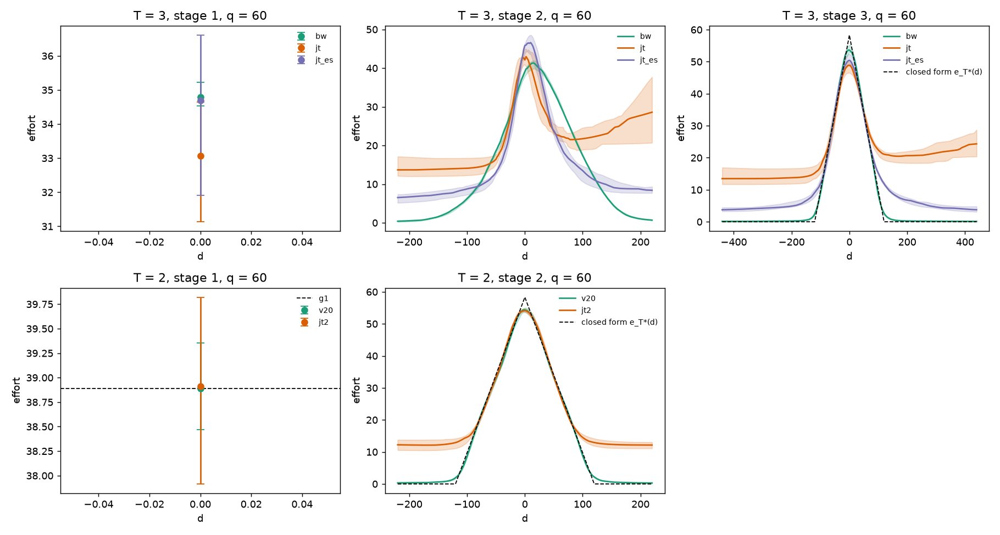
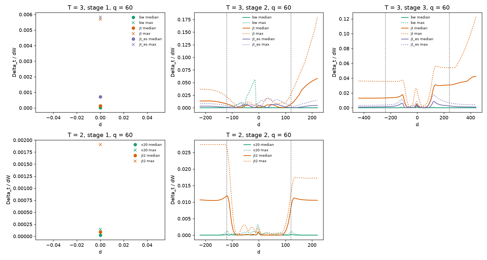
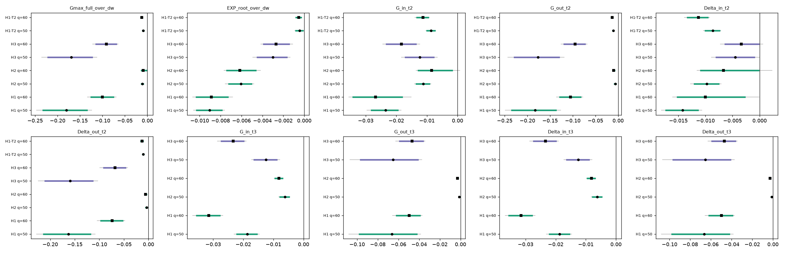
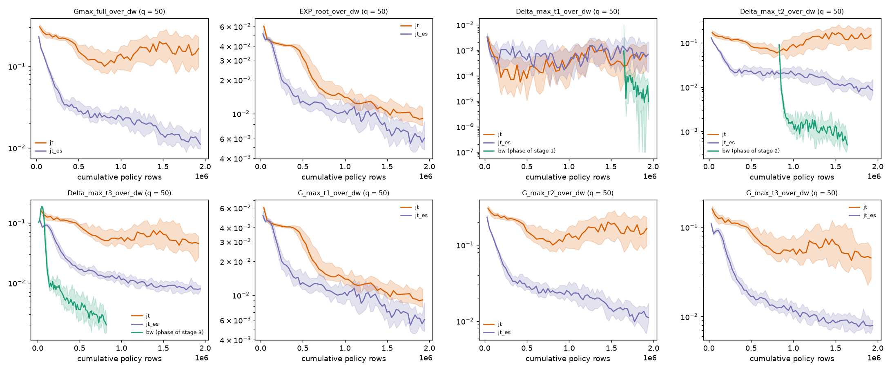
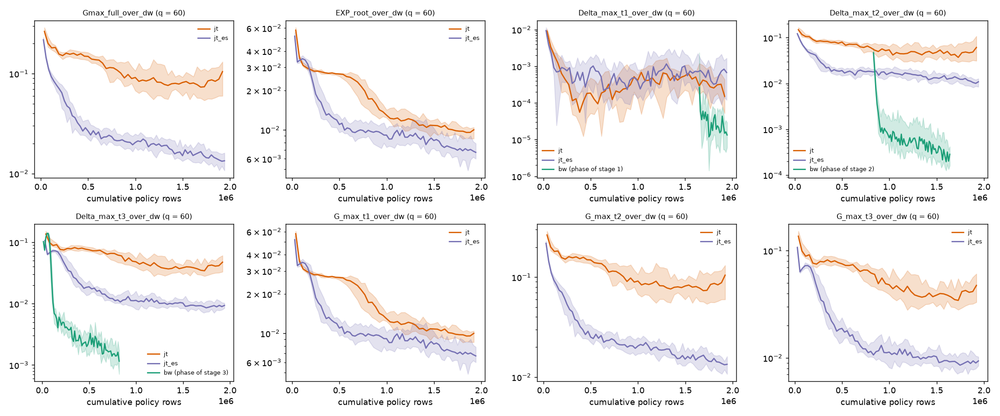
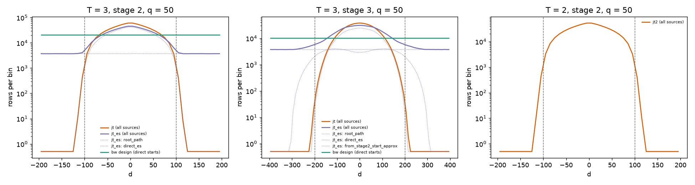
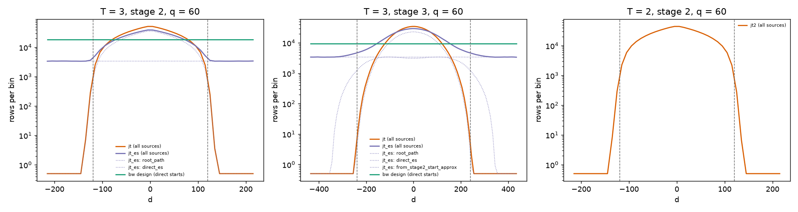

# T3-R1: results at T = 3 (backward induction against joint training)

Date: 2026-10-17. Branch `t3-r1`, code commit `5535d610`, launch from `a848114e`. The pre-registration of the design, the criteria, the secondary statistics and the predictions is `02_preregistration.md` (written and pushed before any of these runs; the PI's reply "proceed P2", stored verbatim in `pi_record/26_g1_reply.md`, added no addendum). Every table below is generated by `report_scripts/results_tables.py` from the CSVs in `results/t3_r1/` and assembled by `report_scripts/assemble_reports.py`; the paired statistics and the gate counts are those of `tools/t3/t3_analysis.py`. The criterion rows (8) and the gate counts (10 rows) were recomputed independently by `tools/t3/t3_blind.py` (largest absolute difference 5.9e-17 over 120 numbers and 1.1e-16 over 152 numbers; the pre-registered bound is 1e-12); the secondary statistics are the analysis tool's and were checked by the independent fact-check of the reports (`pi_record/01_factcheck.md`).

**Definitions** (D6; `utils/dp_br_verifier.py`, `utils/v2_metrics.py`; all gains divided by dW = 4). `G_t(d)` is the gain of a dynamic best response at stage t and gap d, V^BR - V^mean: the deviator re-optimises at stage t and at every later stage. `Delta_t(d)` (`eta_t` is its maximum over d) is the one-step deviation gain: deviate at stage t only, then follow the policy's mean continuation; at the terminal stage the two coincide. `G_max,t` and `Delta_max,t` are the maxima over the grid of D_t; `G_in`, `G_out`, `Delta_in`, `Delta_out` the maxima over the nodes in band (|d| < 2q(t-1), the gaps the equilibrium path can reach) and out of band. `Gmax_full` is the largest `G_t` over all stages and gaps (the quantity of the hypotheses), `EXP_root = G_1(0)` the gain at the root, `dReach` the sum over stages of the largest `Delta_t` over the best-response-reachable gaps, `dFull` the same sum over the whole grid, `Deltamax_all` the largest `Delta_t` over all stages and gaps. At the terminal stage T, `RMSE_pos` and `tail mean` are the root-mean-square and the mean of the deviation of the effort from the closed-form tent `e_T*(d)`, divided by `e_T*(0)`, over the gaps |d| < 2q and |d| >= 2q of the grid of D_T (step 0.5); `|peak|` (`peak_T_abs`) is the relative error of the effort at the apex, |e_T(0) - e_T*(0)| / e_T*(0) (signed: `peak_T_signed`). The evaluated policy is the last iterate as Beta means. At stage 1 there is a single gap (d = 0), so `G_max,1 = EXP_root`.

**In one paragraph.** On the 20 seeds per q of the pre-registered design, backward induction (`bw`) has a much smaller full-domain gain than both joint-training arms at T = 3 (H1, H2), and exploring starts (`jt_es`) shrink the joint arm's full-domain gain by a factor of 8 to 13 (H3); at T = 2 the recorded v2.0 runs beat the joint arm `jt2` in the same measure (H1-T2). All four hypotheses are supported at both q. `bw` passes all three gates (G-A, G-F, G-N) in 18 of 20 runs at each q, which is exactly the number the reading rule asks for. The largest gain of the joint arm `jt` is out of band in all 40 runs, that of `jt2` in 34 of 40, while that of `jt_es` is in band in 33 of 40 (and that of `bw` in all 40). The statements are about these arms as implemented, at the pre-registered equal-policy-row budget, with 20 seeds per q; section 10 lists what the round does not settle.

## 1. The checks

| check | pass | fail | not evaluated |
|---|---|---|---|
| exit_ok | 160 | 0 | 0 |
| files_complete | 160 | 0 | 0 |
| manifest_commit_ok | 160 | 0 | 0 |
| clean_tree | 160 | 0 | 0 |
| global_rng_ok | 160 | 0 | 0 |
| config_equals_plan | 160 | 0 | 0 |
| config_production_ok | 160 | 0 | 0 |
| budget_ok | 160 | 0 | 0 |
| lr_ok | 160 | 0 | 0 |
| refresh_ok | 160 | 0 | 0 |
| exports_ok | 160 | 0 | 0 |
| checks_ok | 160 | 0 | 0 |
| starts_ok | 160 | 0 | 0 |
| replay_ok | 160 | 0 | 0 |

| quantity | value |
|---|---|
| runs | 160 |
| C-INIT within (q, seed) of wave t3: groups / equal | 40 / 40 |
| C-INIT against the planned digests: runs / equal | 160 / 160 |
| start-share cells in all (descriptive) | 5240 |
| flags (abs z > 3) | 17 |
| flags expected under the null (0.0027 per cell) | 14.15 |

The launch (`results/t3_r1/launch_t3_t2j_20261017_010337.json`; one launch of the waves `t3` and `t2j` in the tmux session `t3r1_launch`, 40 workers; the tmux session is not recorded in the launch record):

| quantity | value |
|---|---|
| launch record | `results/t3_r1/launch_t3_t2j_20261017_010337.json` |
| started (UTC) | 2026-10-17 01:03:37 |
| HEAD at the launch | `a848114eef501d9ef6bab0fcd7c71a3989d32d3c` |
| code commit | `5535d6104899526ae1790d50806cc66392549994` |
| workers / nproc | 40 / 64 |
| load average at start | 9.9, 9.5, 9.6 |
| load average at end | 18.8, 38.0, 41.3 |
| free disk at start | 912 GB of 5952 GB |
| runs launched / exit code 0 | 160 / 160 |
| criteria file SHA-256 | `b586a5e39b1fad503282b1bb903696ad7d47c52e75fb9ff6e47f06781ad88332` |

All 160 runs exited 0; no run was moved to `crashed/` and none was re-run. The launch took 34 minutes (01:03:37 to 01:37:41 UTC), about 1.5 times the pre-registered estimate of 22 minutes: the per-run wall times were 1.4 to 1.5 times those of the smoke wave (for example `jt` at q = 50, 494 s against 336 s; `bw`, 577 s against 387 s), with the process CPU time of the joint arms equal to their wall time (`jt`: 493 s CPU), so the runs were not waiting for a CPU. The cause of the slowdown (other users' load, the 40 simultaneous workers, or both) was not separated. The budgets of D5 hold exactly in all 200 runs (the 160 new ones and the 40 recorded `v20` runs; updates, policy rows by stage and in total, minibatch steps):

| arm | runs | updates (expected) | updates equal | rows total (expected) | rows total equal | rows by stage equal | minibatch steps (expected) | steps equal |
|---|---|---|---|---|---|---|---|---|
| bw | 40 | 3,800 | 40 | 1,945,600 | 40 | 40 | 76,000 | 40 |
| jt | 40 | 1,267 | 40 | 1,946,112 | 40 | 40 | 76,020 | 40 |
| jt_es | 40 | 1,754 | 40 | 1,945,186 | 40 | 40 | 87,700 | 40 |
| v20 | 40 | 2,200 | 40 | 1,126,400 | 40 | 40 | 56,000 | 40 |
| jt2 | 40 | 1,100 | 40 | 1,126,400 | 40 | 40 | 44,000 | 40 |

**The starts check.** `starts_ok` is substantive for the 40 `jt_es` runs only (their rows per stage and their 256 / 85 / 171 direct starts per update); for `bw` it is true by construction (bin-balanced starts pinned by the config; only the descriptive z flags apply) and for `jt` and `jt2` the start pattern (root starts only) is covered by `budget_ok`. The descriptive start-share z flags (a flag is not a failure) are of two kinds: the 200 strata cells of `bw` (tail, near and mid share per stage, 5 per run) and the 5,040 bin cells of `jt_es` (the bins of its direct starts at stages 2 and 3):

| arm | q | runs | z cells | flags (abs z > 3) | expected under the null (0.0027 per cell) |
|---|---|---|---|---|---|
| `bw` | 50 | 20 | 100 | 0 | 0.27 |
| `bw` | 60 | 20 | 100 | 0 | 0.27 |
| `jt` | 50 | 20 | 0 | 0 | 0.00 |
| `jt` | 60 | 20 | 0 | 0 | 0.00 |
| `jt_es` | 50 | 20 | 2400 | 7 | 6.48 |
| `jt_es` | 60 | 20 | 2640 | 10 | 7.13 |
| `jt2` | 50 | 20 | 0 | 0 | 0.00 |
| `jt2` | 60 | 20 | 0 | 0 | 0.00 |
| all |  | 160 | 5240 | 17 | 14.15 |

All 17 flags belong to `jt_es` (7 at q = 50, 10 at q = 60) against 13.6 expected under the null for its 5,040 cells; none to `bw`. The evaluation (`tools/t3/t3_eval.py`) ran on the 160 runs and the 40 `v20` runs: 200 valid evaluations, no evaluation error, no global-RNG violation; 120 best-of-run rows (`jt`, `jt_es`, `jt2`). The pre-launch checks C-DIFF, C-INIT, C-T2R and the smoke wave are in `03_checks.md` (all passed).

## 2. The arms, their configuration and code version

| arm | T | scheme | policy / starts | updates | policy rows | minibatch steps | learning rate (actor, critic) |
|---|---|---|---|---|---|---|---|
| `bw` | 3 | backward induction (existing `run/run_ms_stagewise.py`, T = 3) | stage 3 alone, then stage 2 (stage 3 frozen), then stage 1 (stages 2, 3 frozen) | 3,800 | 1,945,600 | 76,000 | 3e-4, linear decay to 3e-5 over local updates 1201-1600 (stages 3 and 2) and 1-600 (stage 1) |
| `jt` | 3 | joint whole-game training (`run/run_joint.py`) | one network for all stages; starts at stage 1 only (root play) | 1,267 | 1,946,112 | 76,020 | 3e-4 up to 950, linear to 3e-5 over 951-1267 |
| `jt_es` | 3 | joint whole-game training with exploring starts (`run/run_joint.py`) | one network for all stages; starts 256 root + 85 stage-2 + 171 stage-3 per update | 1,754 | 1,945,186 | 87,700 | 3e-4 up to 1315, linear to 3e-5 over 1316-1754 |
| `v20` | 2 | recorded v2.0 confirmation runs, re-evaluated | two-phase backward induction of protocol v2.0 | 2,200 | 1,126,400 | 56,000 | as recorded by v2.0 |
| `jt2` | 2 | joint whole-game training at T = 2 (`run/run_joint.py`) | one network for both stages; root play only | 1,100 | 1,126,400 | 44,000 | 3e-4 up to 825, linear to 3e-5 over 826-1100 |

All arms: T = 3 (`bw`, `jt`, `jt_es`) or T = 2 (`v20`, `jt2`), the game of D2 (k = 1/3500, w_H = 6, w_L = 2, shocks U[-q, q], q in {50, 60}), the Beta actor 2-64-64 (tanh) and the separate critic, 512 episodes per update, gamma = lambda = 1, the expected terminal reward, the lagged opponent refreshed at the entry of each phase and every 20 updates, weight exports every 25 updates. The three T = 3 arms share their initial weights within each (q, seed) (C-INIT 40 of 40). Code: `run/run_joint.py` (new) and the unchanged `run/run_ms_stagewise.py` at commit `5535d610`; `v20` are the recorded runs of protocol v2.0 re-evaluated by the same evaluator (C-T2R, 40 of 40 bit for bit). The config of every run is recorded in its `run_config.json` and equals the planned config (`config_equals_plan`, 160 of 160; hashes in `run_config_hashes.csv`). The advantage normalisation of the recorded `v20` runs differs from the other arms in Phase B (`02_preregistration.md` section 13.8).

## 3. Per-seed tables

Final tier, last iterate. "run gates" is G-A and G-F and G-N for `bw` (the three gates of the T = 3 reading); the T = 2 per-seed tables are in `05_t2_comparison.md`.

**q = 50, T = 3**

| seed | `bw` Gmax_full/dW | `bw` EXP_root/dW | `bw` run gates | `jt` Gmax_full/dW | `jt` EXP_root/dW | `jt_es` Gmax_full/dW | `jt_es` EXP_root/dW |
|---|---|---|---|---|---|---|---|
| 50501 | 0.00226 | 0.00040 | pass | 0.08798 | 0.00880 | 0.00871 | 0.00434 |
| 50502 | 0.00138 | 0.00035 | pass | 0.11073 | 0.00831 | 0.00788 | 0.00788 |
| 50503 | 0.00198 | 0.00035 | pass | 0.43516 | 0.00748 | 0.01053 | 0.00479 |
| 50504 | 0.00623 | 0.00140 | FAIL | 0.14603 | 0.00635 | 0.02085 | 0.00724 |
| 50505 | 0.00174 | 0.00035 | pass | 0.23317 | 0.00962 | 0.01003 | 0.00900 |
| 50506 | 0.00315 | 0.00042 | pass | 0.08707 | 0.00492 | 0.01765 | 0.00704 |
| 50507 | 0.00095 | 0.00022 | pass | 0.24026 | 0.00945 | 0.01786 | 0.00889 |
| 50508 | 0.00229 | 0.00027 | pass | 0.17027 | 0.00951 | 0.01122 | 0.00568 |
| 50509 | 0.00089 | 0.00035 | pass | 0.22863 | 0.00665 | 0.01024 | 0.00588 |
| 50510 | 0.00299 | 0.00081 | pass | 0.18765 | 0.01232 | 0.01509 | 0.00735 |
| 50511 | 0.00285 | 0.00091 | pass | 0.05247 | 0.01111 | 0.02243 | 0.00647 |
| 50512 | 0.00181 | 0.00053 | pass | 0.46680 | 0.01587 | 0.01949 | 0.01374 |
| 50513 | 0.00154 | 0.00029 | pass | 0.30884 | 0.01148 | 0.01086 | 0.00481 |
| 50514 | 0.00176 | 0.00060 | pass | 0.09772 | 0.01534 | 0.01040 | 0.00265 |
| 50515 | 0.00449 | 0.00144 | pass | 0.04721 | 0.00835 | 0.01810 | 0.00570 |
| 50516 | 0.00143 | 0.00025 | pass | 0.20574 | 0.00732 | 0.00916 | 0.00721 |
| 50517 | 0.00568 | 0.00102 | FAIL | 0.14292 | 0.01195 | 0.01299 | 0.00519 |
| 50518 | 0.00167 | 0.00031 | pass | 0.19549 | 0.00837 | 0.01022 | 0.00507 |
| 50519 | 0.00202 | 0.00060 | pass | 0.08938 | 0.00834 | 0.00865 | 0.00416 |
| 50520 | 0.00276 | 0.00071 | pass | 0.12715 | 0.01087 | 0.02058 | 0.00956 |

**q = 60, T = 3**

| seed | `bw` Gmax_full/dW | `bw` EXP_root/dW | `bw` run gates | `jt` Gmax_full/dW | `jt` EXP_root/dW | `jt_es` Gmax_full/dW | `jt_es` EXP_root/dW |
|---|---|---|---|---|---|---|---|
| 50501 | 0.00137 | 0.00053 | pass | 0.14709 | 0.00532 | 0.01754 | 0.00930 |
| 50502 | 0.00073 | 0.00028 | pass | 0.08736 | 0.01054 | 0.00942 | 0.00545 |
| 50503 | 0.00268 | 0.00060 | pass | 0.11371 | 0.01243 | 0.01117 | 0.00781 |
| 50504 | 0.00057 | 0.00021 | pass | 0.16463 | 0.00844 | 0.01072 | 0.00794 |
| 50505 | 0.00142 | 0.00021 | pass | 0.12913 | 0.01047 | 0.01567 | 0.00679 |
| 50506 | 0.00218 | 0.00027 | pass | 0.04665 | 0.00809 | 0.01368 | 0.00766 |
| 50507 | 0.00110 | 0.00027 | pass | 0.20948 | 0.00968 | 0.01559 | 0.00654 |
| 50508 | 0.00060 | 0.00022 | pass | 0.06207 | 0.01015 | 0.02272 | 0.00842 |
| 50509 | 0.00057 | 0.00024 | pass | 0.06063 | 0.01069 | 0.00951 | 0.00417 |
| 50510 | 0.00062 | 0.00017 | pass | 0.09976 | 0.00958 | 0.01277 | 0.01113 |
| 50511 | 0.00265 | 0.00039 | pass | 0.21297 | 0.00813 | 0.01685 | 0.00691 |
| 50512 | 0.00145 | 0.00016 | pass | 0.18379 | 0.00921 | 0.01293 | 0.00518 |
| 50513 | 0.00113 | 0.00029 | pass | 0.10638 | 0.01691 | 0.01434 | 0.01106 |
| 50514 | 0.05628 | 0.00997 | FAIL | 0.05510 | 0.00822 | 0.01201 | 0.00504 |
| 50515 | 0.00151 | 0.00035 | pass | 0.09185 | 0.00883 | 0.01958 | 0.00567 |
| 50516 | 0.00103 | 0.00035 | pass | 0.07638 | 0.01038 | 0.00871 | 0.00394 |
| 50517 | 0.01089 | 0.00121 | FAIL | 0.05879 | 0.00782 | 0.01407 | 0.00659 |
| 50518 | 0.00069 | 0.00018 | pass | 0.09478 | 0.01007 | 0.01204 | 0.00594 |
| 50519 | 0.00530 | 0.00055 | pass | 0.04702 | 0.00687 | 0.01635 | 0.00759 |
| 50520 | 0.00250 | 0.00033 | pass | 0.05145 | 0.01238 | 0.00887 | 0.00687 |

## 4. `bw` at T = 3

Gate counts with exact Clopper-Pearson 95 % intervals (G-A and G-F on the final tier, G-N on both tiers; thresholds of D6: G-A: eta_3/dW <= 0.005, RMSE_pos/e_3(0)* <= 0.05, tail mean/e_3(0)* <= 0.02; G-F: Gmax_full/dW <= 0.01; G-N: the development-tier and final-tier values of eta_3 and Gmax_full differ by at most 0.001):

| arm | q | runs with exit 0 | G-A pass [95 % CP] | G-F pass [95 % CP] | G-N pass [95 % CP] | all three [95 % CP] |
|---|---|---|---|---|---|---|
| `bw` | 50 | 20 | 18 [0.683, 0.988] | 20 [0.832, 1.000] | 20 [0.832, 1.000] | 18 [0.683, 0.988] |
| `bw` | 60 | 20 | 20 [0.832, 1.000] | 18 [0.683, 0.988] | 20 [0.832, 1.000] | 18 [0.683, 0.988] |

`bw` passes all three gates in **18 of 20 runs at q = 50 and 18 of 20 at q = 60**. The per-stage and per-gate values (20 seeds per q):

| q | quantity (20 seeds) | median | max | min |
|---|---|---|---|---|
| 50 | eta_3 / dW (maximum stage-3 deviation gain) | 0.00200 | 0.00623 | 0.00089 |
| 50 | RMSE_pos / e_3(0)* (abs d < 2q) | 0.02754 | 0.04917 | 0.02221 |
| 50 | tail mean / e_3(0)* (abs d >= 2q) | 0.00471 | 0.00636 | 0.00179 |
| 50 | Gmax_full / dW | 0.00200 | 0.00623 | 0.00089 |
| 50 | G_max,1 / dW | 0.00041 | 0.00144 | 0.00022 |
| 50 | G_max,2 / dW | 0.00104 | 0.00299 | 0.00036 |
| 50 | G_max,3 / dW | 0.00200 | 0.00623 | 0.00089 |
| 50 | Delta_max,1 (eta_1) / dW | 0.00001 | 0.00022 | 0.00000 |
| 50 | Delta_max,2 (eta_2) / dW | 0.00049 | 0.00247 | 0.00016 |
| 60 | eta_3 / dW (maximum stage-3 deviation gain) | 0.00126 | 0.00268 | 0.00057 |
| 60 | RMSE_pos / e_3(0)* (abs d < 2q) | 0.02654 | 0.03883 | 0.01621 |
| 60 | tail mean / e_3(0)* (abs d >= 2q) | 0.00542 | 0.00798 | 0.00214 |
| 60 | Gmax_full / dW | 0.00139 | 0.05628 | 0.00057 |
| 60 | G_max,1 / dW | 0.00028 | 0.00997 | 0.00016 |
| 60 | G_max,2 / dW | 0.00047 | 0.05628 | 0.00026 |
| 60 | G_max,3 / dW | 0.00126 | 0.00268 | 0.00057 |
| 60 | Delta_max,1 (eta_1) / dW | 0.00001 | 0.00012 | 0.00000 |
| 60 | Delta_max,2 (eta_2) / dW | 0.00026 | 0.05601 | 0.00006 |

The distance of the 20 runs per q (the four failures included) to the thresholds:

| q (all 20 runs, the four failures included) | runs with eta_3/dW > 0.004 (limit 0.005) | RMSE_pos > 0.04 (limit 0.05) | tail mean > 0.016 (limit 0.02) | Gmax_full/dW > 0.008 (limit 0.01) |
|---|---|---|---|---|
| 50 | 3 | 3 | 0 | 0 |
| 60 | 0 | 0 | 0 | 2 |

**The four failures** (the diagnosis column is the analysis tool's):

| q | seed | G-A | G-F | G-N | eta_3/dW | RMSE_pos | tail mean | Gmax_full/dW | at stage | at d | development tier eta_3/dW | development tier Gmax_full/dW | diagnosis (tool) |
|---|---|---|---|---|---|---|---|---|---|---|---|---|---|
| 50 | 50504 | fail | pass | pass | 0.00623 | 0.0429 | 0.0031 | 0.00623 | 3 | -4.0 | 0.00623 | 0.00623 | G-A eta_3 0.00623 > 0.005 |
| 50 | 50517 | fail | pass | pass | 0.00568 | 0.0492 | 0.0063 | 0.00568 | 3 | -18.0 | 0.00556 | 0.00556 | G-A eta_3 0.00568 > 0.005 |
| 60 | 50514 | pass | fail | pass | 0.00235 | 0.0277 | 0.0040 | 0.05628 | 2 | -14.0 | 0.00234 | 0.05555 | G-F Gmax 0.05628 > 0.01 at stage 2, d = -14 (in band) |
| 60 | 50517 | pass | fail | pass | 0.00170 | 0.0262 | 0.0023 | 0.01089 | 2 | -66.0 | 0.00157 | 0.01073 | G-F Gmax 0.01089 > 0.01 at stage 2, d = -66 (in band) |

- **q = 50, seeds 50504 and 50517:** both fail G-A through its first part only. eta_3/dW is 0.00623 and 0.00568 against the limit 0.005; the shape parts of G-A (RMSE_pos 0.0429 and 0.0492, limit 0.05; tail mean 0.0031 and 0.0063, limit 0.02) pass, G-F and G-N pass. The development tier gives nearly the same values (eta_3 0.00623 and 0.00556 against 0.00623 and 0.00568 on the final tier). The largest gain of each run is at stage 3 (d = -4 and d = -18), in band. Seed 50517's RMSE_pos is 0.0492, close to its limit.
- **q = 60, seeds 50514 and 50517:** both fail G-F, at stage 2 and in band, not at stage 3: Gmax_full/dW is 0.05628 at d = -14 (seed 50514, 5.6 times the limit) and 0.01089 at d = -66 (seed 50517, 9 % above the limit). Their stage-3 quantities pass G-A with room (eta_3 0.00235 and 0.00170). The development-tier Gmax_full (0.05555 against 0.05628 for seed 50514; 0.01073 against 0.01089 for seed 50517) is nearly the same, so the failure is not an artefact of the final-tier grid; G-N passes in both runs because the tiers differ by less than 0.001 in the two quantities it compares.
- What these four runs show and do not show: the failures are in two different places (the stage-3 deviation gain eta_3, the first part of G-A, at q = 50; a stage-2 in-band gain at q = 60), each a single run's value near or above a threshold (three of the four marginal, one far above). The data contain no test of why these seeds fail; this round does not try a remedy.

The terminal-stage recovery of the closed form (stage 3), medians over the 20 seeds, for the three T = 3 arms (every arm's effort at the apex is below the tent, as the signed column shows):

| arm | q | e_3(0) | e_3(0)* (tent) | signed relative error of e_3(0) (peak) | abs value (peak_T_abs) | RMSE_pos / e_3(0)* | tail mean / e_3(0)* | tail max / e_3(0)* | eta_3 / dW | e_1(0) |
|---|---|---|---|---|---|---|---|---|---|---|
| `bw` | 50 | 64.37 | 70.00 | -0.0804 | 0.0804 | 0.0275 | 0.0047 | 0.0432 | 0.00200 | 45.593 |
| `bw` | 60 | 53.62 | 58.33 | -0.0808 | 0.0808 | 0.0265 | 0.0054 | 0.0485 | 0.00126 | 34.788 |
| `jt` | 50 | 58.20 | 70.00 | -0.1686 | 0.1686 | 0.0878 | 0.1962 | 0.3622 | 0.04591 | 43.791 |
| `jt` | 60 | 48.87 | 58.33 | -0.1622 | 0.1622 | 0.1271 | 0.3058 | 0.4175 | 0.04233 | 33.073 |
| `jt_es` | 50 | 61.00 | 70.00 | -0.1285 | 0.1285 | 0.0593 | 0.0459 | 0.1467 | 0.00836 | 45.248 |
| `jt_es` | 60 | 50.41 | 58.33 | -0.1358 | 0.1358 | 0.0736 | 0.0954 | 0.2039 | 0.00939 | 34.693 |

## 5. The comparison: H1, H2, H3

The pre-registered criterion: the paired difference of `Gmax_full/dW` (final tier, last iterate), mean over the 20 seeds, with the percentile bootstrap interval of the pairing by (q, seed) (S = 20261016 for H1, H2, H3 at T = 3 and S = 20261017 for H1-T2 at T = 2; 10,000 resamples); a hypothesis is supported iff the upper end of the 95 % interval is below 0 at both q. No run failed, so no pair was dropped (dropped pairs: 0 in all 8 cells).

| hypothesis | verdict (upper end of the 95 % interval < 0 at both q) | q at which it fails |
|---|---|---|
| H1 | supported | none |
| H2 | supported | none |
| H3 | supported | none |
| H1-T2 | supported | none |

| hypothesis | q | pair (a - b) | n pairs | dropped pairs | mean a | mean b | mean difference | 95 % interval | upper end < 0 | 98.75 % interval | median difference | median 95 % interval | seeds a<b / a>b | bootstrap S |
|---|---|---|---|---|---|---|---|---|---|---|---|---|---|---|
| H1 | 50 | `bw` - `jt` | 20 | 0 | 0.00249 | 0.18303 | -0.18054 | [-0.23237, -0.13464] | yes | [-0.24690, -0.12390] | -0.15390 | [-0.21603, -0.10266] | 20 / 0 | 20261016 |
| H1 | 60 | `bw` - `jt` | 20 | 0 | 0.00476 | 0.10495 | -0.10019 | [-0.12522, -0.07612] | yes | [-0.13377, -0.06970] | -0.09221 | [-0.11937, -0.06076] | 19 / 1 | 20261016 |
| H2 | 50 | `bw` - `jt_es` | 20 | 0 | 0.00249 | 0.01365 | -0.01115 | [-0.01306, -0.00937] | yes | [-0.01361, -0.00899] | -0.00913 | [-0.01405, -0.00842] | 20 / 0 | 20261016 |
| H2 | 60 | `bw` - `jt_es` | 20 | 0 | 0.00476 | 0.01373 | -0.00896 | [-0.01317, -0.00252] | yes | [-0.01385, -0.00003] | -0.01141 | [-0.01371, -0.00881] | 19 / 1 | 20261016 |
| H3 | 50 | `jt_es` - `jt` | 20 | 0 | 0.01365 | 0.18303 | -0.16939 | [-0.22104, -0.12330] | yes | [-0.23522, -0.11236] | -0.14449 | [-0.20748, -0.09509] | 20 / 0 | 20261016 |
| H3 | 60 | `jt_es` - `jt` | 20 | 0 | 0.01373 | 0.10495 | -0.09122 | [-0.11459, -0.06952] | yes | [-0.12196, -0.06473] | -0.08034 | [-0.10800, -0.04792] | 20 / 0 | 20261016 |
| H1-T2 | 50 | `v20` - `jt2` | 20 | 0 | 0.00188 | 0.01111 | -0.00923 | [-0.01054, -0.00808] | yes | [-0.01093, -0.00784] | -0.00843 | [-0.01029, -0.00749] | 20 / 0 | 20261017 |
| H1-T2 | 60 | `v20` - `jt2` | 20 | 0 | 0.00113 | 0.01361 | -0.01248 | [-0.01442, -0.01088] | yes | [-0.01505, -0.01054] | -0.01182 | [-0.01357, -0.01015] | 20 / 0 | 20261017 |

Reading of the three hypotheses (each statement is about the arms as implemented, at the equal-policy-row budget, 20 seeds per q):

- **H1** (`bw` - `jt`): supported at both q. Mean `Gmax_full/dW` 0.00249 (`bw`) against 0.18303 (`jt`) at q = 50, a difference of -0.18054 [-0.23237, -0.13464]; 0.00476 against 0.10495 at q = 60, -0.10019 [-0.12522, -0.07612]. 20 of 20 seeds at q = 50 and 19 of 20 at q = 60 have the negative sign. The q = 60 mean of `bw` contains seed 50514 (0.05628); the median difference (-0.09221 [-0.11937, -0.06076]) is of the same size as the mean difference.
- **H2** (`bw` - `jt_es`): supported at both q: -0.01115 [-0.01306, -0.00937] at q = 50, -0.00896 [-0.01317, -0.00252] at q = 60; 20 and 19 of 20 negative. This is the smallest of the three differences and the least tight one: at q = 60 the 98.75 % interval (Bonferroni over four hypotheses; descriptive) is [-0.01385, -0.00003], its upper end barely below 0, and the mean is pulled up by seed 50514 (the median difference is -0.01141 [-0.01371, -0.00881]). The `jt_es` means (0.01365 and 0.01373) are above the G-F threshold of 0.01.
- **H3** (`jt_es` - `jt`): supported at both q: -0.16939 [-0.22104, -0.12330] at q = 50 and -0.09122 [-0.11459, -0.06952] at q = 60, 20 of 20 negative at both. Exploring starts reduce the mean full-domain gain of the joint scheme by a factor of 13.4 (q = 50) and 7.6 (q = 60); `jt_es` stays above `bw`.
- The ordering `bw` < `jt_es` < `jt` in the mean `Gmax_full` holds at both q. The gate counts of the three arms (G-A and G-F on the final tier, G-N on both tiers; the T = 2 arms are in `05_t2_comparison.md`):

| arm | q | runs with exit 0 | G-A pass [95 % CP] | G-F pass [95 % CP] | G-N pass [95 % CP] | all three [95 % CP] |
|---|---|---|---|---|---|---|
| `bw` | 50 | 20 | 18 [0.683, 0.988] | 20 [0.832, 1.000] | 20 [0.832, 1.000] | 18 [0.683, 0.988] |
| `bw` | 60 | 20 | 20 [0.832, 1.000] | 18 [0.683, 0.988] | 20 [0.832, 1.000] | 18 [0.683, 0.988] |
| `jt` | 50 | 20 | 0 [0.000, 0.168] | 0 [0.000, 0.168] | 20 [0.832, 1.000] | 0 [0.000, 0.168] |
| `jt` | 60 | 20 | 0 [0.000, 0.168] | 0 [0.000, 0.168] | 20 [0.832, 1.000] | 0 [0.000, 0.168] |
| `jt_es` | 50 | 20 | 0 [0.000, 0.168] | 4 [0.057, 0.437] | 20 [0.832, 1.000] | 0 [0.000, 0.168] |
| `jt_es` | 60 | 20 | 0 [0.000, 0.168] | 4 [0.057, 0.437] | 20 [0.832, 1.000] | 0 [0.000, 0.168] |

  `jt` and `jt_es` pass G-N in 20 of 20 runs but G-A in none; `jt_es` passes G-F in 4 of 20 at each q, `jt` in none. The three parts of G-A and of G-N, counted per arm (all five arms):

| arm | q | G-A eta part (<= 0.005) | G-A RMSE_pos part (<= 0.05) | G-A tail part (<= 0.02) | G-A all | G-F | G-N eta part | G-N Gmax part |
|---|---|---|---|---|---|---|---|---|
| `bw` | 50 | 18 | 20 | 20 | 18 | 20 | 20 | 20 |
| `bw` | 60 | 20 | 20 | 20 | 20 | 18 | 20 | 20 |
| `jt` | 50 | 0 | 0 | 0 | 0 | 0 | 20 | 20 |
| `jt` | 60 | 0 | 0 | 0 | 0 | 0 | 20 | 20 |
| `jt_es` | 50 | 1 | 1 | 1 | 0 | 4 | 20 | 20 |
| `jt_es` | 60 | 1 | 1 | 0 | 0 | 4 | 20 | 20 |
| `v20` | 50 | 19 | 20 | 20 | 19 | 20 | 20 | 20 |
| `v20` | 60 | 20 | 20 | 20 | 20 | 20 | 20 | 20 |
| `jt2` | 50 | 0 | 12 | 0 | 0 | 9 | 20 | 20 |
| `jt2` | 60 | 0 | 1 | 0 | 0 | 4 | 20 | 20 |

**The secondaries** (paired differences, same pairing and bootstrap; `a - b` as in the criterion table; not criteria; the T = 2 pair is in `05_t2_comparison.md`):

| statistic | hypothesis | q | mean a | mean b | mean difference | 95 % interval | 98.75 % interval | median difference [95 %] | seeds a<b / a>b |
|---|---|---|---|---|---|---|---|---|---|
| EXP_root / dW | H1 | 50 | 0.00058 | 0.00962 | -0.00904 | [-0.01027, -0.00789] | [-0.01059, -0.00762] | -0.00881 [-0.01018, -0.00744] | 20 / 0 |
| EXP_root / dW | H1 | 60 | 0.00084 | 0.00971 | -0.00887 | [-0.01031, -0.00731] | [-0.01066, -0.00684] | -0.00941 [-0.01014, -0.00802] | 19 / 1 |
| EXP_root / dW | H2 | 50 | 0.00058 | 0.00663 | -0.00605 | [-0.00720, -0.00505] | [-0.00755, -0.00481] | -0.00554 [-0.00679, -0.00448] | 20 / 0 |
| EXP_root / dW | H2 | 60 | 0.00084 | 0.00700 | -0.00616 | [-0.00739, -0.00466] | [-0.00767, -0.00418] | -0.00653 [-0.00730, -0.00535] | 19 / 1 |
| EXP_root / dW | H3 | 50 | 0.00663 | 0.00962 | -0.00299 | [-0.00448, -0.00168] | [-0.00492, -0.00136] | -0.00267 [-0.00432, -0.00069] | 18 / 2 |
| EXP_root / dW | H3 | 60 | 0.00700 | 0.00971 | -0.00271 | [-0.00388, -0.00147] | [-0.00416, -0.00111] | -0.00316 [-0.00438, -0.00122] | 17 / 3 |
| dReach / dW | H1 | 50 | 0.00323 | 0.03816 | -0.03493 | [-0.04105, -0.02927] | [-0.04278, -0.02752] | -0.03220 [-0.04115, -0.02833] | 20 / 0 |
| dReach / dW | H1 | 60 | 0.00523 | 0.04745 | -0.04222 | [-0.05015, -0.03291] | [-0.05208, -0.02979] | -0.04417 [-0.05129, -0.03690] | 19 / 1 |
| dReach / dW | H2 | 50 | 0.00323 | 0.02065 | -0.01742 | [-0.02020, -0.01492] | [-0.02103, -0.01437] | -0.01570 [-0.01939, -0.01359] | 20 / 0 |
| dReach / dW | H2 | 60 | 0.00523 | 0.02135 | -0.01611 | [-0.02112, -0.00891] | [-0.02207, -0.00631] | -0.01767 [-0.02067, -0.01528] | 19 / 1 |
| dReach / dW | H3 | 50 | 0.02065 | 0.03816 | -0.01751 | [-0.02398, -0.01145] | [-0.02585, -0.00972] | -0.01675 [-0.02215, -0.01274] | 17 / 3 |
| dReach / dW | H3 | 60 | 0.02135 | 0.04745 | -0.02610 | [-0.03156, -0.02064] | [-0.03326, -0.01914] | -0.02668 [-0.03349, -0.01849] | 20 / 0 |
| RMSE_pos / e_T(0)* | H1 | 50 | 0.02993 | 0.08729 | -0.05736 | [-0.06326, -0.05164] | [-0.06500, -0.05022] | -0.05704 [-0.06284, -0.04876] | 20 / 0 |
| RMSE_pos / e_T(0)* | H1 | 60 | 0.02633 | 0.13041 | -0.10409 | [-0.11803, -0.09325] | [-0.12225, -0.09081] | -0.09999 [-0.10987, -0.09327] | 20 / 0 |
| RMSE_pos / e_T(0)* | H2 | 50 | 0.02993 | 0.06231 | -0.03238 | [-0.03830, -0.02646] | [-0.04009, -0.02491] | -0.03262 [-0.03868, -0.02693] | 20 / 0 |
| RMSE_pos / e_T(0)* | H2 | 60 | 0.02633 | 0.07382 | -0.04749 | [-0.05397, -0.04118] | [-0.05570, -0.03968] | -0.04827 [-0.05753, -0.03551] | 20 / 0 |
| RMSE_pos / e_T(0)* | H3 | 50 | 0.06231 | 0.08729 | -0.02498 | [-0.03353, -0.01653] | [-0.03541, -0.01445] | -0.02322 [-0.03317, -0.01704] | 17 / 3 |
| RMSE_pos / e_T(0)* | H3 | 60 | 0.07382 | 0.13041 | -0.05659 | [-0.06999, -0.04641] | [-0.07436, -0.04429] | -0.05108 [-0.06186, -0.04368] | 20 / 0 |
| tail mean / e_T(0)* | H1 | 50 | 0.00431 | 0.20314 | -0.19884 | [-0.21982, -0.18105] | [-0.22713, -0.17743] | -0.19110 [-0.20647, -0.17311] | 20 / 0 |
| tail mean / e_T(0)* | H1 | 60 | 0.00498 | 0.30995 | -0.30496 | [-0.32718, -0.28508] | [-0.33410, -0.28045] | -0.30061 [-0.31584, -0.27310] | 20 / 0 |
| tail mean / e_T(0)* | H2 | 50 | 0.00431 | 0.04409 | -0.03978 | [-0.04525, -0.03421] | [-0.04678, -0.03276] | -0.04009 [-0.04444, -0.03246] | 20 / 0 |
| tail mean / e_T(0)* | H2 | 60 | 0.00498 | 0.09330 | -0.08832 | [-0.09389, -0.08303] | [-0.09553, -0.08162] | -0.08817 [-0.09314, -0.07919] | 20 / 0 |
| tail mean / e_T(0)* | H3 | 50 | 0.04409 | 0.20314 | -0.15905 | [-0.18085, -0.14023] | [-0.18822, -0.13612] | -0.15375 [-0.17450, -0.12764] | 20 / 0 |
| tail mean / e_T(0)* | H3 | 60 | 0.09330 | 0.30995 | -0.21665 | [-0.23989, -0.19498] | [-0.24640, -0.18963] | -0.21227 [-0.23316, -0.18583] | 20 / 0 |
| abs relative error of e_T(0) (peak_T_abs) | H1 | 50 | 0.07776 | 0.16450 | -0.08673 | [-0.10108, -0.07217] | [-0.10514, -0.06834] | -0.08690 [-0.11274, -0.06413] | 20 / 0 |
| abs relative error of e_T(0) (peak_T_abs) | H1 | 60 | 0.07646 | 0.17728 | -0.10083 | [-0.13182, -0.07402] | [-0.13978, -0.06664] | -0.08562 [-0.12770, -0.05254] | 20 / 0 |
| abs relative error of e_T(0) (peak_T_abs) | H2 | 50 | 0.07776 | 0.12793 | -0.05017 | [-0.06706, -0.03375] | [-0.07144, -0.02898] | -0.05876 [-0.07162, -0.02958] | 18 / 2 |
| abs relative error of e_T(0) (peak_T_abs) | H2 | 60 | 0.07646 | 0.13403 | -0.05757 | [-0.08361, -0.03279] | [-0.09044, -0.02691] | -0.04930 [-0.09312, -0.01307] | 16 / 4 |
| abs relative error of e_T(0) (peak_T_abs) | H3 | 50 | 0.12793 | 0.16450 | -0.03656 | [-0.06086, -0.01120] | [-0.06671, -0.00394] | -0.04515 [-0.05933, -0.01703] | 15 / 5 |
| abs relative error of e_T(0) (peak_T_abs) | H3 | 60 | 0.13403 | 0.17728 | -0.04326 | [-0.07948, -0.00748] | [-0.08842, +0.00191] | -0.04096 [-0.07553, -0.00741] | 15 / 5 |
| e_1(0) | H1 | 50 | 45.57975 | 43.64745 | +1.93231 | [+0.60295, +3.37741] | [+0.27370, +3.79457] | +0.93020 [-0.47180, +4.25282] | 7 / 13 |
| e_1(0) | H1 | 60 | 34.85083 | 32.80622 | +2.04461 | [+1.00366, +3.18329] | [+0.73379, +3.47524] | +1.59999 [+0.52634, +3.34417] | 5 / 15 |
| e_1(0) | H2 | 50 | 45.57975 | 45.17601 | +0.40374 | [-0.95445, +1.79959] | [-1.29874, +2.18681] | +0.67418 [-1.37037, +2.06338] | 10 / 10 |
| e_1(0) | H2 | 60 | 34.85083 | 34.48690 | +0.36393 | [-1.37474, +1.96452] | [-1.86091, +2.39779] | +0.96178 [-1.48934, +2.72290] | 9 / 11 |
| e_1(0) | H3 | 50 | 45.17601 | 43.64745 | +1.52857 | [-0.25567, +3.16600] | [-0.81216, +3.54018] | +1.63792 [+0.50993, +3.14024] | 5 / 15 |
| e_1(0) | H3 | 60 | 34.48690 | 32.80622 | +1.68068 | [-0.42736, +3.98756] | [-1.01131, +4.55292] | +0.90659 [-0.83929, +4.12361] | 9 / 11 |

Reading: the scalar secondaries order the arms like `Gmax_full` (`bw` smallest, `jt` largest) with two exceptions among the pre-registered statistics. (1) The root effort e_1(0): `bw` has the largest, 45.58 (q = 50) and 34.85 (q = 60), `jt` the smallest (43.65 and 32.81); the `bw` - `jt` difference is +1.93 [+0.60, +3.38] and +2.04 [+1.00, +3.18] (the interval excludes 0), the `bw` - `jt_es` difference does not (+0.40 [-0.95, +1.80] and +0.36 [-1.37, +1.96]); the report does not compare e_1(0) with a closed form because none is part of D6 at T = 3. (2) The stage-1 deviation gain `Delta_max,1` (eta_1): `jt_es` has the larger one (the H3 difference is +0.00056 [-0.00030, +0.00143] at q = 50 and +0.00082 [+0.00005, +0.00164] at q = 60, with 7 and 6 of 20 seeds negative), while `bw` has the smallest (section 6). The per-stage and per-band paired differences are in section 6.

## 6. Where the gains are: by stage and band

The band at stage t >= 2 is |d| < 2q(t - 1), the gaps the equilibrium path can reach (D6); a node exactly at |d| = 2q(t - 1) is out of band. Medians over the 20 seeds (final tier; the rows of `v20` and `jt2` are discussed in `05_t2_comparison.md`). The full-domain maxima `G_max,t`, in band / out of band:

| arm | q | G_max,1 / dW | G_max,2 / dW | G_max,3 / dW | G_in,2 / G_out,2 | G_in,3 / G_out,3 |
|---|---|---|---|---|---|---|
| `bw` | 50 | 0.00041 | 0.00104 | 0.00200 | 0.00104 / 0.00022 | 0.00200 / 0.00001 |
| `bw` | 60 | 0.00028 | 0.00047 | 0.00126 | 0.00047 / 0.00013 | 0.00126 / 0.00000 |
| `jt` | 50 | 0.00912 | 0.15815 | 0.04591 | 0.02244 / 0.15815 | 0.01872 / 0.04591 |
| `jt` | 60 | 0.00963 | 0.09332 | 0.04233 | 0.02705 / 0.09332 | 0.03278 / 0.04233 |
| `jt_es` | 50 | 0.00617 | 0.01104 | 0.00836 | 0.01104 / 0.00574 | 0.00836 / 0.00086 |
| `jt_es` | 60 | 0.00683 | 0.01330 | 0.00939 | 0.01267 / 0.00911 | 0.00939 / 0.00281 |
| `v20` | 50 | 0.00041 | 0.00157 | - | 0.00157 / 0.00043 | - |
| `v20` | 60 | 0.00020 | 0.00102 | - | 0.00102 / 0.00029 | - |
| `jt2` | 50 | 0.00066 | 0.01020 | - | 0.00990 / 0.01014 | - |
| `jt2` | 60 | 0.00067 | 0.01298 | - | 0.01190 / 0.01298 | - |

The one-step maxima `Delta_max,t` (eta_t), in band / out of band:

| arm | q | Delta_max,1 (eta_1) / dW | Delta_max,2 (eta_2) / dW | Delta_max,3 (eta_3) / dW | Delta_in,2 / Delta_out,2 | Delta_in,3 / Delta_out,3 |
|---|---|---|---|---|---|---|
| `bw` | 50 | 0.00001 | 0.00049 | 0.00200 | 0.00049 / 0.00004 | 0.00200 / 0.00001 |
| `bw` | 60 | 0.00001 | 0.00026 | 0.00126 | 0.00026 / 0.00004 | 0.00126 / 0.00000 |
| `jt` | 50 | 0.00058 | 0.14454 | 0.04591 | 0.01537 / 0.14454 | 0.01872 / 0.04591 |
| `jt` | 60 | 0.00012 | 0.05821 | 0.04233 | 0.01336 / 0.05821 | 0.03278 / 0.04233 |
| `jt_es` | 50 | 0.00105 | 0.00827 | 0.00836 | 0.00819 / 0.00334 | 0.00836 / 0.00086 |
| `jt_es` | 60 | 0.00071 | 0.01117 | 0.00939 | 0.01020 / 0.00500 | 0.00939 / 0.00281 |
| `v20` | 50 | 0.00001 | 0.00157 | - | 0.00157 / 0.00043 | - |
| `v20` | 60 | 0.00002 | 0.00102 | - | 0.00102 / 0.00029 | - |
| `jt2` | 50 | 0.00010 | 0.01020 | - | 0.00990 / 0.01014 | - |
| `jt2` | 60 | 0.00009 | 0.01298 | - | 0.01190 / 0.01298 | - |

The stage and band of each run's largest gain (`Gmax_full`):

| arm | q | Gmax_full at stage 1 | at stage 2 | at stage 3 | of which out of band (stages >= 2) | of the out-of-band ones, exactly on the edge node (abs d = 2q(t-1)) | in band (stages >= 2) |
|---|---|---|---|---|---|---|---|
| `bw` | 50 | 0 | 1 | 19 | 0 | 0 | 20 |
| `bw` | 60 | 0 | 3 | 17 | 0 | 0 | 20 |
| `jt` | 50 | 0 | 20 | 0 | 20 | 0 | 0 |
| `jt` | 60 | 0 | 20 | 0 | 20 | 0 | 0 |
| `jt_es` | 50 | 1 | 15 | 4 | 2 | 0 | 17 |
| `jt_es` | 60 | 0 | 17 | 3 | 4 | 0 | 16 |
| `v20` | 50 | 0 | 20 | 0 | 0 | 0 | 20 |
| `v20` | 60 | 0 | 20 | 0 | 0 | 0 | 20 |
| `jt2` | 50 | 0 | 20 | 0 | 15 | 5 | 5 |
| `jt2` | 60 | 0 | 20 | 0 | 19 | 1 | 1 |

The gap at which each maximum is attained (median over the seeds of the absolute value of d, and the range of d over the seeds):

| arm | q | stage | G_max,t: median abs d [min, max over seeds] | Delta_max,t | G_in | G_out | Delta_in | Delta_out |
|---|---|---|---|---|---|---|---|---|
| `bw` | 50 | 2 | 8.0 [-74, 14] | 6.0 [-76, 14] | 8.0 [-74, 14] | 100.0 [-100, 100] | 6.0 [-76, 14] | 158.0 [-188, 190] |
| `bw` | 50 | 3 | 4.0 [-82, 28] | 4.0 [-82, 28] | 4.0 [-82, 28] | 200.0 [-200, 200] | 4.0 [-82, 28] | 200.0 [-200, 200] |
| `bw` | 60 | 2 | 17.0 [-84, 38] | 21.0 [-150, 62] | 17.0 [-84, 38] | 120.0 [-148, 148] | 15.0 [-84, 62] | 211.0 [-220, 220] |
| `bw` | 60 | 3 | 2.0 [-98, 120] | 2.0 [-98, 120] | 2.0 [-98, 120] | 240.0 [-440, 240] | 2.0 [-98, 120] | 240.0 [-440, 240] |
| `jt` | 50 | 2 | 200.0 [200, 200] | 200.0 [200, 200] | 98.0 [-98, 98] | 200.0 [200, 200] | 44.0 [-40, 98] | 200.0 [200, 200] |
| `jt` | 50 | 3 | 400.0 [400, 400] | 400.0 [400, 400] | 109.0 [-98, 198] | 400.0 [400, 400] | 109.0 [-98, 198] | 400.0 [400, 400] |
| `jt` | 60 | 2 | 220.0 [-220, 220] | 220.0 [-220, 220] | 118.0 [-118, 118] | 220.0 [-220, 220] | 84.0 [-118, 118] | 220.0 [-220, 220] |
| `jt` | 60 | 3 | 440.0 [-128, 440] | 440.0 [-128, 440] | 135.0 [-128, 238] | 440.0 [-240, 440] | 135.0 [-128, 238] | 440.0 [-240, 440] |
| `jt_es` | 50 | 2 | 21.0 [-38, 200] | 21.0 [-36, 200] | 17.0 [-38, 70] | 145.0 [-200, 200] | 17.0 [-36, 68] | 163.0 [-200, 200] |
| `jt_es` | 50 | 3 | 102.0 [-56, 104] | 102.0 [-56, 104] | 102.0 [-56, 104] | 200.0 [-200, 200] | 102.0 [-56, 104] | 200.0 [-200, 200] |
| `jt_es` | 60 | 2 | 70.0 [-46, 220] | 62.0 [-46, 220] | 55.0 [-46, 84] | 204.0 [-220, 220] | 46.0 [-46, 82] | 220.0 [-220, 220] |
| `jt_es` | 60 | 3 | 122.0 [-118, 126] | 122.0 [-118, 126] | 122.0 [-118, 126] | 240.0 [-240, 240] | 122.0 [-118, 126] | 240.0 [-240, 240] |
| `v20` | 50 | 2 | 14.0 [-86, -2] | 14.0 [-86, -2] | 14.0 [-86, -2] | 100.0 [-100, 102] | 14.0 [-86, -2] | 100.0 [-100, 102] |
| `v20` | 60 | 2 | 2.0 [-20, -2] | 2.0 [-20, -2] | 2.0 [-20, -2] | 120.0 [-120, 122] | 2.0 [-20, -2] | 120.0 [-120, 122] |
| `jt2` | 50 | 2 | 101.0 [-102, 110] | 101.0 [-102, 110] | 98.0 [-98, -96] | 101.0 [-102, 110] | 98.0 [-98, -96] | 101.0 [-102, 110] |
| `jt2` | 60 | 2 | 130.0 [-220, 132] | 130.0 [-220, 132] | 118.0 [-118, 118] | 130.0 [-220, 132] | 118.0 [-118, 118] | 130.0 [-220, 132] |

- **`jt` (joint, root starts only):** the largest gain of every run, at both q, is at **stage 2 and out of band** (20 of 20 and 20 of 20), at the edge of the domain: the argmax gap of `G_max,2` is |d| = 200 (q = 50, all 20 runs) and |d| = 220 (q = 60, all 20 runs), that of `G_max,3` 400 and 440 (median). The medians are G_out,2 = 0.158 (q = 50) and 0.093 (q = 60) against G_in,2 = 0.022 and 0.027; at stage 3, G_out,3 = 0.046 and 0.042 against G_in,3 = 0.019 and 0.033. The in-band quantities are not zero either (about 0.02 to 0.03), and the root-path quantity EXP_root is 0.0096 and 0.0097 on average (median 0.0091 and 0.0096): the policy is far closer to equilibrium on the gaps its own play reaches than elsewhere.
- **`jt_es`:** the largest gain is in band at stage 2 or 3 in 17 of 20 (q = 50; one further run has it at stage 1) and 16 of 20 (q = 60) runs, and at stage 2 in 15 and 17 of 20. Out of band the stage-2 and stage-3 medians are 0.0057 and 0.0009 (q = 50), 0.0091 and 0.0028 (q = 60), against in-band 0.0110 and 0.0084, 0.0127 and 0.0094. Its remaining excess is mainly an in-band excess, which is a different kind of failure from `jt`'s.
- **`bw`:** the largest gain is in band in all 40 runs and at stage 3 in 36 of them (19 and 17 of 20); the out-of-band stage-3 gain is 0.00001 (q = 50) and 0.00000 (q = 60) (medians).
- The paired band differences confirm the same picture for H1: at stage 2 the `bw` - `jt` difference of the out-of-band gain G_out,2 is -0.18272 [-0.23438, -0.13703] (q = 50) and -0.10469 [-0.12840, -0.08287] (q = 60), of the in-band gain G_in,2 -0.02355 and -0.02680 (all intervals exclude 0). The per-stage and per-band paired differences of all three T = 3 hypotheses:

| statistic | hypothesis | q | mean difference | 95 % interval | 98.75 % interval | median difference [95 %] | seeds a<b / a>b |
|---|---|---|---|---|---|---|---|
| Delta_max_t1_over_dw | H1 | 50 | -0.00097 | [-0.00143, -0.00054] | [-0.00157, -0.00044] | -0.00057 [-0.00133, -0.00024] | 17 / 3 |
| Delta_max_t1_over_dw | H1 | 60 | -0.00049 | [-0.00109, -0.00012] | [-0.00134, -0.00009] | -0.00011 [-0.00024, -0.00004] | 18 / 2 |
| Delta_max_t1_over_dw | H2 | 50 | -0.00153 | [-0.00245, -0.00079] | [-0.00276, -0.00063] | -0.00105 [-0.00179, -0.00026] | 17 / 3 |
| Delta_max_t1_over_dw | H2 | 60 | -0.00131 | [-0.00206, -0.00066] | [-0.00228, -0.00052] | -0.00071 [-0.00151, -0.00014] | 18 / 2 |
| Delta_max_t1_over_dw | H3 | 50 | +0.00056 | [-0.00030, +0.00143] | [-0.00050, +0.00167] | +0.00040 [-0.00028, +0.00104] | 7 / 13 |
| Delta_max_t1_over_dw | H3 | 60 | +0.00082 | [+0.00005, +0.00164] | [-0.00015, +0.00188] | +0.00028 [-0.00001, +0.00104] | 6 / 14 |
| G_max_t1_over_dw | H1 | 50 | -0.00904 | [-0.01027, -0.00789] | [-0.01059, -0.00762] | -0.00881 [-0.01018, -0.00744] | 20 / 0 |
| G_max_t1_over_dw | H1 | 60 | -0.00887 | [-0.01031, -0.00731] | [-0.01066, -0.00684] | -0.00941 [-0.01014, -0.00802] | 19 / 1 |
| G_max_t1_over_dw | H2 | 50 | -0.00605 | [-0.00720, -0.00505] | [-0.00755, -0.00481] | -0.00554 [-0.00679, -0.00448] | 20 / 0 |
| G_max_t1_over_dw | H2 | 60 | -0.00616 | [-0.00739, -0.00466] | [-0.00767, -0.00418] | -0.00653 [-0.00730, -0.00535] | 19 / 1 |
| G_max_t1_over_dw | H3 | 50 | -0.00299 | [-0.00448, -0.00168] | [-0.00492, -0.00136] | -0.00267 [-0.00432, -0.00069] | 18 / 2 |
| G_max_t1_over_dw | H3 | 60 | -0.00271 | [-0.00388, -0.00147] | [-0.00416, -0.00111] | -0.00316 [-0.00438, -0.00122] | 17 / 3 |
| Delta_max_t2_over_dw | H1 | 50 | -0.16247 | [-0.21270, -0.11770] | [-0.22700, -0.10760] | -0.14324 [-0.20233, -0.08296] | 20 / 0 |
| Delta_max_t2_over_dw | H1 | 60 | -0.07034 | [-0.09460, -0.04721] | [-0.10289, -0.04147] | -0.05794 [-0.09406, -0.03117] | 19 / 1 |
| Delta_max_t2_over_dw | H2 | 50 | -0.01012 | [-0.01242, -0.00795] | [-0.01312, -0.00738] | -0.00795 [-0.01345, -0.00736] | 20 / 0 |
| Delta_max_t2_over_dw | H2 | 60 | -0.00709 | [-0.01138, -0.00053] | [-0.01198, +0.00198] | -0.00994 [-0.01172, -0.00745] | 19 / 1 |
| Delta_max_t2_over_dw | H3 | 50 | -0.15235 | [-0.20243, -0.10702] | [-0.21608, -0.09671] | -0.13112 [-0.19625, -0.07565] | 20 / 0 |
| Delta_max_t2_over_dw | H3 | 60 | -0.06325 | [-0.08539, -0.04261] | [-0.09287, -0.03802] | -0.04485 [-0.08473, -0.02358] | 20 / 0 |
| G_max_t2_over_dw | H1 | 50 | -0.18179 | [-0.23354, -0.13601] | [-0.24793, -0.12527] | -0.15642 [-0.21661, -0.10338] | 20 / 0 |
| G_max_t2_over_dw | H1 | 60 | -0.10092 | [-0.12603, -0.07674] | [-0.13464, -0.07033] | -0.09293 [-0.12091, -0.06092] | 19 / 1 |
| G_max_t2_over_dw | H2 | 50 | -0.01165 | [-0.01384, -0.00956] | [-0.01450, -0.00902] | -0.01045 [-0.01489, -0.00920] | 20 / 0 |
| G_max_t2_over_dw | H2 | 60 | -0.00961 | [-0.01389, -0.00307] | [-0.01456, -0.00063] | -0.01212 [-0.01449, -0.00958] | 19 / 1 |
| G_max_t2_over_dw | H3 | 50 | -0.17014 | [-0.22170, -0.12417] | [-0.23570, -0.11315] | -0.14449 [-0.20829, -0.09904] | 20 / 0 |
| G_max_t2_over_dw | H3 | 60 | -0.09131 | [-0.11463, -0.06963] | [-0.12199, -0.06485] | -0.08034 [-0.10800, -0.04809] | 20 / 0 |
| G_in_t2 | H1 | 50 | -0.02355 | [-0.02809, -0.01955] | [-0.02957, -0.01844] | -0.02173 [-0.02424, -0.01771] | 20 / 0 |
| G_in_t2 | H1 | 60 | -0.02680 | [-0.03407, -0.01818] | [-0.03549, -0.01512] | -0.02609 [-0.03867, -0.02305] | 19 / 1 |
| G_in_t2 | H2 | 50 | -0.01123 | [-0.01343, -0.00918] | [-0.01410, -0.00864] | -0.00998 [-0.01318, -0.00835] | 20 / 0 |
| G_in_t2 | H2 | 60 | -0.00843 | [-0.01277, -0.00180] | [-0.01353, +0.00073] | -0.01140 [-0.01297, -0.00909] | 19 / 1 |
| G_in_t2 | H3 | 50 | -0.01232 | [-0.01702, -0.00784] | [-0.01837, -0.00658] | -0.01272 [-0.01587, -0.00847] | 18 / 2 |
| G_in_t2 | H3 | 60 | -0.01837 | [-0.02322, -0.01361] | [-0.02444, -0.01236] | -0.01783 [-0.02485, -0.01316] | 20 / 0 |
| G_out_t2 | H1 | 50 | -0.18272 | [-0.23438, -0.13703] | [-0.24903, -0.12633] | -0.15770 [-0.21701, -0.10405] | 20 / 0 |
| G_out_t2 | H1 | 60 | -0.10469 | [-0.12840, -0.08287] | [-0.13600, -0.07780] | -0.09316 [-0.12124, -0.06119] | 20 / 0 |
| G_out_t2 | H2 | 50 | -0.00634 | [-0.00800, -0.00494] | [-0.00848, -0.00467] | -0.00558 [-0.00688, -0.00444] | 20 / 0 |
| G_out_t2 | H2 | 60 | -0.00981 | [-0.01169, -0.00817] | [-0.01237, -0.00779] | -0.00895 [-0.01051, -0.00729] | 20 / 0 |
| G_out_t2 | H3 | 50 | -0.17638 | [-0.22879, -0.13020] | [-0.24345, -0.11899] | -0.15275 [-0.21166, -0.09961] | 20 / 0 |
| G_out_t2 | H3 | 60 | -0.09487 | [-0.11872, -0.07297] | [-0.12617, -0.06817] | -0.08187 [-0.10800, -0.05155] | 20 / 0 |
| Delta_in_t2 | H1 | 50 | -0.01418 | [-0.01728, -0.01137] | [-0.01814, -0.01064] | -0.01420 [-0.01795, -0.00923] | 20 / 0 |
| Delta_in_t2 | H1 | 60 | -0.01002 | [-0.01514, -0.00274] | [-0.01604, -0.00009] | -0.01298 [-0.01596, -0.00983] | 19 / 1 |
| Delta_in_t2 | H2 | 50 | -0.00972 | [-0.01205, -0.00759] | [-0.01275, -0.00708] | -0.00753 [-0.01191, -0.00710] | 20 / 0 |
| Delta_in_t2 | H2 | 60 | -0.00666 | [-0.01087, -0.00020] | [-0.01155, +0.00233] | -0.00932 [-0.01140, -0.00714] | 19 / 1 |
| Delta_in_t2 | H3 | 50 | -0.00446 | [-0.00799, -0.00097] | [-0.00888, +0.00005] | -0.00453 [-0.00926, -0.00325] | 16 / 4 |
| Delta_in_t2 | H3 | 60 | -0.00336 | [-0.00633, -0.00021] | [-0.00726, +0.00062] | -0.00406 [-0.00670, +0.00101] | 13 / 7 |
| Delta_out_t2 | H1 | 50 | -0.16313 | [-0.21337, -0.11837] | [-0.22782, -0.10839] | -0.14429 [-0.20262, -0.08332] | 20 / 0 |
| Delta_out_t2 | H1 | 60 | -0.07398 | [-0.09668, -0.05289] | [-0.10413, -0.04812] | -0.05812 [-0.09422, -0.03147] | 20 / 0 |
| Delta_out_t2 | H2 | 50 | -0.00389 | [-0.00551, -0.00260] | [-0.00602, -0.00235] | -0.00331 [-0.00393, -0.00214] | 20 / 0 |
| Delta_out_t2 | H2 | 60 | -0.00591 | [-0.00738, -0.00461] | [-0.00779, -0.00434] | -0.00497 [-0.00641, -0.00434] | 20 / 0 |
| Delta_out_t2 | H3 | 50 | -0.15924 | [-0.21013, -0.11391] | [-0.22401, -0.10339] | -0.14130 [-0.19938, -0.08112] | 20 / 0 |
| Delta_out_t2 | H3 | 60 | -0.06807 | [-0.09121, -0.04693] | [-0.09886, -0.04215] | -0.04737 [-0.08569, -0.02525] | 20 / 0 |
| Delta_max_t3_over_dw | H1 | 50 | -0.06402 | [-0.09528, -0.03958] | [-0.10567, -0.03568] | -0.04406 [-0.05345, -0.03242] | 20 / 0 |
| Delta_max_t3_over_dw | H1 | 60 | -0.04893 | [-0.06084, -0.03857] | [-0.06474, -0.03644] | -0.04165 [-0.05638, -0.03187] | 20 / 0 |
| Delta_max_t3_over_dw | H2 | 50 | -0.00617 | [-0.00775, -0.00483] | [-0.00822, -0.00451] | -0.00613 [-0.00702, -0.00488] | 20 / 0 |
| Delta_max_t3_over_dw | H2 | 60 | -0.00815 | [-0.00944, -0.00702] | [-0.00984, -0.00677] | -0.00782 [-0.00893, -0.00699] | 20 / 0 |
| Delta_max_t3_over_dw | H3 | 50 | -0.05784 | [-0.08899, -0.03377] | [-0.09932, -0.03000] | -0.03762 [-0.04571, -0.02609] | 20 / 0 |
| Delta_max_t3_over_dw | H3 | 60 | -0.04079 | [-0.05234, -0.03058] | [-0.05603, -0.02865] | -0.03335 [-0.04905, -0.02311] | 20 / 0 |
| G_max_t3_over_dw | H1 | 50 | -0.06402 | [-0.09528, -0.03958] | [-0.10567, -0.03568] | -0.04406 [-0.05345, -0.03242] | 20 / 0 |
| G_max_t3_over_dw | H1 | 60 | -0.04893 | [-0.06084, -0.03857] | [-0.06474, -0.03644] | -0.04165 [-0.05638, -0.03187] | 20 / 0 |
| G_max_t3_over_dw | H2 | 50 | -0.00617 | [-0.00775, -0.00483] | [-0.00822, -0.00451] | -0.00613 [-0.00702, -0.00488] | 20 / 0 |
| G_max_t3_over_dw | H2 | 60 | -0.00815 | [-0.00944, -0.00702] | [-0.00984, -0.00677] | -0.00782 [-0.00893, -0.00699] | 20 / 0 |
| G_max_t3_over_dw | H3 | 50 | -0.05784 | [-0.08899, -0.03377] | [-0.09932, -0.03000] | -0.03762 [-0.04571, -0.02609] | 20 / 0 |
| G_max_t3_over_dw | H3 | 60 | -0.04079 | [-0.05234, -0.03058] | [-0.05603, -0.02865] | -0.03335 [-0.04905, -0.02311] | 20 / 0 |
| G_in_t3 | H1 | 50 | -0.01868 | [-0.02210, -0.01551] | [-0.02311, -0.01468] | -0.01645 [-0.02403, -0.01402] | 20 / 0 |
| G_in_t3 | H1 | 60 | -0.03150 | [-0.03551, -0.02786] | [-0.03678, -0.02680] | -0.03181 [-0.03346, -0.02618] | 20 / 0 |
| G_in_t3 | H2 | 50 | -0.00617 | [-0.00775, -0.00483] | [-0.00822, -0.00451] | -0.00613 [-0.00702, -0.00488] | 20 / 0 |
| G_in_t3 | H2 | 60 | -0.00815 | [-0.00944, -0.00702] | [-0.00984, -0.00677] | -0.00782 [-0.00893, -0.00699] | 20 / 0 |
| G_in_t3 | H3 | 50 | -0.01251 | [-0.01638, -0.00894] | [-0.01728, -0.00789] | -0.00975 [-0.01777, -0.00688] | 19 / 1 |
| G_in_t3 | H3 | 60 | -0.02335 | [-0.02726, -0.01995] | [-0.02864, -0.01909] | -0.02175 [-0.02570, -0.01903] | 20 / 0 |
| G_out_t3 | H1 | 50 | -0.06646 | [-0.09765, -0.04231] | [-0.10791, -0.03845] | -0.04590 [-0.05540, -0.03467] | 20 / 0 |
| G_out_t3 | H1 | 60 | -0.04975 | [-0.06181, -0.03930] | [-0.06564, -0.03723] | -0.04232 [-0.05650, -0.03075] | 20 / 0 |
| G_out_t3 | H2 | 50 | -0.00113 | [-0.00157, -0.00080] | [-0.00170, -0.00072] | -0.00085 [-0.00126, -0.00068] | 20 / 0 |
| G_out_t3 | H2 | 60 | -0.00286 | [-0.00341, -0.00241] | [-0.00360, -0.00232] | -0.00281 [-0.00306, -0.00223] | 20 / 0 |
| G_out_t3 | H3 | 50 | -0.06533 | [-0.09655, -0.04116] | [-0.10688, -0.03731] | -0.04505 [-0.05470, -0.03428] | 20 / 0 |
| G_out_t3 | H3 | 60 | -0.04688 | [-0.05893, -0.03636] | [-0.06281, -0.03438] | -0.03932 [-0.05372, -0.02743] | 20 / 0 |
| Delta_in_t3 | H1 | 50 | -0.01868 | [-0.02210, -0.01551] | [-0.02311, -0.01468] | -0.01645 [-0.02403, -0.01402] | 20 / 0 |
| Delta_in_t3 | H1 | 60 | -0.03150 | [-0.03551, -0.02786] | [-0.03678, -0.02680] | -0.03181 [-0.03346, -0.02618] | 20 / 0 |
| Delta_in_t3 | H2 | 50 | -0.00617 | [-0.00775, -0.00483] | [-0.00822, -0.00451] | -0.00613 [-0.00702, -0.00488] | 20 / 0 |
| Delta_in_t3 | H2 | 60 | -0.00815 | [-0.00944, -0.00702] | [-0.00984, -0.00677] | -0.00782 [-0.00893, -0.00699] | 20 / 0 |
| Delta_in_t3 | H3 | 50 | -0.01251 | [-0.01638, -0.00894] | [-0.01728, -0.00789] | -0.00975 [-0.01777, -0.00688] | 19 / 1 |
| Delta_in_t3 | H3 | 60 | -0.02335 | [-0.02726, -0.01995] | [-0.02864, -0.01909] | -0.02175 [-0.02570, -0.01903] | 20 / 0 |
| Delta_out_t3 | H1 | 50 | -0.06646 | [-0.09765, -0.04231] | [-0.10791, -0.03845] | -0.04590 [-0.05540, -0.03467] | 20 / 0 |
| Delta_out_t3 | H1 | 60 | -0.04975 | [-0.06181, -0.03930] | [-0.06564, -0.03723] | -0.04232 [-0.05650, -0.03075] | 20 / 0 |
| Delta_out_t3 | H2 | 50 | -0.00113 | [-0.00157, -0.00080] | [-0.00170, -0.00072] | -0.00085 [-0.00126, -0.00068] | 20 / 0 |
| Delta_out_t3 | H2 | 60 | -0.00286 | [-0.00341, -0.00241] | [-0.00360, -0.00232] | -0.00281 [-0.00306, -0.00223] | 20 / 0 |
| Delta_out_t3 | H3 | 50 | -0.06533 | [-0.09655, -0.04116] | [-0.10688, -0.03731] | -0.04505 [-0.05470, -0.03428] | 20 / 0 |
| Delta_out_t3 | H3 | 60 | -0.04688 | [-0.05893, -0.03636] | [-0.06281, -0.03438] | -0.03932 [-0.05372, -0.02743] | 20 / 0 |

Figures (seed median with an inter-quartile band; the closed form at the terminal stage; band edges marked): the effort functions e_t(d), the gains Delta_t(d)/dW (median and maximum over the seeds), and the paired differences with their intervals (all hypotheses and both q; the thick coloured bar is the 95 % interval, the thin grey one the 98.75 % interval, circle q = 50, square q = 60; the T = 2 pair is included).

## 7. EXP_root against Gmax_full

| arm | q | Gmax_full mean | median | max | EXP_root mean | median | max | ratio of the means Gmax_full / EXP_root |
|---|---|---|---|---|---|---|---|---|
| `bw` | 50 | 0.00249 | 0.00200 | 0.00623 | 0.00058 | 0.00041 | 0.00144 | 4.3 |
| `bw` | 60 | 0.00476 | 0.00139 | 0.05628 | 0.00084 | 0.00028 | 0.00997 | 5.7 |
| `jt` | 50 | 0.18303 | 0.15815 | 0.46680 | 0.00962 | 0.00912 | 0.01587 | 19.0 |
| `jt` | 60 | 0.10495 | 0.09332 | 0.21297 | 0.00971 | 0.00963 | 0.01691 | 10.8 |
| `jt_es` | 50 | 0.01365 | 0.01104 | 0.02243 | 0.00663 | 0.00617 | 0.01374 | 2.1 |
| `jt_es` | 60 | 0.01373 | 0.01330 | 0.02272 | 0.00700 | 0.00683 | 0.01113 | 2.0 |
| `v20` | 50 | 0.00188 | 0.00157 | 0.00580 | 0.00045 | 0.00041 | 0.00115 | 4.2 |
| `v20` | 60 | 0.00113 | 0.00102 | 0.00319 | 0.00024 | 0.00020 | 0.00049 | 4.8 |
| `jt2` | 50 | 0.01111 | 0.01020 | 0.01870 | 0.00089 | 0.00066 | 0.00304 | 12.5 |
| `jt2` | 60 | 0.01361 | 0.01298 | 0.02742 | 0.00077 | 0.00067 | 0.00233 | 17.7 |

The root-path gain EXP_root and the full-domain gain Gmax_full order the T = 3 arms the same way (`bw` < `jt_es` < `jt`), but they differ in size by very different factors. For `jt` the mean Gmax_full is 19.0 (q = 50) and 10.8 (q = 60) times its EXP_root; for `bw` 4.3 and 5.7; for `jt_es` 2.1 and 2.0. The paired `bw` - `jt` difference is 20.0 times smaller in EXP_root (-0.00904 and -0.00887) than in Gmax_full at q = 50 (-0.18054), and 11.3 times smaller at q = 60 (-0.10019): the pre-registered prediction P2 holds (section 9). EXP_root does not carry the main finding: a joint policy can have a root-path gain near 0.01 (the G-F threshold) and a mean full-domain gain of 0.10 (q = 60) to 0.18 (q = 50), up to 0.467 in one run (`jt`, q = 50).

The other gains of D6 item 3 (medians, maxima in parentheses; `dReach` and `dFull` are exploratory diagnostics):

| arm | q | EXP_root / dW: median (max) | dReach / dW | Deltamax_all / dW | dFull / dW |
|---|---|---|---|---|---|
| `bw` | 50 | 0.00041 (0.00144) | 0.00262 (0.00840) | 0.00200 (0.00623) | 0.00262 (0.00840) |
| `bw` | 60 | 0.00028 (0.00997) | 0.00161 (0.05844) | 0.00139 (0.05601) | 0.00161 (0.05844) |
| `jt` | 50 | 0.00912 (0.01587) | 0.03401 (0.06856) | 0.14454 (0.42765) | 0.18913 (0.71989) |
| `jt` | 60 | 0.00963 (0.01691) | 0.04649 (0.07804) | 0.05968 (0.17988) | 0.10627 (0.29419) |
| `jt_es` | 50 | 0.00617 (0.01374) | 0.01791 (0.03303) | 0.01035 (0.02166) | 0.01880 (0.03303) |
| `jt_es` | 60 | 0.00683 (0.01113) | 0.02114 (0.03717) | 0.01117 (0.01928) | 0.02146 (0.03717) |
| `v20` | 50 | 0.00041 (0.00115) | 0.00163 (0.00580) | 0.00157 (0.00580) | 0.00163 (0.00580) |
| `v20` | 60 | 0.00020 (0.00049) | 0.00106 (0.00319) | 0.00102 (0.00319) | 0.00106 (0.00319) |
| `jt2` | 50 | 0.00066 (0.00304) | 0.01008 (0.01862) | 0.01020 (0.01870) | 0.01073 (0.01877) |
| `jt2` | 60 | 0.00067 (0.00233) | 0.01224 (0.02664) | 0.01298 (0.02742) | 0.01375 (0.02745) |

## 8. Best of run, learning curves, coverage, cost and concentration

**Best of run** (descriptive: "selected with the development verifier; not a pre-specified candidate"; the candidates are the development checks and the last iterate; the winner has the smallest development Gmax_full and is evaluated on both tiers):

| arm | q | n | Gmax_full mean, last iterate | mean, best of run | median, last | median, best | EXP_root mean, last | mean, best | mean best update | runs whose best update is the last update | best-of-run gates all pass |
|---|---|---|---|---|---|---|---|---|---|---|---|
| `jt` | 50 | 20 | 0.18303 | 0.06820 | 0.15815 | 0.06772 | 0.00962 | 0.01376 | 756.2 | 0 | 0 |
| `jt` | 60 | 20 | 0.10495 | 0.05455 | 0.09332 | 0.05153 | 0.00971 | 0.01099 | 931.2 | 0 | 0 |
| `jt_es` | 50 | 20 | 0.01365 | 0.00946 | 0.01104 | 0.00903 | 0.00663 | 0.00583 | 1573.8 | 0 | 0 |
| `jt_es` | 60 | 20 | 0.01373 | 0.01145 | 0.01330 | 0.01067 | 0.00700 | 0.00649 | 1616.5 | 1 | 0 |
| `jt2` | 50 | 20 | 0.01111 | 0.01040 | 0.01020 | 0.00989 | 0.00089 | 0.00169 | 1005.0 | 4 | 0 |
| `jt2` | 60 | 20 | 0.01361 | 0.01275 | 0.01298 | 0.01133 | 0.00077 | 0.00092 | 1018.8 | 4 | 0 |

Selection by the development verifier helps `jt` (mean Gmax_full 0.0682 at q = 50 against 0.1830 for the last iterate; 0.0545 against 0.1050 at q = 60) and `jt_es` (0.0095 and 0.0114 against 0.0136 and 0.0137), at earlier updates (mean winning update 756 and 931 of 1,267 for `jt`; 1,574 and 1,616 of 1,754 for `jt_es`). No run of any arm passes all gates at its best checkpoint (0 of 120), and `jt`'s best-of-run values are still 5.5 to 6.8 times the G-F threshold. The last update is the best one in 9 of the 120 runs (`jt_es`, q = 60: 1; `jt2`: 4 at each q, where the last iterate is the check at update 1,100). The gates of the best-of-run policies:

| arm | q | G-A pass (of 20) | G-F pass | G-N pass | G-S pass (T = 2) | all gates | eta_T / dW median | RMSE_pos median | tail mean median |
|---|---|---|---|---|---|---|---|---|---|
| `jt` | 50 | 0 | 0 | 20 | - | 0 | 0.03205 | 0.1008 | 0.2127 |
| `jt` | 60 | 0 | 0 | 20 | - | 0 | 0.02553 | 0.1328 | 0.2726 |
| `jt_es` | 50 | 0 | 15 | 20 | - | 0 | 0.00819 | 0.0627 | 0.0483 |
| `jt_es` | 60 | 0 | 6 | 20 | - | 0 | 0.00875 | 0.0757 | 0.0913 |
| `jt2` | 50 | 0 | 10 | 20 | 13 | 0 | 0.00989 | 0.0479 | 0.1550 |
| `jt2` | 60 | 0 | 6 | 20 | 14 | 0 | 0.01133 | 0.0667 | 0.2019 |

The best-of-run `jt_es` passes G-F in 15 of 20 runs at q = 50 and 6 of 20 at q = 60 (its last iterate: 4 and 4), `jt2` in 10 and 6 (last iterate 9 and 4); G-A in none, in any arm.

**Learning curves** (descriptive; cumulative policy rows on the horizontal axis; development checks every 25 updates of the joint arms, each `bw` phase's own Delta; median over the seeds with a band):

| arm | q | fraction of the updates | check update (median over seeds) | development Gmax_full / dW (median) | development EXP_root / dW (median) |
|---|---|---|---|---|---|
| `jt` | 50 | 25 % | 325 | 0.15221 | 0.03146 |
| `jt` | 50 | 50 % | 625 | 0.13348 | 0.01464 |
| `jt` | 50 | 75 % | 950 | 0.20082 | 0.01088 |
| `jt` | 50 | 100 % | 1250 | 0.16459 | 0.00907 |
| `jt` | 60 | 25 % | 325 | 0.14886 | 0.02668 |
| `jt` | 60 | 50 % | 625 | 0.08936 | 0.01372 |
| `jt` | 60 | 75 % | 950 | 0.07869 | 0.01083 |
| `jt` | 60 | 100 % | 1250 | 0.10485 | 0.01000 |
| `jt_es` | 50 | 25 % | 450 | 0.02787 | 0.01293 |
| `jt_es` | 50 | 50 % | 875 | 0.02516 | 0.01020 |
| `jt_es` | 50 | 75 % | 1325 | 0.01490 | 0.00829 |
| `jt_es` | 50 | 100 % | 1750 | 0.01110 | 0.00604 |
| `jt_es` | 60 | 25 % | 450 | 0.02668 | 0.01097 |
| `jt_es` | 60 | 50 % | 875 | 0.01940 | 0.00911 |
| `jt_es` | 60 | 75 % | 1325 | 0.01644 | 0.00864 |
| `jt_es` | 60 | 100 % | 1750 | 0.01343 | 0.00672 |
| `jt2` | 50 | 25 % | 275 | 0.02960 | 0.00169 |
| `jt2` | 50 | 50 % | 550 | 0.01586 | 0.00126 |
| `jt2` | 50 | 75 % | 825 | 0.01176 | 0.00152 |
| `jt2` | 50 | 100 % | 1100 | 0.01011 | 0.00066 |
| `jt2` | 60 | 25 % | 275 | 0.03414 | 0.00176 |
| `jt2` | 60 | 50 % | 550 | 0.01663 | 0.00119 |
| `jt2` | 60 | 75 % | 825 | 0.01399 | 0.00087 |
| `jt2` | 60 | 100 % | 1100 | 0.01295 | 0.00067 |

The development Gmax_full of `jt` falls during the first part of its budget (median 0.152 at 25 % of the updates, 0.133 at 50 %) and is not lower afterwards (0.201 at 75 %, 0.165 at 100 %; q = 50), while its EXP_root keeps falling (0.0315 at 25 % to 0.0091 at 100 %). The development Gmax_full of `jt_es` falls between 75 % and 100 % of the updates (0.0149 to 0.0111 at q = 50), which is the learning-rate decay window; the round does not show whether a longer budget would lower it further. The curves say nothing about the cause of either behaviour.

**Visitation and coverage** (policy rows by stage and gap bin, by start; the joint arms' `visitation.npz`, `bw`'s design counts; all columns are medians over the seeds of the per-run values; the stage-3 rows of `jt_es` from stage-2 starts are approximate, float32 bin edges):

| arm | q | stage | policy rows | rows by start (root path / direct / from stage-2 starts) | bins visited | share of rows in band | mean rows per in-band bin | mean rows per out-of-band bin |
|---|---|---|---|---|---|---|---|---|
| `bw` | 50 | 2 | 819200 | direct design 819200 | 40 of 40 | 0.5000 | 20480.0 | 20480.0 |
| `bw` | 50 | 3 | 819200 | direct design 819200 | 80 of 80 | 0.5000 | 10240.0 | 10240.0 |
| `bw` | 60 | 2 | 819200 | direct design 819200 | 44 of 44 | 0.5455 | 18618.2 | 18618.2 |
| `bw` | 60 | 3 | 819200 | direct design 819200 | 88 of 88 | 0.5455 | 9309.1 | 9309.1 |
| `jt` | 50 | 2 | 648704 | root path 648704; direct 0 | 24 of 40 | 0.9987 | 32391.8 | 43.4 |
| `jt` | 50 | 3 | 648704 | root path 648704; direct 0 | 44 of 80 | 0.9999 | 16216.7 | 0.9 |
| `jt` | 60 | 2 | 648704 | root path 648704; direct 0 | 28 of 44 | 0.9992 | 27006.6 | 27.2 |
| `jt` | 60 | 3 | 648704 | root path 648704; direct 0 | 50 of 88 | 1.0000 | 13514.6 | 0.1 |
| `jt_es` | 50 | 2 | 598114 | root path 449024; direct 149090 | 40 of 40 | 0.8741 | 26140.2 | 3765.4 |
| `jt_es` | 50 | 3 | 898048 | root path 449024; direct 299934; from stage-2 starts (approximate) 149090 | 80 of 80 | 0.8177 | 18359.0 | 4092.2 |
| `jt_es` | 60 | 2 | 598114 | root path 449024; direct 149090 | 44 of 44 | 0.8861 | 22082.6 | 3406.6 |
| `jt_es` | 60 | 3 | 898048 | root path 449024; direct 299934; from stage-2 starts (approximate) 149090 | 88 of 88 | 0.8386 | 15690.2 | 3622.9 |
| `jt2` | 50 | 2 | 563200 | root path 563200; direct 0 | 24 of 40 | 0.9984 | 28116.2 | 43.8 |
| `jt2` | 60 | 2 | 563200 | root path 563200; direct 0 | 28 of 44 | 0.9990 | 23442.6 | 28.9 |

`bw`'s direct starts per stage by stratum (median over seeds; stage 2 has no tail stratum, stage 3 has a larger one):

| q | stage | direct starts in the tail stratum (median) | near stratum | mid stratum |
|---|---|---|---|---|
| 50 | 2 | 0 | 81882 | 737318 |
| 50 | 3 | 614617 | 40888 | 163693 |
| 60 | 2 | 0 | 74470 | 744730 |
| 60 | 3 | 595942 | 37252 | 186018 |

`jt` (root play) visits 24 of the 40 stage-2 bins and 44 of the 80 stage-3 bins at q = 50 (28 of 44 and 50 of 88 at q = 60); 99.85 % or more of its rows lie in band (99.87 % at stage 2, q = 50), and an out-of-band bin gets 43.4 (stage 2) and 0.9 (stage 3) rows (medians of the per-run means) at q = 50, against 20,480 and 10,240 rows per bin for `bw` and 3,765 and 4,092 for `jt_es` (which visits all bins). The ordering of the arms in the out-of-band gains follows this ordering of rows per out-of-band bin. That is an observed co-variation across three arms; the round has no coverage-matched arm, so it does not establish coverage as the cause (section 10).

**Cost** (per run, median over the 20 seeds; the MS runner does not record a peak RSS for `bw`, and the recorded `v20` runs have no CPU time):

| arm | q | updates | policy rows | minibatch steps | wall s (median) | wall s (max) | CPU s (median; v20: not recorded) | rollout s | update s | dev verifier s | final evaluation s | peak RSS MB (ru_maxrss / 1024) |
|---|---|---|---|---|---|---|---|---|---|---|---|---|
| `bw` | 50 | 3800 | 1945600 | 76000 | 577 | 618 | 529 | 11.1 | 511.5 | 6.2 | - | - |
| `bw` | 60 | 3800 | 1945600 | 76000 | 578 | 640 | 515 | 10.9 | 496.6 | 6.4 | - | - |
| `jt` | 50 | 1267 | 1946112 | 76020 | 494 | 566 | 493 | 10.4 | 480.6 | 2.1 | 0.19 | 498 |
| `jt` | 60 | 1267 | 1946112 | 76020 | 475 | 580 | 474 | 10.1 | 461.2 | 2.2 | 0.25 | 501 |
| `jt_es` | 50 | 1754 | 1945186 | 87700 | 567 | 653 | 566 | 13.4 | 549.3 | 3.0 | 0.24 | 500 |
| `jt_es` | 60 | 1754 | 1945186 | 87700 | 567 | 668 | 563 | 13.4 | 545.1 | 3.2 | 0.21 | 503 |
| `jt2` | 50 | 1100 | 1126400 | 44000 | 309 | 344 | 305 | 6.6 | 297.6 | 0.7 | 0.03 | 492 |
| `jt2` | 60 | 1100 | 1126400 | 44000 | 245 | 311 | 244 | 5.4 | 237.7 | 0.5 | 0.03 | 493 |
| `v20` | 50 | 2200 | 1126400 | 56000 | 356 | 373 | - | 6.5 | 264.1 | 0.3 | - | - |
| `v20` | 60 | 2200 | 1126400 | 56000 | 356 | 364 | - | 6.7 | 271.4 | 0.4 | - | - |

Per phase for the arms that train in phases (wall s / CPU s of each phase; the total wall time of `bw` contains about 44 s (q = 50) and 55 s (q = 60) per run outside the three training phases, which the phase wall times do not include):

| arm | q | stage-3 phase: wall s / CPU s | stage-2 phase | stage-1 phase |
|---|---|---|---|---|
| `bw` | 50 | 224.7 / 223.2 | 220.7 / 220.0 | 78.6 / 78.1 |
| `bw` | 60 | 227.5 / 227.2 | 220.6 / 219.9 | 77.5 / 77.4 |
| `v20` | 50 | - | 159.6 / - | 120.4 / - |
| `v20` | 60 | - | 164.1 / - | 125.0 / - |

| arm | runs | total wall hours |
|---|---|---|
| `bw` | 40 | 6.39 |
| `jt` | 40 | 5.43 |
| `jt2` | 40 | 3.06 |
| `jt_es` | 40 | 6.30 |
| `v20` | 40 | 3.95 |
| all | 200 | 25.14 |

At the equal-policy-row budget `bw` is not cheaper in wall time than the joint arms (median 577 s against 494 s for `jt` and 567 s for `jt_es` at q = 50), and the machine was shared. For the joint arms the process CPU time is within 2 % of the wall time; the CPU time of `bw` is the sum of its three phase timers and is not comparable to the whole-process CPU time of the joint arms.

**Concentration of the Beta policies** (D6 item 7: the maximum over the grid of the normalised standard deviation of the policy's Beta distribution, per stage; median over the seeds, maximum in parentheses; the development and the final tier agree to within 1.2e-5 in these medians):

| arm | q | final tier t = 1: median (max) | t = 2 | t = 3 | development tier t = 1: median (max) | t = 2 | t = 3 |
|---|---|---|---|---|---|---|---|
| `bw` | 50 | 0.0243 (0.0309) | 0.0244 (0.0313) | 0.0328 (0.0422) | 0.0243 (0.0309) | 0.0244 (0.0313) | 0.0328 (0.0422) |
| `bw` | 60 | 0.0220 (0.0280) | 0.0232 (0.0384) | 0.0316 (0.0398) | 0.0220 (0.0280) | 0.0232 (0.0384) | 0.0316 (0.0398) |
| `jt` | 50 | 0.0297 (0.0335) | 0.0388 (0.0494) | 0.0301 (0.0495) | 0.0297 (0.0335) | 0.0388 (0.0494) | 0.0301 (0.0495) |
| `jt` | 60 | 0.0270 (0.0291) | 0.0291 (0.0493) | 0.0288 (0.0399) | 0.0270 (0.0291) | 0.0291 (0.0493) | 0.0288 (0.0399) |
| `jt_es` | 50 | 0.0340 (0.0364) | 0.0306 (0.0335) | 0.0288 (0.0323) | 0.0340 (0.0364) | 0.0306 (0.0335) | 0.0288 (0.0323) |
| `jt_es` | 60 | 0.0301 (0.0351) | 0.0294 (0.0311) | 0.0283 (0.0304) | 0.0301 (0.0351) | 0.0294 (0.0311) | 0.0283 (0.0304) |
| `v20` | 50 | 0.0282 (0.0342) | 0.0305 (0.0367) | - | 0.0282 (0.0342) | 0.0305 (0.0367) | - |
| `v20` | 60 | 0.0258 (0.0303) | 0.0291 (0.0339) | - | 0.0258 (0.0303) | 0.0291 (0.0339) | - |
| `jt2` | 50 | 0.0314 (0.0324) | 0.0311 (0.0319) | - | 0.0314 (0.0324) | 0.0311 (0.0319) | - |
| `jt2` | 60 | 0.0310 (0.0325) | 0.0314 (0.0326) | - | 0.0310 (0.0325) | 0.0314 (0.0326) | - |

## 9. The predictions against the outcome

The PI's predictions of D8 (expectations, not tests):

| prediction | outcome |
|---|---|
| **P1.** H1 and H1-T2 are supported. The joint arms' largest gains lie out of band, at the stages and gaps their own play does not reach. | H1 and H1-T2 are supported at both q (section 5; `05_t2_comparison.md`). The second sentence holds for `jt`: the largest gain is out of band in 20 of 20 runs at both q, all at stage 2. It holds for `jt2` in 15 of 20 (q = 50) and 19 of 20 (q = 60) runs (6 of these 34 lie exactly on the edge node, which D6 counts as out of band). It does not hold for `jt_es`: the largest gain is in band in 17 of 20 (q = 50) and 16 of 20 (q = 60) runs (section 6). |
| **P2.** At both q and both horizons, the absolute mean paired difference BW - JT is smaller in EXP_root than in Gmax_full. | Holds in all four cases: T = 3, `bw` - `jt`: 0.00904 against 0.18054 (q = 50) and 0.00887 against 0.10019 (q = 60); T = 2, `v20` - `jt2`: 0.00044 against 0.00923 and 0.00053 against 0.01248 (section 7; `05_t2_comparison.md`). |
| **P3.** H3 and H2 are both supported: `jt_es` lies between `jt` and `bw` in Gmax_full. | Holds. H3 and H2 are supported at both q; the means are `bw` 0.00249 / 0.00476 < `jt_es` 0.01365 / 0.01373 < `jt` 0.18303 / 0.10495 (q = 50 / 60) (section 5). |
| **P4.** At T = 3, `bw` passes all three gates in fewer runs than v2.0 did at T = 2 (19 of 20 and 20 of 20). Any failures are at G-A, the stage-3 recovery, where the expected starts per bin are half those at T = 2 (D3). | The first sentence holds: 18 of 20 at both q, against 19 and 20 (the Clopper-Pearson intervals overlap: [0.683, 0.988] against [0.751, 0.999] and [0.832, 1.000]). The second holds at q = 50 only (both failures are G-A's eta_3 part); at q = 60 both failures are G-F at stage 2, in band, none at G-A (section 4). |

## 10. Caveats

- **The budget rule.** The arms are matched by policy rows (D5), not by updates, minibatch steps or wall time: `bw` 76,000 minibatch steps, `jt` 76,020, `jt_es` 87,700 (`jt_es` spends 15 % more minibatch steps than `bw` for its 1,945,186 rows: an update of 1,109 rows fills 4.3 minibatches of 256 and the partial one counts as a step, D5), `v20` 56,000 and `jt2` 44,000 at T = 2. Another matching rule could change the comparison; the round tests none.
- **Capacity.** `bw`'s policy is three networks (one frozen copy per stage); a joint arm's policy is one network for all stages (as in the original plan and in Pieroth et al.). The comparison H1 and H2 contains both the order of training and this capacity difference; the round does not separate them.
- **The `jt_es` start mix (D3, D5).** 256 root, 85 stage-2 and 171 stage-3 direct starts per update (the September 2026 T = 3 curriculum's Phase C mix), covering every bin at a lower density per bin than `bw`. H2 compares two schemes as implemented; it is not a coverage-matched test of the backward order, and `jt_es`'s result is for this one mix.
- **The expected terminal reward.** All arms use the conditional expectation of the terminal reward (`reward_mode = "expected"`), which the July 2026 multistage runs did not; comparisons with those runs are not made.
- **The tail set at T = 3.** The terminal-stage recovery uses the closed form on the grid of D_3; its tail set |d| >= 2q is 100 to 400 gaps per side at q = 50 (440 at q = 60), against 100 to 200 per side at T = 2, while the threshold of G-A (0.02) is v2.0's. The G-A pass rate at T = 3 is therefore not the same statistic as at T = 2.
- **20 seeds per q.** The Clopper-Pearson intervals of the pass counts are wide (18 of 20: [0.683, 0.988]); the paired intervals describe the sampling variation of the seed means under one game and one budget, not other settings.
- **One launch of two waves.** The waves `t3` and `t2j` were launched together once (after the smoke wave, which is not analysed); no tuning, lock or repeat wave took place; the arms were run once.
