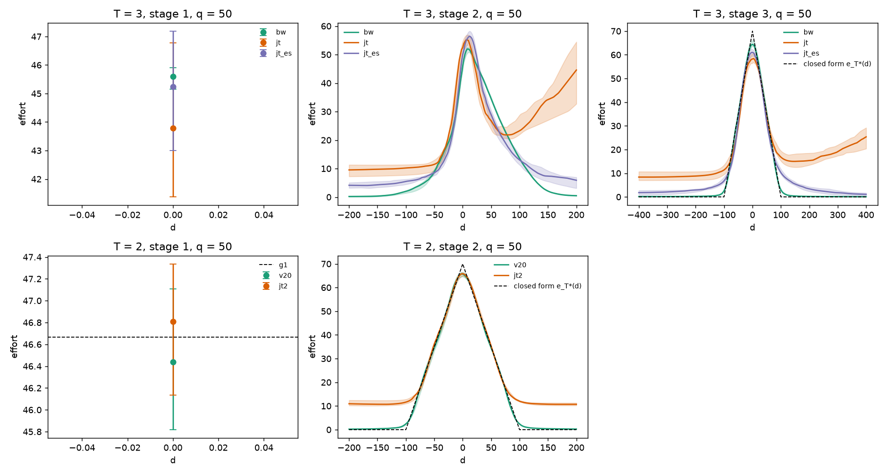
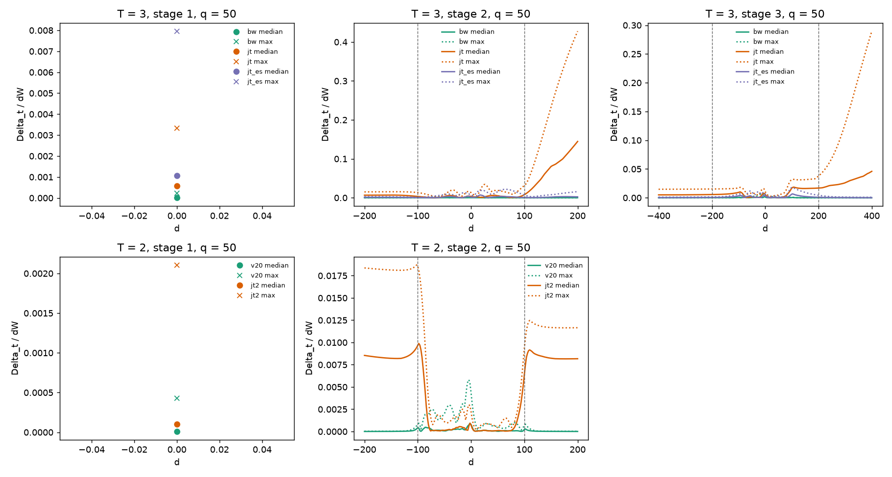
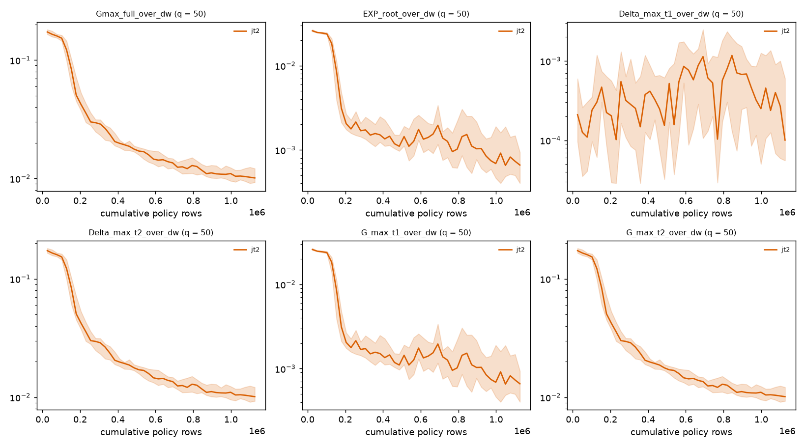

# T3-R1: the T = 2 comparison (recorded v2.0 runs against the joint arm `jt2`)

Date: 2026-10-17. The same structure as `04_t3_results.md`, for H1-T2: the 40 recorded v2.0 confirmation runs (`v20`; seeds 30501-30520, q in {50, 60}) against the new joint arm `jt2` (the joint whole-game runner `run/run_joint.py` at T = 2, same seeds, same budget in policy rows). **The `v20` runs are the recorded confirmation runs of protocol v2.0, re-evaluated; nothing about v2.0 was re-run or re-tuned (C-T2R: the evaluator reproduces all seven gate values and four verdicts of the 40 recorded runs bit for bit, `03_checks.md` section 3). The seed block is reused on purpose so the new arm pairs with the locked solver's runs; this block confirms nothing new about v2.0**, and seed 30510 at q = 50, v2.0's one failed confirmation run (G-A), stays in the comparison as recorded. Tables are generated by `report_scripts/results_tables.py` from `results/t3_r1/`; the criterion rows and the gate counts are recomputed by `tools/t3/t3_blind.py` (agreement 5.9e-17 and 1.1e-16), the secondary statistics are `tools/t3/t3_analysis.py`'s (checked by the fact-check, `pi_record/01_factcheck.md`). Definitions of the quantities (G, Delta, the band, EXP_root, `|peak|` and the others) are in `04_t3_results.md`; quantities are divided by dW = 4. The tables of `04_t3_results.md` sections 6 to 8 contain the rows of `v20` and `jt2` as well.

## 1. What differs between the two arms

- **Scheme.** `v20`: two-phase backward induction (Phase A: stage 2 alone, 1,600 updates; Phase B: stage 1 with stage 2 frozen, 600 updates), 2,200 updates and 56,000 minibatch steps. `jt2`: one network for both stages trained jointly from root play, 1,100 updates and 44,000 minibatch steps. Both see 1,126,400 policy rows (`jt2`: 563,200 per stage; `v20`: 819,200 at stage 2 and 307,200 at stage 1), the same game, actor, critic and optimiser.
- **Start distribution (coverage).** `v20` trains stage 2 in Phase A from 512 bin-balanced starts per update over all of D_2 (half of them out of band); `jt2` trains from root play only: its stage-2 rows are 99.8 % in band at q = 50 and 99.9 % at q = 60 and it visits 24 of the 40 (q = 50) and 28 of the 44 (q = 60) stage-2 bins (`04_t3_results.md` section 8, coverage table).
- **Continuation.** `v20` Phase B uses the exact expected continuation of the frozen stage-2 policy for the stage-1 rows; `jt2` uses the sampled continuation.
- **Capacity.** The policy of `v20` is two networks (the frozen stage-2 snapshot and the stage-1 actor), that of `jt2` one.
- **Optimisation details.** The advantage normalisation of `v20` in Phase B is over the stage-1 rows only (`adv_norm_scope = stage1_rows`), that of `jt2` over all rows (`02_preregistration.md` section 13.8); the learning-rate windows differ with the schemes (arms table in `04_t3_results.md` section 2).

## 2. The checks

The launch, the post-launch checks (14 verdicts, 160 of 160 runs, among them the 40 `jt2` runs), the budgets of D5 (`jt2` 1,100 updates, 563,200 rows per stage, 44,000 minibatch steps; `v20` 2,200 updates, 56,000 steps, in all 80 runs) and C-INIT (the initial weights of `jt2` equal those of `MSRun` at T = 2 in all 40 (q, seed) groups, `03_checks.md` section 2) are in `04_t3_results.md` section 1. The 40 `v20` runs are not launched by this round; they are the files of `results/v2_T2_locked/confirmation_v2_0` re-evaluated (C-T2R, `03_checks.md` section 3).

## 3. Per-seed tables

Final tier, last iterate; "run gates" is G-A and G-F and G-N and G-S.

**q = 50**

| seed | `v20` Gmax_full/dW | `v20` EXP_root/dW | `v20` run gates | `jt2` Gmax_full/dW | `jt2` EXP_root/dW | `jt2` G-A | `jt2` G-F | `jt2` G-S |
|---|---|---|---|---|---|---|---|---|
| 30501 | 0.00097 | 0.00021 | pass | 0.00992 | 0.00170 | fail | pass | fail |
| 30502 | 0.00161 | 0.00028 | pass | 0.01005 | 0.00040 | fail | fail | pass |
| 30503 | 0.00181 | 0.00035 | pass | 0.01574 | 0.00071 | fail | fail | pass |
| 30504 | 0.00090 | 0.00062 | pass | 0.01116 | 0.00222 | fail | fail | fail |
| 30505 | 0.00229 | 0.00055 | pass | 0.00939 | 0.00087 | fail | pass | pass |
| 30506 | 0.00133 | 0.00020 | pass | 0.01164 | 0.00117 | fail | fail | fail |
| 30507 | 0.00114 | 0.00038 | pass | 0.00704 | 0.00044 | fail | pass | pass |
| 30508 | 0.00154 | 0.00047 | pass | 0.00944 | 0.00056 | fail | pass | pass |
| 30509 | 0.00115 | 0.00030 | pass | 0.01870 | 0.00090 | fail | fail | pass |
| 30510 | 0.00580 | 0.00115 | FAIL | 0.01247 | 0.00070 | fail | fail | pass |
| 30511 | 0.00073 | 0.00020 | pass | 0.01396 | 0.00304 | fail | fail | fail |
| 30512 | 0.00146 | 0.00029 | pass | 0.00911 | 0.00032 | fail | pass | pass |
| 30513 | 0.00193 | 0.00038 | pass | 0.01036 | 0.00034 | fail | fail | pass |
| 30514 | 0.00310 | 0.00048 | pass | 0.00910 | 0.00027 | fail | pass | pass |
| 30515 | 0.00234 | 0.00040 | pass | 0.00957 | 0.00053 | fail | pass | pass |
| 30516 | 0.00136 | 0.00056 | pass | 0.00912 | 0.00146 | fail | pass | fail |
| 30517 | 0.00136 | 0.00052 | pass | 0.01206 | 0.00082 | fail | fail | pass |
| 30518 | 0.00298 | 0.00059 | pass | 0.01146 | 0.00027 | fail | fail | pass |
| 30519 | 0.00165 | 0.00041 | pass | 0.00898 | 0.00062 | fail | pass | pass |
| 30520 | 0.00213 | 0.00058 | pass | 0.01285 | 0.00040 | fail | fail | pass |

**q = 60**

| seed | `v20` Gmax_full/dW | `v20` EXP_root/dW | `v20` run gates | `jt2` Gmax_full/dW | `jt2` EXP_root/dW | `jt2` G-A | `jt2` G-F | `jt2` G-S |
|---|---|---|---|---|---|---|---|---|
| 30501 | 0.00086 | 0.00016 | pass | 0.01535 | 0.00091 | fail | fail | fail |
| 30502 | 0.00143 | 0.00025 | pass | 0.01389 | 0.00080 | fail | fail | pass |
| 30503 | 0.00040 | 0.00014 | pass | 0.00914 | 0.00027 | fail | pass | pass |
| 30504 | 0.00142 | 0.00024 | pass | 0.01339 | 0.00063 | fail | fail | pass |
| 30505 | 0.00097 | 0.00030 | pass | 0.01432 | 0.00106 | fail | fail | fail |
| 30506 | 0.00047 | 0.00012 | pass | 0.01421 | 0.00043 | fail | fail | pass |
| 30507 | 0.00060 | 0.00014 | pass | 0.01228 | 0.00034 | fail | fail | pass |
| 30508 | 0.00123 | 0.00037 | pass | 0.01165 | 0.00076 | fail | fail | pass |
| 30509 | 0.00107 | 0.00027 | pass | 0.01257 | 0.00233 | fail | fail | fail |
| 30510 | 0.00089 | 0.00038 | pass | 0.00999 | 0.00026 | fail | pass | pass |
| 30511 | 0.00119 | 0.00033 | pass | 0.00966 | 0.00039 | fail | pass | pass |
| 30512 | 0.00093 | 0.00011 | pass | 0.01187 | 0.00034 | fail | fail | pass |
| 30513 | 0.00073 | 0.00011 | pass | 0.01053 | 0.00029 | fail | fail | pass |
| 30514 | 0.00122 | 0.00016 | pass | 0.00819 | 0.00070 | fail | pass | fail |
| 30515 | 0.00161 | 0.00021 | pass | 0.01600 | 0.00033 | fail | fail | pass |
| 30516 | 0.00114 | 0.00017 | pass | 0.01455 | 0.00037 | fail | fail | pass |
| 30517 | 0.00067 | 0.00020 | pass | 0.01607 | 0.00078 | fail | fail | pass |
| 30518 | 0.00080 | 0.00016 | pass | 0.02742 | 0.00100 | fail | fail | pass |
| 30519 | 0.00178 | 0.00041 | pass | 0.01165 | 0.00106 | fail | fail | fail |
| 30520 | 0.00319 | 0.00049 | pass | 0.01954 | 0.00232 | fail | fail | fail |

## 4. Gates

| arm | q | runs with exit 0 | G-A pass [95 % CP] | G-F pass [95 % CP] | G-N pass [95 % CP] | G-S pass [95 % CP] | all four [95 % CP] |
|---|---|---|---|---|---|---|---|
| `v20` | 50 | 20 | 19 [0.751, 0.999] | 20 [0.832, 1.000] | 20 [0.832, 1.000] | 20 [0.832, 1.000] | 19 [0.751, 0.999] |
| `v20` | 60 | 20 | 20 [0.832, 1.000] | 20 [0.832, 1.000] | 20 [0.832, 1.000] | 20 [0.832, 1.000] | 20 [0.832, 1.000] |
| `jt2` | 50 | 20 | 0 [0.000, 0.168] | 9 [0.231, 0.685] | 20 [0.832, 1.000] | 15 [0.509, 0.913] | 0 [0.000, 0.168] |
| `jt2` | 60 | 20 | 0 [0.000, 0.168] | 4 [0.057, 0.437] | 20 [0.832, 1.000] | 14 [0.457, 0.881] | 0 [0.000, 0.168] |

`v20`: 19 of 20 runs pass all four gates at q = 50 (seed 30510 fails G-A: `eta_2/dW` 0.00580 against 0.005), 20 of 20 at q = 60 (the recorded v2.0 result). `jt2`: none of the 40 runs passes G-A (G-A parts below), G-F in 9 of 20 (q = 50) and 4 of 20 (q = 60), G-N in 20 of 20, G-S in 15 of 20 and 14 of 20.

| arm | q | G-A eta part (<= 0.005) | G-A RMSE_pos part (<= 0.05) | G-A tail part (<= 0.02) | G-A all | G-F | G-N eta part | G-N Gmax part |
|---|---|---|---|---|---|---|---|---|
| `bw` | 50 | 18 | 20 | 20 | 18 | 20 | 20 | 20 |
| `bw` | 60 | 20 | 20 | 20 | 20 | 18 | 20 | 20 |
| `jt` | 50 | 0 | 0 | 0 | 0 | 0 | 20 | 20 |
| `jt` | 60 | 0 | 0 | 0 | 0 | 0 | 20 | 20 |
| `jt_es` | 50 | 1 | 1 | 1 | 0 | 4 | 20 | 20 |
| `jt_es` | 60 | 1 | 1 | 0 | 0 | 4 | 20 | 20 |
| `v20` | 50 | 19 | 20 | 20 | 19 | 20 | 20 | 20 |
| `v20` | 60 | 20 | 20 | 20 | 20 | 20 | 20 | 20 |
| `jt2` | 50 | 0 | 12 | 0 | 0 | 9 | 20 | 20 |
| `jt2` | 60 | 0 | 1 | 0 | 0 | 4 | 20 | 20 |

(The table covers all five arms; the `jt2` and `v20` rows are the T = 2 ones.) The G-A failures of `jt2` are in the eta part and the tail part in every run (0 of 20 pass either), at q = 50 also in the RMSE part in 8 of 20 runs and at q = 60 in 19 of 20.

## 5. The criterion (H1-T2)

| q | pair (a - b) | n pairs | mean a | mean b | mean difference | 95 % interval | upper end < 0 | 98.75 % interval | median difference | median 95 % interval | seeds a<b / a>b |
|---|---|---|---|---|---|---|---|---|---|---|---|
| 50 | `v20` - `jt2` | 20 | 0.00188 | 0.01111 | -0.00923 | [-0.01054, -0.00808] | yes | [-0.01093, -0.00784] | -0.00843 | [-0.01029, -0.00749] | 20 / 0 |
| 60 | `v20` - `jt2` | 20 | 0.00113 | 0.01361 | -0.01248 | [-0.01442, -0.01088] | yes | [-0.01505, -0.01054] | -0.01182 | [-0.01357, -0.01015] | 20 / 0 |

**H1-T2 is supported at both q:** the mean paired difference of `Gmax_full/dW` (`v20` - `jt2`) is -0.00923 [-0.01054, -0.00808] at q = 50 and -0.01248 [-0.01442, -0.01088] at q = 60, negative in 20 of 20 seeds at both q (the criterion: the upper end of the 95 % interval below 0 at both q; S = 20261017, 10,000 resamples; dropped pairs 0). The mean `Gmax_full` is 0.00188 (`v20`) against 0.01111 (`jt2`) at q = 50 and 0.00113 against 0.01361 at q = 60.

## 6. Closed-form recovery, stage 1, and the secondaries

The terminal-stage tent (stage 2) and the stage-1 effort are compared with the closed form of the two-stage game (`|peak|`: the relative error of the stage-2 effort at the apex d = 0, |e_2(0) - e_2*(0)| / e_2*(0), signed in its own column; RMSE_pos and tail as in D6; the stage-1 error against g1 = dW/(6kq)). Medians over the 20 seeds:

| arm | q | e_2(0) | e_2(0)* (tent) | signed relative error of e_2(0) (peak) | abs value (peak_T_abs) | RMSE_pos / e_2(0)* | tail mean / e_2(0)* | tail max / e_2(0)* | stage-1 relative error, signed | abs | eta_2 / dW | Gmax_full / dW | e_1(0) |
|---|---|---|---|---|---|---|---|---|---|---|---|---|---|
| `v20` | 50 | 65.69 | 70.00 | -0.0615 | 0.0615 | 0.0239 | 0.0080 | 0.0374 | -0.0049 | 0.0131 | 0.00157 | 0.00157 | 46.437 |
| `v20` | 60 | 54.38 | 58.33 | -0.0678 | 0.0678 | 0.0229 | 0.0104 | 0.0379 | 0.0000 | 0.0117 | 0.00102 | 0.00102 | 38.890 |
| `jt2` | 50 | 65.84 | 70.00 | -0.0595 | 0.0595 | 0.0485 | 0.1585 | 0.1774 | 0.0030 | 0.0131 | 0.01020 | 0.01020 | 46.809 |
| `jt2` | 60 | 54.12 | 58.33 | -0.0722 | 0.0722 | 0.0690 | 0.2081 | 0.2379 | 0.0006 | 0.0248 | 0.01298 | 0.01298 | 38.914 |

Paired differences (`v20` - `jt2`; negative = `v20` is smaller; not criteria):

| statistic | hypothesis | q | mean a | mean b | mean difference | 95 % interval | 98.75 % interval | median difference [95 %] | seeds a<b / a>b |
|---|---|---|---|---|---|---|---|---|---|
| EXP_root / dW | H1-T2 | 50 | 0.00045 | 0.00089 | -0.00044 | [-0.00080, -0.00014] | [-0.00091, -0.00007] | -0.00017 [-0.00047, -0.00004] | 15 / 5 |
| EXP_root / dW | H1-T2 | 60 | 0.00024 | 0.00077 | -0.00053 | [-0.00078, -0.00032] | [-0.00086, -0.00028] | -0.00039 [-0.00062, -0.00020] | 19 / 1 |
| dReach / dW | H1-T2 | 50 | 0.00195 | 0.01089 | -0.00894 | [-0.01043, -0.00758] | [-0.01084, -0.00728] | -0.00812 [-0.00998, -0.00716] | 20 / 0 |
| dReach / dW | H1-T2 | 60 | 0.00117 | 0.01295 | -0.01178 | [-0.01381, -0.01007] | [-0.01446, -0.00973] | -0.01079 [-0.01298, -0.01023] | 20 / 0 |
| RMSE_pos / e_T(0)* | H1-T2 | 50 | 0.02638 | 0.05026 | -0.02388 | [-0.02808, -0.01987] | [-0.02958, -0.01894] | -0.02331 [-0.02666, -0.01794] | 20 / 0 |
| RMSE_pos / e_T(0)* | H1-T2 | 60 | 0.02348 | 0.07007 | -0.04660 | [-0.05328, -0.04073] | [-0.05543, -0.03946] | -0.04343 [-0.05179, -0.03981] | 20 / 0 |
| tail mean / e_T(0)* | H1-T2 | 50 | 0.00829 | 0.15970 | -0.15142 | [-0.15920, -0.14407] | [-0.16130, -0.14209] | -0.15014 [-0.15633, -0.14136] | 20 / 0 |
| tail mean / e_T(0)* | H1-T2 | 60 | 0.01049 | 0.21331 | -0.20282 | [-0.21644, -0.19022] | [-0.22034, -0.18729] | -0.19752 [-0.20692, -0.19310] | 20 / 0 |
| abs relative error of e_T(0) (peak_T_abs) | H1-T2 | 50 | 0.06305 | 0.06283 | +0.00022 | [-0.01503, +0.01590] | [-0.01943, +0.02038] | +0.00718 [-0.01065, +0.01452] | 8 / 12 |
| abs relative error of e_T(0) (peak_T_abs) | H1-T2 | 60 | 0.06780 | 0.07210 | -0.00430 | [-0.01679, +0.00839] | [-0.02029, +0.01164] | -0.00721 [-0.02267, +0.01445] | 13 / 7 |
| e_1(0) | H1-T2 | 50 | 46.52484 | 46.68556 | -0.16072 | [-1.12743, +0.83378] | [-1.38927, +1.12396] | -0.36367 [-1.00457, +0.38548] | 13 / 7 |
| e_1(0) | H1-T2 | 60 | 38.91197 | 39.06070 | -0.14873 | [-1.01790, +0.74908] | [-1.25539, +0.98546] | -0.13099 [-0.76654, +0.73293] | 11 / 9 |
| stage-1 relative error (abs) | H1-T2 | 50 | 0.01622 | 0.02918 | -0.01296 | [-0.02713, -0.00033] | [-0.03102, +0.00219] | +0.00094 [-0.02498, +0.00482] | 10 / 10 |
| stage-1 relative error (abs) | H1-T2 | 60 | 0.01359 | 0.03689 | -0.02330 | [-0.03983, -0.00807] | [-0.04433, -0.00431] | -0.01713 [-0.04106, +0.00182] | 13 / 7 |

- **Apex and root effort:** the paired differences of `|peak|` ([-0.01503, +0.01590] at q = 50, [-0.01679, +0.00839] at q = 60) and of the root effort e_1(0) ([-1.13, +0.83] and [-1.02, +0.75]) are not distinguishable from 0 with 20 seeds per q; that is absence of evidence of a difference (the intervals allow differences of up to about 25 % of the mean |peak|), not evidence that the arms are equal. Both arms' effort at the apex is below the tent (signed relative error about -0.06 to -0.07).
- **Off-peak shape:** the tail mean is 0.1585 (q = 50) and 0.2081 (q = 60) of e_2(0)* in `jt2` against 0.0080 and 0.0104 in `v20` (differences -0.15142 [-0.15920, -0.14407] and -0.20282 [-0.21644, -0.19022]); RMSE_pos is 0.0485 and 0.0690 against 0.0239 and 0.0229 (medians; mean differences -0.02388 and -0.04660). The effort of `jt2` outside the band does not go to 0: at q = 50 it stays at about 11 on both sides (the tail mean 0.1585 x e_2(0)* = 11.1; figure below); `v20`'s tails are near 0, as is the closed form.
- **Stage-1 error** relative to g1: the mean is smaller in `v20` (0.01622 against 0.02918 at q = 50, difference -0.01296 [-0.02713, -0.00033]; 0.01359 against 0.03689 at q = 60, -0.02330 [-0.03983, -0.00807]) but the medians at q = 50 are equal (0.0131 and 0.0131; the median difference is +0.00094 [-0.02498, +0.00482], with 10 of 20 seeds negative; the 98.75 % interval of the mean difference includes 0), so at q = 50 the mean difference is carried by a few `jt2` runs above the G-S limit of 0.05 (G-S fails in 5 of 20 `jt2` runs at q = 50 and 6 of 20 at q = 60, against none for `v20`); at q = 60 the median difference is -0.01713 [-0.04106, +0.00182].
- **EXP_root** is smaller in `v20` too: -0.00044 [-0.00080, -0.00014] (q = 50; 15 of 20 seeds negative) and -0.00053 [-0.00078, -0.00032] (q = 60; 19 of 20). The eta_1 (`Delta_max,1`) differences are -0.00037 [-0.00063, -0.00014] and -0.00030 [-0.00056, -0.00009] (15 and 13 of 20 negative; at q = 60 the median difference's interval includes 0).

## 7. Where the gains are

| statistic | hypothesis | q | mean difference | 95 % interval | 98.75 % interval | median difference [95 %] | seeds a<b / a>b |
|---|---|---|---|---|---|---|---|
| Delta_max_t1_over_dw | H1-T2 | 50 | -0.00037 | [-0.00063, -0.00014] | [-0.00071, -0.00010] | -0.00009 [-0.00030, -0.00004] | 15 / 5 |
| Delta_max_t1_over_dw | H1-T2 | 60 | -0.00030 | [-0.00056, -0.00009] | [-0.00063, -0.00005] | -0.00007 [-0.00031, +0.00002] | 13 / 7 |
| G_max_t1_over_dw | H1-T2 | 50 | -0.00044 | [-0.00080, -0.00014] | [-0.00091, -0.00007] | -0.00017 [-0.00047, -0.00004] | 15 / 5 |
| G_max_t1_over_dw | H1-T2 | 60 | -0.00053 | [-0.00078, -0.00032] | [-0.00086, -0.00028] | -0.00039 [-0.00062, -0.00020] | 19 / 1 |
| Delta_max_t2_over_dw | H1-T2 | 50 | -0.00923 | [-0.01054, -0.00808] | [-0.01093, -0.00784] | -0.00843 [-0.01029, -0.00749] | 20 / 0 |
| Delta_max_t2_over_dw | H1-T2 | 60 | -0.01248 | [-0.01442, -0.01088] | [-0.01505, -0.01054] | -0.01182 [-0.01357, -0.01015] | 20 / 0 |
| G_max_t2_over_dw | H1-T2 | 50 | -0.00923 | [-0.01054, -0.00808] | [-0.01093, -0.00784] | -0.00843 [-0.01029, -0.00749] | 20 / 0 |
| G_max_t2_over_dw | H1-T2 | 60 | -0.01248 | [-0.01442, -0.01088] | [-0.01505, -0.01054] | -0.01182 [-0.01357, -0.01015] | 20 / 0 |
| G_in_t2 | H1-T2 | 50 | -0.00865 | [-0.01001, -0.00742] | [-0.01036, -0.00712] | -0.00783 [-0.01023, -0.00680] | 20 / 0 |
| G_in_t2 | H1-T2 | 60 | -0.01131 | [-0.01330, -0.00958] | [-0.01389, -0.00924] | -0.01077 [-0.01269, -0.00874] | 20 / 0 |
| G_out_t2 | H1-T2 | 50 | -0.01063 | [-0.01183, -0.00955] | [-0.01219, -0.00927] | -0.00987 [-0.01153, -0.00893] | 20 / 0 |
| G_out_t2 | H1-T2 | 60 | -0.01326 | [-0.01521, -0.01162] | [-0.01583, -0.01127] | -0.01270 [-0.01408, -0.01132] | 20 / 0 |
| Delta_in_t2 | H1-T2 | 50 | -0.00865 | [-0.01001, -0.00742] | [-0.01036, -0.00712] | -0.00783 [-0.01023, -0.00680] | 20 / 0 |
| Delta_in_t2 | H1-T2 | 60 | -0.01131 | [-0.01330, -0.00958] | [-0.01389, -0.00924] | -0.01077 [-0.01269, -0.00874] | 20 / 0 |
| Delta_out_t2 | H1-T2 | 50 | -0.01063 | [-0.01183, -0.00955] | [-0.01219, -0.00927] | -0.00987 [-0.01153, -0.00893] | 20 / 0 |
| Delta_out_t2 | H1-T2 | 60 | -0.01326 | [-0.01521, -0.01162] | [-0.01583, -0.01127] | -0.01270 [-0.01408, -0.01132] | 20 / 0 |

The largest gain of `jt2` is at stage 2 in every run and **out of band** in 15 of 20 (q = 50) and 19 of 20 (q = 60) runs; 5 of the 15 (q = 50) and 1 of the 19 (q = 60) lie exactly on the edge node |d| = 2q, which D6 counts as out of band (`v20`: in band in all 40; `04_t3_results.md` section 6, which also gives the in-band and out-of-band medians of `G` and `Delta` and the argmax gaps of both T = 2 arms). The stage-2 medians are G_in,2 = 0.0099 and G_out,2 = 0.0101 (q = 50), 0.0119 and 0.0130 (q = 60) for `jt2`, against 0.0016 and 0.0004, 0.0010 and 0.0003 for `v20`: the two arms differ in both bands, but the out-of-band difference is the larger one at both q (-0.01063 against -0.00865 at q = 50, -0.01326 against -0.01131 at q = 60).

(The T = 2 panels are the lower rows; the q = 60 figures are `effort_functions_q60.png` and `deviation_gains_q60.png` in `results/t3_r1/analysis/figures/`, and the paired-differences figure with the H1-T2 rows is in `04_t3_results.md` section 6.)

## 8. EXP_root against Gmax_full

At T = 2 the mean `Gmax_full` is 4.2 (q = 50) and 4.8 (q = 60) times the mean EXP_root for `v20` and 12.5 and 17.7 times for `jt2` (table of `04_t3_results.md` section 7). The paired `v20` - `jt2` difference is -0.00044 and -0.00053 in EXP_root against -0.00923 and -0.01248 in `Gmax_full`: the difference between the arms is about 21 and 24 times smaller in EXP_root, as in the pre-registered prediction P2 (section 10).

## 9. Best of run, learning curves, coverage, cost

- **Best of run** (descriptive: "selected with the development verifier; not a pre-specified candidate"; means over the 20 seeds): `jt2` 0.01040 and 0.01275 against 0.01111 and 0.01361 for the last iterate (q = 50 and 60; medians 0.00989 and 0.01133 against 0.01020 and 0.01298). The best-of-run `jt2` passes G-F in 10 of 20 runs at q = 50 and 6 of 20 at q = 60 and G-S in 13 and 14; G-A in none; in 4 runs at each q the last update is the best one (`04_t3_results.md` section 8).
- **Learning curves** (development tier, median over the seeds at 25, 50, 75 and 100 % of the updates): Gmax_full 0.0296, 0.0159, 0.0118 and 0.0101 at q = 50 and 0.0341, 0.0166, 0.0140 and 0.0130 at q = 60, EXP_root between 0.0007 and 0.0018 throughout (`04_t3_results.md` section 8, table of the checks):

- **Coverage, cost, concentration:** the rows of `jt2` and `v20` are in the tables of `04_t3_results.md` section 8 (coverage: `jt2` visits 24 of 40 and 28 of 44 stage-2 bins; cost: median wall 309 s (q = 50) and 245 s (q = 60) for `jt2`, 356 s for `v20`, CPU time of `v20` not recorded; the median maximum normalised standard deviation of the Beta policies is 0.026 to 0.031 for both arms).

## 10. The predictions at T = 2

P1 (H1-T2 supported; the joint arm's largest gains out of band): H1-T2 is supported at both q (section 5); `jt2`'s largest gain is out of band in 15 of 20 and 19 of 20 runs (section 7). P2 (the absolute difference smaller in EXP_root than in Gmax_full): holds, 0.00044 against 0.00923 and 0.00053 against 0.01248 (section 8). P3 and P4 concern T = 3 (`04_t3_results.md` section 9).

## 11. Caveats and scope

- The comparison contrasts two whole schemes: backward against joint from root play at one budget in policy rows and one set of seeds, and the arms differ at the same time in coverage (the start distribution), continuation, capacity (two networks against one), the learning-rate schedule and the Phase B advantage normalisation (section 1). The round does not separate these ingredients; "the training scheme" in the title of H1-T2 means the whole of them. The statement supported is H1-T2 as pre-registered: the mean paired difference of `Gmax_full/dW`, 20 seeds per q.
- The two caveats of D5 apply to H1-T2 as they do to H1 and H2: **capacity** (above) and **coverage** (the `jt2` stage-2 rows are root-path rows, almost all in band; the `v20` rows are bin-balanced over D_2).
- `jt2` was run once, with the settings of D5; no tuning of `jt2` took place, so its gap to `v20` is not a statement about the best a joint scheme can do at T = 2.
- The `v20` runs are not new evidence about v2.0; the confirmation of v2.0 is in `reports/t2_refine_100526/`.
