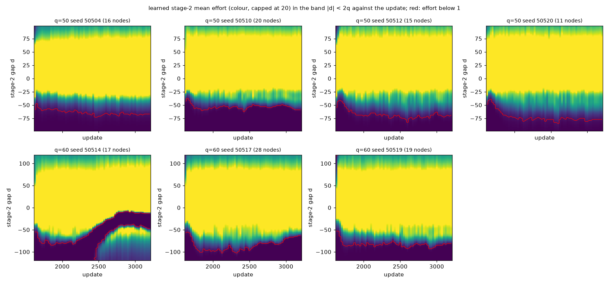
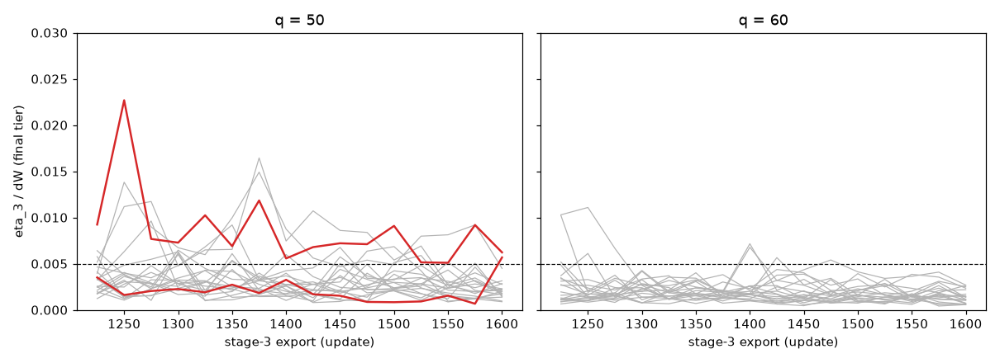

# T3-R2, P1: audit of the four T = 3 `bw` failures (gate G1)

Date: 2026-10-19. Branch `t3-r2`. Every table below is generated by `report_scripts/audit_tables.py` from the CSV / JSON files of `results/t3_r2/audit/` (written by `tools/t3/t3r2_audit.py`); the prose is `report_scripts/templates/01_audit.tpl.md`, assembled by `report_scripts/assemble_audit.py`, and the numbers in it come from `reports/t3/r2/tables/audit_numbers.json` (written by the same script), from the tables, or are quoted from the cited files (a few values in the prose are typed in; the fact-check, `pi_record/01_factcheck.md`, checked them). The units of the gains are fractions of ΔW = 4 ("/dW") unless a column says otherwise.

## 0. Result

**No implementation error found.**

Nothing in the audit is classified (E). The four T3-R1 `bw` re-runs are bit-identical to their originals, the stored snapshots equal the weight exports and the stored continuation tables of eight runs are exactly what the code builds from the frozen snapshots, the stage-2 and stage-3 training semantics match their specification in unit tests with hand-computed expectations or replayed draws, and an independent best-response calculator (no verifier or metrics numerics) reproduces the stored gains at the stored maximising state of each of the 200 runs (G, Δ_T) and the stored EXP_root to at most 2.5e-05 ΔW (G), 5.5e-06 ΔW (Δ_T) and 1.0e-04 ΔW (EXP_root), all below the G-N tolerance of 0.001 ΔW (EXP_root, which is not gated, is the closest, one decade below), with no flip of any gate verdict at those states (the calculator was not run over the whole state grid of the other runs; the refined tier, a finer grid, flips none either) and none of H1, H2, H3, H1-T2. The four failures and the seven near-zero stretches are learning failures (L): at every one of the 126 stretch nodes the one-step best-response effort is above 1, the objective Q_2^m is increasing at the learned effort, and there is no local maximum near zero effort (section 8).

| item | finding | D2 class |
|---|---|---|
| A1, four re-runs | bit-identical in both comparisons (section 2) | none needed |
| A2, 40 snapshots | 40 of 40 identical (section 3) | none needed |
| A3 step 1, 8 table pairs | 8 of 8 rebuilt bit for bit (section 4) | none needed |
| A3 step 2, tables against the calculator | at most 1.4e-08 ΔW (flag level 1e-5) | none needed |
| A4, semantics | 6 tests with hand-computed expectations or replayed draws pass (section 5) | none needed |
| A5, calculator against the stored verifier values of 200 runs | G ≤ 2.5e-05, Δ_T ≤ 5.5e-06, EXP_root ≤ 1.0e-04 ΔW; V^mean at 20 states per stage ≤ 2.8e-05 ΔW; no difference above 1e-3 ΔW (0 runs), none above 1e-4 ΔW (0) | (N) |
| A5, flips | 0 gate flips; 0 flips of H1, H2, H3, H1-T2 (calculator values and refined tier) | none |
| A6, refined tier, 200 runs | G-A / G-F verdicts differ in 0 runs; largest difference of Gmax_full 1.7e-04 ΔW; `dReach` of four `jt` runs moves by 1.1e-03 to 1.7e-03 ΔW (grid-defined reachable set, not gated) | (N) |
| failure q = 50, seed 50504 (η_3) | a persistent excess: η_3 is above 0.005 at every one of the last 16 exports (range 0.0051 to 0.0227; section 9) | (L) |
| failure q = 50, seed 50517 (η_3) | last iterate at the top of its own last-16-export range | (L) |
| failure q = 60, seed 50514 (Gmax_full) | a stretch that formed during stage-2 training | (L) |
| failure q = 60, seed 50517 (Gmax_full) | a stretch present at the first stage-2 export that partly recovered (efforts of 9.4 to 15.9 at the failure node at the exports `u01750` to `u02950` that were looked at) and collapsed again in updates 2950 to 3200 (section 8) | (L) |
| the seven stretches | all policy errors, none equilibrium-like, none with a local maximum near zero | (L) for each; the mechanism that keeps a stretch is not tested |
| anything unexplained | the audit does not say why training does not leave a stretch; no finding is (U) in the sense of an unexplained number | none |

## 1. Set-up

- Code commits: `67336a38cca03215c467096e28d3717a54cf32fb` (the new tools and tests; A1, A2, A3, A6, A7 and A8 ran at it) and `897982f28b820108ba7a8d1e9ebd3ec6407f4141` (the fixes of the independent review, `03_checks.md`; A5 and its convergence test were re-run at it, with more columns and the extra q = 50 stretch rows; the first A5 outputs are kept in `results/t3_r2/audit/at_67336a38/` and agree with the re-run in every shared column). `agents/`, `envs/`, `utils/`, `run/`, `protocols/` (at the time of the audit; P2 later added the lock and the LOCK record), `tools/ms/`, `tools/v2/` and the existing `tools/t3/` files are those of `be2b7e9f`. Every `record_*.json` in `results/t3_r2/audit/` holds the HEAD and `git status --porcelain` of its step. The steps A1, A2, A3 and the first A5 ran with only `results/` untracked (the re-run manifests say `clean_tree` true); A1's comparison, A6, A7 and A8 ran while the untracked report scripts and table fragments of `reports/t3/r2/` already existed, and the A5 re-run (the source of every A5 number below) and its convergence test ran with modified and untracked files under `reports/` and `results/` only (their `record_*.json` list them). No path of `tools/`, `tests/`, `agents/`, `envs/`, `utils/` or `run/` was dirty at any step.
- Roots (explicit arguments, recorded in each `record_*.json`): T3-R1 untracked root `.../t3-bw-vs-jt-51e472/results/t3_r1` (weights, `state_end*.pt`, `eval/arrays/`), v2.0 confirmation runs `.../v2-t2-refine/results/v2_T2_locked/confirmation_v2_0`, tracked records `results/t3_r1/`. The reference-root check of P0 is in `00_housekeeping.md`.
- The audit tool is pure: it moves no RNG and writes nothing but `results/t3_r2/audit/` (and, for A1, the four re-runs in `results/t3_r2/reruns/`). Parallel steps use spawned single-threaded processes (`OMP_NUM_THREADS=1`, at most 40 workers).
- Cost of every step (`results/t3_r2/audit/costs.csv`; the A1 re-runs are the only training; all steps together take 783 seconds of wall time, 443 of them the longest of the four A1 runs, which ran side by side):

| step | items | workers | wall seconds |
|---|---|---|---|
| `a2` | 40 | 20 | 3.9 |
| `a3` | 8 | 8 | 44.7 |
| `a5` | 200 | 24 | 67.6 |
| `a6` | 200 | 16 | 18.3 |
| `a8` | 640 | 16 | 11.2 |
| `a5-conv` | 12 | 12 | 49.3 |
| `a7` | 40 | 20 | 24.2 |
| `a1-rerun` | 4 | 4 | 442.8 |
| `a1-compare` | 4 | 8 | 10.5 |
| `a5` | 200 | 24 | 68.1 |
| `a5-conv` | 16 | 16 | 42.8 |

## 2. A1, reproduction

Each failing `bw` run was run again with `run/run_ms_stagewise.py --config <its own T3-R1 run_config.json> --out-dir results/t3_r2/reruns/q{q}/seed{s}/bw` (at most 4 workers, tmux session `t3r2_a1`, `results/t3_r2/a1_rerun_stdout.txt`, `audit/a1_rerun_exit.csv`). Two comparisons per run (`audit/a1_compare.csv`, `audit/a1_compare_runs_q*_s*.txt`): `tools/t3/compare_runs.py bw` over the 152 weight exports, the freeze arrays, both continuation tables, the bin maps (162 npz files), the CSVs without their wall-clock columns and the final full state; and `t3_eval.evaluate_run` on the re-run against the run's row of `results/t3_r1/eval/per_run.csv`, text equality of every metric column (137 columns).

| q | seed | exit code | wall s | `compare_runs.py bw` (original against re-run) | metric columns compared (`evaluate_run` against `per_run.csv`) | columns differing | `run_config.json` byte-equal | bit-identical |
|---|---|---|---|---|---|---|---|---|
| 50 | 50504 | 0 | 426 | 162 npz files compared, all identical: True ms_updates.csv identical (wall-clock columns excluded): True ms_checks_stage3.csv identical (wall-clock columns excluded): True ms_checks_stage2.csv identical (wall-clock columns excluded): True ms_checks_stage1.csv identical (wall-clock columns excluded): True final actor / critic / frozen stages and stream states identical: True | 137 | 0 | yes | **yes** |
| 50 | 50517 | 0 | 420 | 162 npz files compared, all identical: True ms_updates.csv identical (wall-clock columns excluded): True ms_checks_stage3.csv identical (wall-clock columns excluded): True ms_checks_stage2.csv identical (wall-clock columns excluded): True ms_checks_stage1.csv identical (wall-clock columns excluded): True final actor / critic / frozen stages and stream states identical: True | 137 | 0 | yes | **yes** |
| 60 | 50514 | 0 | 431 | 162 npz files compared, all identical: True ms_updates.csv identical (wall-clock columns excluded): True ms_checks_stage3.csv identical (wall-clock columns excluded): True ms_checks_stage2.csv identical (wall-clock columns excluded): True ms_checks_stage1.csv identical (wall-clock columns excluded): True final actor / critic / frozen stages and stream states identical: True | 137 | 0 | yes | **yes** |
| 60 | 50517 | 0 | 443 | 162 npz files compared, all identical: True ms_updates.csv identical (wall-clock columns excluded): True ms_checks_stage3.csv identical (wall-clock columns excluded): True ms_checks_stage2.csv identical (wall-clock columns excluded): True ms_checks_stage1.csv identical (wall-clock columns excluded): True final actor / critic / frozen stages and stream states identical: True | 137 | 0 | yes | **yes** |

**Outcome: 4 of 4 bit-identical in both comparisons**, `run_config.json` byte-equal. Training at the T3-R1 settings is deterministic on this host (single-threaded CPU, the same machine on a second day): a failing run fails again with identical weights, tables and gains.

## 3. A2, snapshot identity (40 `bw` runs)

In `state_end_stage1.pt`: `frozen_stages["3"]` against the export `weights/u01600.npz`, `frozen_stages["2"]` against `u03200.npz`, the live actor against `u03800.npz`, bit for bit (data: `audit/a2_snapshot_identity.csv`).

| q | runs | `frozen_stages["3"]` = `u01600` | `frozen_stages["2"]` = `u03200` | live actor = `u03800` | all three identical |
|---|---|---|---|---|---|
| 50 | 20 | 20 | 20 | 20 | 20 |
| 60 | 20 | 20 | 20 | 20 | 20 |
| all | 40 | 40 | 40 | 40 | 40 |

**Outcome: 40 of 40 identical.** The policy that `t3_eval` evaluates (the three snapshots of `state_end_stage1.pt`) is the one the exports record at the end of each phase.

## 4. A3, continuation tables (four failing and four passing runs)

Step 1 (decisive): `utils.ms_continuation.build_nested_tables` from the two frozen snapshots against the stored `continuation_table_stage2.npz` and `continuation_table_stage1.npz`, bit for bit. Step 2 (descriptive): both tables at 201 points spread evenly over their y-grid against the calculator's W_3^mean and W_2^mean (the shock-integrated mean continuations of the stage-3 and stage-2 policies; v2.0's check (ii-b) at T = 2 found 4.98e-7 and 4.1e-7 ΔW against its limit of 1e-6, `protocols/v2_T2_locked_v2_0.md`). Data: `audit/a3_tables.csv`.

| q | seed | run | stage-2 table rebuilt = stored (bit) | stage-1 table rebuilt = stored (bit) | max abs diff to the calculator, stage-2 table (/dW) | same, stage-1 table (/dW) | flag (> 1e-5 dW) |
|---|---|---|---|---|---|---|---|
| 50 | 50504 | failing | yes | yes | 9.31e-09 | 1.16e-08 | no |
| 50 | 50517 | failing | yes | yes | 2.08e-09 | 1.35e-08 | no |
| 60 | 50514 | failing | yes | yes | 1.85e-09 | 8.47e-09 | no |
| 60 | 50517 | failing | yes | yes | 3.44e-09 | 7.35e-09 | no |
| 50 | 50501 | passing | yes | yes | 3.83e-09 | 1.28e-08 | no |
| 50 | 50502 | passing | yes | yes | 1.68e-09 | 1.24e-08 | no |
| 60 | 50501 | passing | yes | yes | 2.72e-09 | 7.08e-09 | no |
| 60 | 50502 | passing | yes | yes | 2.30e-09 | 7.94e-09 | no |

**Outcome: 8 of 8 table pairs bit-identical; the largest difference to the calculator is 1.4e-08 ΔW**, below the flag level of 1e-5 ΔW by a factor of about 700. So the tables the runner wrote are the expected continuations of the frozen stages as the code defines them, for these eight runs (that the phase of stage 2 trained against the table it wrote is a reading of `run/run_ms_stagewise.py`, not an audit check).

## 5. A4, stage-2 training semantics at T = 3

`tests/test_t3r2_semantics.py` (6 tests with hand-computed expectations or draws replayed from the same generators; returns are float32 and compared with a relative tolerance of 1e-5; record: `results/t3_r2/preflight/tests/semantics.txt`: "============================== 6 passed in 2.38s ==============================="):

1. the observation at (t = 2, T = 3) is [0.5, d/B] (B = 200 at q = 50); at t = 3 it is [1, d/(2B)];
2. a learner in role 1 sees −d (the stored states equal d/B for role 0 and −d/B for role 1), the opponent sees the negative of that;
3. the stage-2 return of `run.ms_rollout.collect_stage_batch` equals −k e_L² + Ṽ_3(d + e_L − e_O), with the efforts replayed from the same generators, and one fully hand-computed number with a linear table;
4. the table lookup refuses an out-of-grid y (the end points are inside; below, above and NaN raise), also through the rollout with a table that is too narrow;
5. the opponent's stage-2 action comes from the lagged copy: with a live actor that has moved away from the snapshot, the stored returns equal the lagged-copy computation and differ clearly (by more than 1e-3) from the live-actor computation; the learner's own log-probability uses the live actor;
6. the stage-3 phase reward of `run.v2_rollout.collect_batch_v2` (`reward_mode="expected"`) is w_L + ΔW F_ξ(d + e − e_opp) − k e², with one hand-computed value.

**Outcome: all pass.** (Together with A2 and A3: the observation encoding, the roles, the continuation table, the lagged opponent and the stage-3 reward each do what the specification says.)

## 6. A5, the independent best-response calculator

`tools/t3/t3r2_br_calc.py`. It computes Q_T, V_T^mean, V_T^BR, W_{t+1}^mean/BR, Q_t^m, V_t^mean, Δ_t, V_t^BR, G_t and EXP_root = G_1(0) as defined in the prompt's table, from the mean-effort functions of the loaded networks (float32 networks, float64 means), with the learned effort as one of the candidates of every maximisation. Numerics: value functions tabulated on a symmetric grid of D_t of step 0.05 and cubic-spline interpolated; the expectation is a composite Gauss-Legendre rule on panels of width 1 aligned at z = 0 and ±2q with 4 nodes per panel and the triangular density in the weights; maximisation over the effort: a grid of step 0.01 on [0, 100] followed by bounded refinement around the best grid point and at both bounds. **Independence:** it uses none of `verify`, `gl_shock_rule`, `stage_grid`, `effort_grid`, `evaluate` of `utils/dp_br_verifier.py` / `utils/v2_metrics.py` (an AST test in `tests/test_t3r2_calc.py` checks every name and import); the loaders and the mean-effort functions come in through the audit tool, and the calculator class takes only `f_xi` and `F_xi` of `utils.theory_multistage`, which that test integrates numerically (the helper `closed_form_policy`, used by the tests and the report only, also takes `g1_two_stage` and `g2_two_stage`). **One departure from the letter of the prompt, disclosed:** the tabulations (V^BR on the whole grid) refine with a vectorised golden-section search on the same brackets; the individually reported states use `scipy`'s bounded Brent as the prompt says; `test_the_vectorised_refinement_equals_scipy_bounded_brent` checks that both give the same values (≤ 1e-9) and efforts (≤ 2e-3 on the coarse test grid).

**Tests** (`tests/test_t3r2_calc.py`, 14 tests): F_ξ and f_ξ against numerical integration; the shock rule (unit mass, mean 0, variance 2q²/3); **the T = 2 closed form** (tent and g1 as functions) at q = 50 and q = 60 (both above q_crit = 41.83): Δ_t and G_t at the root and at 50 states of D_2 are at most 1e-6 ΔW (they are at machine precision, 2e-16 to 6e-16 ΔW in a rerun of the test); a perturbed closed form has the exactly computable gain; the T = 3 continuation against direct nested adaptive quadrature at three (d, e) points (≤ 2e-7); the best-response chain at least the mean chain, G_T = Δ_T; both effort bounds; the convergence helper; **agreement with the verifier on a synthetic T = 3 policy** (V^mean at 20 states per stage ≤ 1e-4 ΔW, Δ_3 and EXP_root ≤ 1e-3 ΔW); and **an independent brute-force T = 3 chain** written in the test (exact cell masses of the shock, linear interpolation, a plain effort grid; q = 20, a non-equilibrium policy), which agrees with the calculator on Δ_2 and G_2 at four states and on EXP_root to 1e-5 ΔW (the actual differences are about 1e-6 ΔW, on values of 0.2 to 0.4 ΔW).

**(a) The four failure points** (`audit/a5_failure_points.csv`). The stored columns are those of `results/t3_r1/analysis/bw_failures/points.csv` (T3-R1 report §4.1):

| q | seed | stage | gap d | failing quantity | Delta stored (/dW) | Delta calc | G stored | G calc | abs diff Delta | abs diff G | learned effort stored | calc | best-response effort stored | calc (dynamic) | one-step argmax stored | calc | slope dQ/de at the learned effort |
|---|---|---|---|---|---|---|---|---|---|---|---|---|---|---|---|---|---|
| 50 | 50504 | 3 | -4 | eta_3/dW | 0.006227 | 0.006227 | 0.006227 | 0.006227 | 6.67e-09 | 6.67e-09 | 59.15 | 59.15 | 67.14 | 67.14 | 67.14 | 67.14 | 0.00464 |
| 50 | 50517 | 3 | -18 | eta_3/dW | 0.005676 | 0.005676 | 0.005676 | 0.005676 | 2.09e-08 | 2.09e-08 | 64.29 | 64.29 | 48.02 | 48.02 | 48.02 | 48.02 | -0.00279 |
| 60 | 50514 | 2 | -14 | Gmax_full/dW | 0.056009 | 0.056008 | 0.056279 | 0.056278 | 7.90e-07 | 2.95e-07 | 0.52 | 0.52 | 34.44 | 34.42 | 34.43 | 34.40 | 0.01309 |
| 60 | 50517 | 2 | -66 | Gmax_full/dW | 0.010727 | 0.010723 | 0.010885 | 0.010880 | 4.16e-06 | 5.43e-06 | 0.16 | 0.16 | 14.71 | 14.72 | 14.71 | 14.71 | 0.00596 |

The calculator reproduces the stored gains to at most 5.4e-06 ΔW, the stored dynamic best-response efforts to at most 0.018 effort units and the stored one-step argmax efforts to at most 0.029 effort units (the largest is 34.43 against 34.40 at q = 60, seed 50514, d = −14, where the objective is nearly flat; the stored efforts are the verifier's argmax on an effort grid of step 0.5 with vertex refinement, the calculator's the refined maximiser (this explanation was not tested further); the efforts are the less well determined quantity, the gains agree to 1e-5 or better). At the two q = 60 points the slope of Q_2^m at the learned effort is positive (0.0131 and 0.0060 per effort unit): the objective rises when the effort is raised from the learned near-zero value; the q = 50 slopes are 0.0046 and −0.0028 (the learned stage-3 effort is 8 below and 16 above the best response, respectively).

**(b), (c) All 200 runs of `results/t3_r1/eval/per_run.csv`** (for every evaluated state `audit/a5_runs.csv` also holds the learned effort, both best-response efforts and the slope at the learned effort: at the state of the stored maximum `e_hat_at_Gmax`, `a_dev_at_Gmax`, `a_br_at_Gmax`, `slope_at_Gmax`; at the Δ_T state `e_hat_at_DeltaT`, `a_dev_at_DeltaT`, `a_br_at_DeltaT`, `G_at_DeltaT_over_dw`, `slope_at_DeltaT`; at the root `e1_calc`, `a_dev_1`, `a_br_1`, `Delta_1_over_dw`, `slope_1`) (120 T = 3 runs, 40 `jt2`, 40 `v20`; `audit/a5_runs.csv`). For each run the calculator gives G and Δ at the state of the stored maximum (`Gmax_full_t`, `Gmax_full_d`), Δ_T at `Delta_argmax_d_t{T}` and EXP_root = G_1(0), set against the stored verifier values:

| arm | runs | max abs diff G at the stored state (/dW) | median | max abs diff Delta_T at the stored state | max abs diff EXP_root | median | runs with a difference > 1e-4 dW | > 1e-3 dW |
|---|---|---|---|---|---|---|---|---|
| `bw` | 40 | 5.49e-06 | 3.25e-09 | 2.09e-08 | 9.97e-05 | 2.79e-06 | 0 | 0 |
| `jt` | 40 | 4.77e-06 | 1.30e-06 | 2.36e-06 | 2.60e-05 | 8.80e-06 | 0 | 0 |
| `jt_es` | 40 | 2.55e-05 | 1.98e-06 | 1.18e-08 | 2.55e-05 | 7.38e-06 | 0 | 0 |
| `jt2` | 40 | 5.51e-06 | 3.50e-09 | 5.51e-06 | 1.33e-05 | 3.52e-06 | 0 | 0 |
| `v20` | 40 | 1.66e-08 | 2.64e-09 | 1.66e-08 | 1.10e-05 | 4.22e-06 | 0 | 0 |
| all | 200 | 2.55e-05 | 6.90e-09 | 5.51e-06 | 9.97e-05 | 5.38e-06 | 0 | 0 |

Largest differences: G 2.55e-05 ΔW (jt_es q=50 seed 50502), Δ_T 5.51e-06 ΔW (jt2 q=60 seed 30502), EXP_root 9.97e-05 ΔW (bw q=60 seed 50514); medians 6.9e-09, 3.6e-09, 5.4e-06 ΔW. **No difference above 1e-3 ΔW** (the G-N tolerance and the (E) threshold of D2), none above 1e-4 ΔW. The EXP_root differences (the largest, 9.97e-5 ΔW, is just inside 1e-4) are the verifier's coarser grids at the root; EXP_root is a secondary statistic and is not gated.

**Agreement of V^mean with the verifier** (V_1^mean(0) and V_t^mean at 20 states per stage against the final-tier arrays of the same candidate; `audit/a5_verifier_agreement.csv`; for `bw` the run's `freeze_stage1_final.npz`, for `jt` and `jt_es` its `final_eval_final.npz`, for `v20` the evaluation of `load_v20` on `FINAL_CONFIG`, as the prompt says):

| arm | q | seed | verifier arrays | V_1^mean(0) verifier | calculator | max abs diff stage 1 (/dW) | stage 2 (20 states) | stage 3 (20 states) | max over stages | > 1e-4 dW |
|---|---|---|---|---|---|---|---|---|---|---|
| `bw` | 50 | 50501 | freeze_stage1_final.npz | 2.653842 | 2.653750 | 2.31e-05 | 2.80e-05 | 0.00e+00 | 2.80e-05 | no |
| `bw` | 60 | 50501 | freeze_stage1_final.npz | 3.079093 | 3.079153 | 1.51e-05 | 1.99e-05 | 0.00e+00 | 1.99e-05 | no |
| `jt` | 50 | 50501 | final_eval_final.npz | 2.603898 | 2.603809 | 2.24e-05 | 2.77e-05 | 0.00e+00 | 2.77e-05 | no |
| `jt_es` | 60 | 50501 | final_eval_final.npz | 2.913832 | 2.913807 | 6.16e-06 | 2.09e-05 | 0.00e+00 | 2.09e-05 | no |
| `v20` | 50 | 30501 | t3_eval.evaluate_tier(load_v20, FINAL_CONFIG) | 2.662103 | 2.662003 | 2.49e-05 | 0.00e+00 | - | 2.49e-05 | no |

Stage 3 agrees exactly (the closed-form terminal stage on the same grid); the largest difference, 2.8e-05 ΔW, is the verifier's linear interpolation of the continuation, below 1e-4 ΔW.

**Convergence test** (`audit/a5_convergence.json`): the four failure points, the root of the five named runs and 20 stretch nodes of the three q = 60 stretch runs (7 + 7 + 6) (extra, beyond the prompt: 5 nodes of each of the four q = 50 stretch runs, rows `stretch nodes q50 extra`), with every step halved (table step 0.025, effort step 0.005, panel width 0.5) and the nodes per panel doubled (8):

| test set | run | points | max change of Delta, G, V (/dW) when every step is halved | <= 1e-6 | max change of the efforts | <= 1e-3 |
|---|---|---|---|---|---|---|
| failure point | `t3r1_q50_s50504_bw` | 1 | 3.33e-16 | yes | 0.0000 | yes |
| failure point | `t3r1_q50_s50517_bw` | 1 | 0.00e+00 | yes | 0.0000 | yes |
| failure point | `t3r1_q60_s50514_bw` | 1 | 3.09e-09 | yes | 0.0005 | yes |
| failure point | `t3r1_q60_s50517_bw` | 1 | 2.07e-09 | yes | 0.0005 | yes |
| root | `t3r1_q50_s50501_bw` | 1 | 4.14e-10 | yes | 0.0010 | yes |
| root | `t3r1_q60_s50501_bw` | 1 | 1.09e-09 | yes | 0.0002 | yes |
| root | `t3r1_q50_s50501_jt` | 1 | 7.70e-10 | yes | 0.0004 | yes |
| root | `t3r1_q60_s50501_jt_es` | 1 | 1.06e-09 | yes | 0.0001 | yes |
| root | `v2T2locked_q50_s30501` | 1 | 2.79e-09 | yes | 0.0005 | yes |
| stretch nodes | `t3r1_q60_s50514_bw` | 7 | 3.09e-09 | yes | 0.0009 | yes |
| stretch nodes | `t3r1_q60_s50517_bw` | 7 | 1.48e-09 | yes | 0.0006 | yes |
| stretch nodes | `t3r1_q60_s50519_bw` | 6 | 2.25e-09 | yes | 0.0005 | yes |
| stretch nodes q50 extra | `t3r1_q50_s50504_bw` | 5 | 1.47e-09 | yes | 0.0008 | yes |
| stretch nodes q50 extra | `t3r1_q50_s50510_bw` | 5 | 1.82e-09 | yes | 0.0006 | yes |
| stretch nodes q50 extra | `t3r1_q50_s50512_bw` | 5 | 1.87e-09 | yes | 0.0010 | yes |
| stretch nodes q50 extra | `t3r1_q50_s50520_bw` | 5 | 2.72e-09 | yes | 0.0009 | yes |

Values change by at most 3.1e-09 ΔW (limit 1e-6) and efforts by at most 0.0010 (limit 1e-3): the calculator is converged at its default settings. The effort changes reach about 1e-3 at the roots (up to 0.00096) and at the stretch nodes (up to 0.00099), against a limit of 1e-3: the efforts are the quantity with the least margin; the values have a margin of three orders of magnitude.

**(d) Every node of the seven stretches**: the calculator's Δ and G at the 126 nodes of the evaluated iterate against the stored final-tier arrays (`audit/a7_runs.json`, `eval/arrays` of the T3-R1 root): the largest difference is 5.8e-06 ΔW.

| q | seed | stretch nodes | max abs diff Delta (calculator - stored final tier, /dW) | max abs diff G |
|---|---|---|---|---|
| 50 | 50504 | 16 | 4.79e-06 | 4.84e-06 |
| 50 | 50510 | 20 | 5.59e-06 | 5.82e-06 |
| 50 | 50512 | 15 | 3.99e-06 | 4.66e-06 |
| 50 | 50520 | 11 | 3.27e-06 | 2.77e-06 |
| 60 | 50514 | 17 | 3.08e-06 | 3.15e-06 |
| 60 | 50517 | 28 | 4.16e-06 | 5.43e-06 |
| 60 | 50519 | 19 | 3.27e-06 | 3.23e-06 |

**Flips.** A gate verdict flips if the calculator's value (η_3 at the stored argmax, or G at the stored Gmax_full state) and the stored value lie on different sides of 0.005 / 0.01; and a hypothesis flips if replacing `Gmax_full_over_dw` in the T3-R1 table by the calculator value (or by the refined-tier value of A6) moves the upper end of a 95 % interval across 0 (`tools/t3/t3_blind.py`'s recomputation, same bootstrap):

none

| Gmax_full source | hypothesis | q | pairs | mean paired difference | upper end of the 95 % interval | upper end < 0 | hypothesis supported | flip |
|---|---|---|---|---|---|---|---|---|
| stored (T3-R1) | H1 | 50 | 20 | -0.180540 | -0.134644 | yes | yes |  |
| stored (T3-R1) | H1 | 60 | 20 | -0.100187 | -0.076118 | yes | yes |  |
| stored (T3-R1) | H2 | 50 | 20 | -0.011154 | -0.009372 | yes | yes |  |
| stored (T3-R1) | H2 | 60 | 20 | -0.008964 | -0.002523 | yes | yes |  |
| stored (T3-R1) | H3 | 50 | 20 | -0.169386 | -0.123299 | yes | yes |  |
| stored (T3-R1) | H3 | 60 | 20 | -0.091224 | -0.069521 | yes | yes |  |
| stored (T3-R1) | H1-T2 | 50 | 20 | -0.009226 | -0.008078 | yes | yes |  |
| stored (T3-R1) | H1-T2 | 60 | 20 | -0.012482 | -0.010880 | yes | yes |  |
| calculator at the stored state | H1 | 50 | 20 | -0.180541 | -0.134644 | yes | yes |  |
| calculator at the stored state | H1 | 60 | 20 | -0.100189 | -0.076120 | yes | yes |  |
| calculator at the stored state | H2 | 50 | 20 | -0.011151 | -0.009367 | yes | yes |  |
| calculator at the stored state | H2 | 60 | 20 | -0.008965 | -0.002524 | yes | yes |  |
| calculator at the stored state | H3 | 50 | 20 | -0.169390 | -0.123306 | yes | yes |  |
| calculator at the stored state | H3 | 60 | 20 | -0.091224 | -0.069522 | yes | yes |  |
| calculator at the stored state | H1-T2 | 50 | 20 | -0.009227 | -0.008078 | yes | yes |  |
| calculator at the stored state | H1-T2 | 60 | 20 | -0.012482 | -0.010880 | yes | yes |  |
| refined verifier tier | H1 | 50 | 20 | -0.180526 | -0.134632 | yes | yes |  |
| refined verifier tier | H1 | 60 | 20 | -0.100169 | -0.076095 | yes | yes |  |
| refined verifier tier | H2 | 50 | 20 | -0.011146 | -0.009366 | yes | yes |  |
| refined verifier tier | H2 | 60 | 20 | -0.008949 | -0.002491 | yes | yes |  |
| refined verifier tier | H3 | 50 | 20 | -0.169380 | -0.123296 | yes | yes |  |
| refined verifier tier | H3 | 60 | 20 | -0.091220 | -0.069519 | yes | yes |  |
| refined verifier tier | H1-T2 | 50 | 20 | -0.009224 | -0.008071 | yes | yes |  |
| refined verifier tier | H1-T2 | 60 | 20 | -0.012481 | -0.010877 | yes | yes |  |

**Run-pass recount.** The run-pass rule of the confirmation tools (`t3c_analysis.run_row` and the independent `t3c_blind.run_passes`) applied to T3-R1's own table must reproduce T3-R1's gate counts (`results/t3_r1/analysis/gate_counts.csv`); it does, in the counts and run for run (also against the stored `gates_pass` column), including the four failing `bw` runs:

| arm | q | runs | run passes in `analysis/gate_counts.csv` (T3-R1) | `t3c_analysis.run_row` | `t3c_blind.run_passes` | counts equal | equal run for run (also against the stored `gates_pass` column) |
|---|---|---|---|---|---|---|---|
| `bw` | 50 | 20 | 18 | 18 | 18 | yes | yes |
| `bw` | 60 | 20 | 18 | 18 | 18 | yes | yes |
| `jt` | 50 | 20 | 0 | 0 | 0 | yes | yes |
| `jt` | 60 | 20 | 0 | 0 | 0 | yes | yes |
| `jt_es` | 50 | 20 | 0 | 0 | 0 | yes | yes |
| `jt_es` | 60 | 20 | 0 | 0 | 0 | yes | yes |

**Outcome: 0 gate flips, 0 hypothesis flips.** H1, H2, H3 and H1-T2 are supported under all three sources of `Gmax_full`, as T3-R1 reported. All differences are (N).

## 7. A6, the refined verifier tier (200 runs)

`VerifierConfig("refined", state_step=1.0, effort_step=0.25, gl_half=64)` with the same code (`audit/a6_refined.csv`; 200 of 200 evaluations valid; at most 2.9 seconds per run). Differences |refined − final|:

| arm | runs | max abs diff Gmax_full (/dW) | eta_T | EXP_root | dReach | Deltamax_all | G-A or G-F verdict differs |
|---|---|---|---|---|---|---|---|
| `bw` | 40 | 1.69e-04 | 5.30e-05 | 9.70e-05 | 1.40e-04 | 1.71e-04 | 0 |
| `jt` | 40 | 4.54e-06 | 1.22e-05 | 2.34e-05 | 1.69e-03 | 7.94e-06 | 0 |
| `jt_es` | 40 | 5.69e-05 | 5.02e-05 | 2.38e-05 | 7.36e-05 | 4.85e-05 | 0 |
| `jt2` | 40 | 3.73e-05 | 3.73e-05 | 1.26e-05 | 4.55e-04 | 3.73e-05 | 0 |
| `v20` | 40 | 6.98e-05 | 6.98e-05 | 1.06e-05 | 7.31e-05 | 6.98e-05 | 0 |
| all | 200 | 1.69e-04 | 6.98e-05 | 9.70e-05 | 1.69e-03 | 1.71e-04 | 0 |

| per-stage maximum | runs | max abs diff refined - final (/dW) |
|---|---|---|
| G_max_t1 | 200 | 9.70e-05 |
| G_max_t2 | 200 | 1.69e-04 |
| G_max_t3 | 120 | 5.30e-05 |
| Delta_max_t1 | 200 | 7.69e-05 |
| Delta_max_t2 | 200 | 1.71e-04 |
| Delta_max_t3 | 120 | 5.30e-05 |

| arm | q | seed | Gmax_full final | Gmax_full refined | abs diff | G-A final / refined | G-F final / refined |
|---|---|---|---|---|---|---|---|
| `bw` | 60 | 50514 | 0.056279 | 0.056448 | 1.69e-04 | True / True | False / False |
| `v20` | 50 | 30505 | 0.002294 | 0.002364 | 6.98e-05 | True / True | True / True |
| `bw` | 60 | 50517 | 0.010885 | 0.010946 | 6.09e-05 | True / True | False / False |
| `jt_es` | 50 | 50509 | 0.010242 | 0.010299 | 5.69e-05 | False / False | False / False |
| `bw` | 50 | 50520 | 0.002762 | 0.002815 | 5.30e-05 | True / True | True / True |
| `bw` | 60 | 50520 | 0.002500 | 0.002552 | 5.12e-05 | True / True | True / True |

The G-A and G-F verdicts per arm and q (the shape parts of G-A, RMSE and tail, do not depend on the tier; G-N is not defined for a third tier):

| arm | q | runs | G-A passes, final tier | refined tier | G-F passes, final | refined | G-A and G-F, final | refined |
|---|---|---|---|---|---|---|---|---|
| `bw` | 50 | 20 | 18 | 18 | 20 | 20 | 18 | 18 |
| `bw` | 60 | 20 | 20 | 20 | 18 | 18 | 18 | 18 |
| `jt` | 50 | 20 | 0 | 0 | 0 | 0 | 0 | 0 |
| `jt` | 60 | 20 | 0 | 0 | 0 | 0 | 0 | 0 |
| `jt_es` | 50 | 20 | 0 | 0 | 4 | 4 | 0 | 0 |
| `jt_es` | 60 | 20 | 0 | 0 | 4 | 4 | 0 | 0 |
| `jt2` | 50 | 20 | 0 | 0 | 9 | 9 | 0 | 0 |
| `jt2` | 60 | 20 | 0 | 0 | 4 | 4 | 0 | 0 |
| `v20` | 50 | 20 | 19 | 19 | 20 | 20 | 19 | 19 |
| `v20` | 60 | 20 | 20 | 20 | 20 | 20 | 20 | 20 |

**Outcome: the G-A and G-F verdicts are the same on the refined tier in all 200 runs.** The largest change of Gmax_full is 1.7e-04 ΔW (bw q=60 seed 50514), of η_T 7.0e-05, of EXP_root 9.7e-05 ΔW. `dReach` (the sum of the maxima over the BR-reachable set, an exploratory aggregate that is defined by which grid nodes the reachability intervals cover, and so moves with the grid) changes by 1.1e-03 to 1.7e-03 ΔW in four `jt` runs (the other `jt` runs by up to 9.8e-04, the other arms by up to 4.5e-04); it is not a gate quantity and enters no hypothesis. G-N is not defined for a third tier. All differences are (N).

## 8. A7, the near-zero stretches

Seven runs have a stretch: consecutive in-band (|d| < 2q) stage-2 nodes of the final-tier grid with learned mean effort below 1 in the evaluated iterate (`results/t3_r1/analysis/bw_failures/zero_effort.csv`; q = 50: seeds 50504, 50510, 50512, 50520; q = 60: 50514, 50517, 50519; the failing runs are 50504 at q = 50 and 50514, 50517 at q = 60). Data: `audit/a7_runs.json` (summaries, formation, objective at every node, training windows), `audit/a7_series.csv` (α, β, mean effort and normalised standard deviation at every stretch node and every one of the 64 stage-2 exports `u01625` ... `u03200`), `audit/a7_emat.npz` (mean effort on the whole stage-2 grid for every export of every run; an evaluation array, untracked like T3-R1's `eval/arrays/`, re-creatable with `t3r2_audit.py a7`), `audit/a7_phase_entry.csv`. The objective Q_2^m(d, e) uses the frozen stage 3 (`u01600`) and the opponent of the same export, over e in [0, 100] at step 0.01, at two exports: the first at which the node's effort is below 1, and `u03200`.

**1. Formation and 5. classification of the nodes** (a node is "equilibrium-like" where the one-step best-response effort is below 1 and a "policy error" otherwise; judged at the evaluated iterate `u03200`):

| q | seed | run | stretch nodes | stretches (d) | first export below 1 (update, range over nodes) | export from which the node stays below 1 | policy error (one-step argmax >= 1) | equilibrium-like (< 1) | Q increasing at the learned effort | local maximum of Q at or near e = 0 | alpha < 1 at the final export |
|---|---|---|---|---|---|---|---|---|---|---|---|
| 50 | 50504 | **fail** | 16 | [-98, -68] | 1625 - 1625 | 1625 - 3125 | 16 | 0 | 16 of 16 | 0 of 16 | 13 of 16 |
| 50 | 50510 | pass | 20 | [-98, -60] | 1625 - 1625 | 1625 - 2450 | 20 | 0 | 20 of 20 | 0 of 20 | 19 of 20 |
| 50 | 50512 | pass | 15 | [-98, -70] | 1625 - 1625 | 1625 - 3200 | 15 | 0 | 15 of 15 | 0 of 15 | 12 of 15 |
| 50 | 50520 | pass | 11 | [-98, -78] | 1625 - 1625 | 1625 - 3075 | 11 | 0 | 11 of 11 | 0 of 11 | 7 of 11 |
| 60 | 50514 | **fail** | 17 | [-46, -14] | 2475 - 2750 | 2575 - 3175 | 17 | 0 | 17 of 17 | 0 of 17 | 16 of 17 |
| 60 | 50517 | **fail** | 28 | [-118, -64] | 1625 - 1625 | 1625 - 3175 | 28 | 0 | 28 of 28 | 0 of 28 | 27 of 28 |
| 60 | 50519 | pass | 19 | [-118, -82] | 1625 - 1625 | 1625 - 3150 | 19 | 0 | 19 of 19 | 0 of 19 | 18 of 19 |

In 6 of the 7 runs every stretch node is already below 1 at the first export `u01625`, 25 updates after the phase entry. Only seed 50514 at q = 60 forms its stretch during training: its nodes first fall below 1 between update 2475 and update 2750 (the earliest and the latest node). The phase-entry policy (the stage-3 network `u01600` evaluated at the stage-2 input, before any stage-2 update; descriptive, `audit/a7_phase_entry.csv`):

| q | seed | stretch nodes | nodes with effort < 1 at the phase entry (u01600 at the stage-2 input) | median entry effort | max entry effort | nodes with effort < 1 at the end (u03200) | the other runs of the q: share of these nodes with entry effort < 1 (range) | other runs with at least half of these nodes below 1 at the entry |
|---|---|---|---|---|---|---|---|---|
| 50 | 50504 | 16 | 11 | 0.414 | 3.553 | 16 | 0.00 - 1.00 | 14 of 16 |
| 50 | 50510 | 20 | 20 | 0.013 | 0.247 | 20 | 0.00 - 1.00 | 14 of 16 |
| 50 | 50512 | 15 | 15 | 0.148 | 0.543 | 15 | 0.00 - 1.00 | 14 of 16 |
| 50 | 50520 | 11 | 11 | 0.046 | 0.139 | 11 | 0.00 - 1.00 | 14 of 16 |
| 60 | 50514 | 17 | 0 | 41.940 | 66.979 | 17 | 0.00 - 0.00 | 0 of 17 |
| 60 | 50517 | 28 | 26 | 0.070 | 1.392 | 28 | 0.00 - 1.00 | 14 of 17 |
| 60 | 50519 | 19 | 19 | 0.016 | 0.081 | 19 | 0.00 - 1.00 | 14 of 17 |

At the entry the nodes of the six early-forming stretches are mostly at or near zero effort (the median entry effort is 0.01 to 0.41), and so are the same nodes in 14 of the 16 runs without a stretch at q = 50 and in 14 of the 17 at q = 60 (for the nodes of seeds 50517 and 50519): a low entry effort is common and is not what separates the stretch runs; they are the runs in which these nodes stay there. Seed 50514 is the exception: its entry effort at the stretch nodes has median 42 and maximum 67, and the nodes fell below 1 later, in updates 2475 to 2750.

**2. The objective at the stretch nodes:** over all 126 nodes, **126 are policy errors and 0 equilibrium-like; Q_2^m is increasing at the learned effort at 126 of them; the curve has a local maximum at or near zero effort at 0 of them** (each of the 252 curves, two exports per node, has exactly one local maximum, the interior one at the one-step best-response effort, at 2.1 to 34.4 effort units). Per run, the smallest slope, the range of the best-response effort, the largest gains and the training signals (`ms_updates.csv`: share of the stage-2 learner draws below the action clamp, `kl_final_epoch`, `clip_frac`, `adv_raw_std`, over local updates 1201-1600 and over the formation window):

| q | seed | smallest slope dQ/de at the learned effort | smallest one-step argmax | largest | largest Delta (/dW) at a stretch node | largest G | share of stage-2 learner draws below the clamp, local 1201-1600 | same, formation window | kl_final_epoch (mean, decay window) | clip_frac | adv_raw_std |
|---|---|---|---|---|---|---|---|---|---|---|---|
| 50 | 50504 | 0.00144 | 2.88 | 7.10 | 0.00208 | 0.00264 | 0.269 | 0.353 | 0.0068 | 0.060 | 0.0325 |
| 50 | 50510 | 0.00110 | 2.10 | 7.44 | 0.00247 | 0.00298 | 0.351 | 0.335 | 0.0073 | 0.070 | 0.0279 |
| 50 | 50512 | 0.00116 | 2.21 | 5.58 | 0.00118 | 0.00150 | 0.284 | 0.464 | 0.0071 | 0.072 | 0.0287 |
| 50 | 50520 | 0.00128 | 2.51 | 4.85 | 0.00089 | 0.00123 | 0.249 | 0.307 | 0.0074 | 0.074 | 0.0290 |
| 60 | 50514 | 0.00814 | 21.09 | 34.40 | 0.05601 | 0.05628 | 0.054 | 0.155 | 0.0069 | 0.058 | 0.0332 |
| 60 | 50517 | 0.00223 | 4.43 | 15.25 | 0.01072 | 0.01088 | 0.320 | 0.334 | 0.0066 | 0.067 | 0.0282 |
| 60 | 50519 | 0.00229 | 4.54 | 10.21 | 0.00511 | 0.00530 | 0.289 | 0.405 | 0.0080 | 0.071 | 0.0280 |

At the two q = 60 failure nodes (the stored maxima) the curve at the first export below 1 and at the end:

| q | seed | export | update | gap d | learned mean effort | slope dQ/de there | one-step argmax | dynamic best response | Delta (/dW) | G (/dW) | Q at the grid maximum minus Q at the learned effort (/dW) | local max near e = 0 | efforts of the local maxima | class |
|---|---|---|---|---|---|---|---|---|---|---|---|---|---|---|
| 60 | 50514 | first_below1 | 2750 | -14 | 0.317 | 0.01308 | 34.20 | 34.22 | 0.05589 | 0.05616 | 0.05589 | no | 34.20 | policy error |
| 60 | 50514 | final | 3200 | -14 | 0.518 | 0.01309 | 34.40 | 34.42 | 0.05601 | 0.05628 | 0.05601 | no | 34.40 | policy error |
| 60 | 50517 | first_below1 | 1625 | -66 | 0.070 | 0.00793 | 20.48 | 20.49 | 0.02005 | 0.02023 | 0.02005 | no | 20.48 | policy error |
| 60 | 50517 | final | 3200 | -66 | 0.163 | 0.00596 | 14.71 | 14.72 | 0.01072 | 0.01088 | 0.01072 | no | 14.71 | policy error |

**The nodes do not all stay down.** The number of stretch nodes with learned effort below 1 at selected exports, and how many nodes left 1 and came back (47 of the 126 nodes at some time):

| q | seed | stretch nodes | nodes below 1 at u01625 | nodes below 1 at u02000 | nodes below 1 at u02500 | nodes below 1 at u02950 | nodes below 1 at u03200 | nodes that left 1 and came back | export from which a node stays below 1 (range over nodes) |
|---|---|---|---|---|---|---|---|---|---|
| 50 | 50504 | 16 | 16 | 16 | 14 | 16 | 16 | 3 of 16 | 1625 - 3125 |
| 50 | 50510 | 20 | 20 | 20 | 20 | 20 | 20 | 2 of 20 | 1625 - 2450 |
| 50 | 50512 | 15 | 15 | 14 | 13 | 15 | 15 | 7 of 15 | 1625 - 3200 |
| 50 | 50520 | 11 | 11 | 11 | 11 | 11 | 11 | 4 of 11 | 1625 - 3075 |
| 60 | 50514 | 17 | 0 | 0 | 3 | 13 | 17 | 5 of 17 | 2575 - 3175 |
| 60 | 50517 | 28 | 28 | 11 | 11 | 20 | 28 | 20 of 28 | 1625 - 3175 |
| 60 | 50519 | 19 | 19 | 18 | 19 | 14 | 19 | 6 of 19 | 1625 - 3150 |

In the four q = 50 runs and in seed 50519 the nodes are below 1 at nearly every one of these exports. In seed 50517 (q = 60) all 28 nodes are below 1 at `u01625`, only 11 at `u02000` and `u02500` (the failure node d = −66 has efforts of 9.4 to 15.9 at the exports `u01750`, `u02000`, `u02500` and `u02950`), 20 at `u02950` and all 28 again at `u03200`: that stretch partly recovered and collapsed again late, inside the learning-rate decay. In seed 50514 the stretch forms late (0, 0, 3, 13, 17 of 17 nodes).

**3. The policy's spread:** at the stretch nodes of the final export α < 1 at the nodes counted in the last column of the first table (112 of 126; the 14 nodes whose effort is between 0.41 and 0.96 have α ≥ 1, which needs α + β of about 218 or more at those efforts, since α = (effort/100)(α + β); the concentration is at least 100 at every node), with β between 99.7 and 282 and a normalised standard deviation between 6e-5 and 5.9e-3 (`audit/a7_series.csv`).

**4. The training signal.** In the stretch runs 25-35 % of the stage-2 learner draws fall below the action clamp in local updates 1201-1600 (5.4 % in seed 50514, 15.5 % in its formation window), against at most 6.7 % (q = 50) and 2.3 % (q = 60) in the runs without a stretch (the sums quoted in the prompt, 11,142 to 71,877 of 204,800 draws, are these shares). The other signals of the decay window, per group (`audit/a7_runs.json`):

| q | group | runs | kl_final_epoch (mean over local 1201-1600) | clip_frac | adv_raw_std | share of learner draws below the clamp |
|---|---|---|---|---|---|---|
| 50 | runs with a stretch | 4 | 0.0068 - 0.0074 | 0.0599 - 0.0736 | 0.0279 - 0.0325 | 0.2494 - 0.3510 |
| 50 | runs without a stretch | 16 | 0.0050 - 0.0066 | 0.0406 - 0.0666 | 0.0211 - 0.0312 | 0.0000 - 0.0666 |
| 60 | runs with a stretch | 3 | 0.0066 - 0.0080 | 0.0576 - 0.0706 | 0.0280 - 0.0332 | 0.0544 - 0.3204 |
| 60 | runs without a stretch | 17 | 0.0059 - 0.0073 | 0.0488 - 0.0755 | 0.0225 - 0.0335 | 0.0000 - 0.0232 |

The two windows of each stretch run (the formation window and local updates 1201-1600), with `adv_raw_mean` and the realised starts per stratum, and the same two quantities per group:

| q | seed | window | local updates | kl_final_epoch | clip_frac | adv_raw_mean | adv_raw_std | realised starts tail / near-tie / middle | stage-2 learner draws below the clamp | share |
|---|---|---|---|---|---|---|---|---|---|---|
| 50 | 50504 | formation | 1 - 25 | 0.0305 | 0.1492 | +0.03545 | 0.1650 | 0 / 1,239 / 11,561 | 4,520 of 12,800 | 0.353 |
| 50 | 50504 | decay | 1201 - 1600 | 0.0068 | 0.0599 | +0.00001 | 0.0325 | 0 / 20,480 / 184,320 | 55,030 of 204,800 | 0.269 |
| 50 | 50510 | formation | 1 - 25 | 0.0216 | 0.1309 | +0.02674 | 0.1314 | 0 / 1,326 / 11,474 | 4,283 of 12,800 | 0.335 |
| 50 | 50510 | decay | 1201 - 1600 | 0.0073 | 0.0700 | +0.00007 | 0.0279 | 0 / 20,491 / 184,309 | 71,877 of 204,800 | 0.351 |
| 50 | 50512 | formation | 1 - 25 | 0.0243 | 0.2342 | +0.03431 | 0.1359 | 0 / 1,298 / 11,502 | 5,943 of 12,800 | 0.464 |
| 50 | 50512 | decay | 1201 - 1600 | 0.0071 | 0.0719 | +0.00005 | 0.0287 | 0 / 20,702 / 184,098 | 58,164 of 204,800 | 0.284 |
| 50 | 50520 | formation | 1 - 25 | 0.0191 | 0.1813 | +0.03050 | 0.1219 | 0 / 1,271 / 11,529 | 3,928 of 12,800 | 0.307 |
| 50 | 50520 | decay | 1201 - 1600 | 0.0074 | 0.0736 | -0.00009 | 0.0290 | 0 / 20,417 / 184,383 | 51,068 of 204,800 | 0.249 |
| 60 | 50514 | formation | 776 - 875 | 0.0129 | 0.0938 | +0.00047 | 0.0328 | 0 / 4,573 / 46,627 | 7,955 of 51,200 | 0.155 |
| 60 | 50514 | decay | 1201 - 1600 | 0.0069 | 0.0576 | -0.00006 | 0.0332 | 0 / 18,612 / 186,188 | 11,142 of 204,800 | 0.054 |
| 60 | 50517 | formation | 1 - 25 | 0.0158 | 0.1792 | +0.04285 | 0.1057 | 0 / 1,124 / 11,676 | 4,272 of 12,800 | 0.334 |
| 60 | 50517 | decay | 1201 - 1600 | 0.0066 | 0.0667 | +0.00003 | 0.0282 | 0 / 18,534 / 186,266 | 65,623 of 204,800 | 0.320 |
| 60 | 50519 | formation | 1 - 25 | 0.0153 | 0.1636 | +0.04435 | 0.1011 | 0 / 1,172 / 11,628 | 5,189 of 12,800 | 0.405 |
| 60 | 50519 | decay | 1201 - 1600 | 0.0080 | 0.0706 | +0.00009 | 0.0280 | 0 / 18,735 / 186,065 | 59,160 of 204,800 | 0.289 |

| q | group | runs | adv_raw_mean (mean over local 1201-1600) | realised starts in the tail stratum (sum over local 1201-1600) | near-tie | middle |
|---|---|---|---|---|---|---|
| 50 | runs with a stretch | 4 | -0.00009 - +0.00007 | 0 - 0 | 20,417 - 20,702 | 184,098 - 184,383 |
| 50 | runs without a stretch | 16 | -0.00015 - +0.00014 | 0 - 0 | 20,131 - 20,718 | 184,082 - 184,669 |
| 60 | runs with a stretch | 3 | -0.00006 - +0.00009 | 0 - 0 | 18,534 - 18,735 | 186,065 - 186,266 |
| 60 | runs without a stretch | 17 | -0.00007 - +0.00012 | 0 - 0 | 18,445 - 18,880 | 185,920 - 186,355 |

`kl_final_epoch`, `clip_frac` and `adv_raw_std` of the stretch runs lie mostly at the upper end of the other runs' ranges (at q = 50 all three of every stretch run are among the six highest of the 20 runs; at q = 60 `kl_final_epoch` and `adv_raw_std` are among the five highest, `clip_frac` of seed 50514 is only the tenth), above them for `kl_final_epoch` at q = 50 and overlapping at q = 60; the share of draws below the clamp separates the groups clearly (seed 50514 aside). The clamp share is a run-level aggregate over all stage-2 learner draws, not a share at the stretch nodes, and its attribution to them was not tested.

**6. The other 33 runs** at the same nodes (the union of the stretch nodes of their q). These runs have no in-band node below 1 at all (that is what "no stretch" means), so their learned effort at every one of these nodes is at least 1; the columns "one-step argmax >= 1" and "< 1" only say where the best response lies, and the last columns show how far the learned effort is from it:

| q | runs without a stretch | nodes (union of the stretch nodes of the q) | share of learner draws below the clamp, decay window (range) | median | the stretch runs of the q (range) | of those nodes: one-step argmax >= 1 (range) | one-step argmax < 1 (range) | lowest learned effort among the nodes at the end (range over runs) | median over the nodes of (one-step argmax - learned effort) (range over runs) | nodes that were below 1 at some export (range) |
|---|---|---|---|---|---|---|---|---|---|---|
| 50 | 16 | 20 | 0.0000 - 0.0666 | 0.0001 | 0.249 - 0.351 | 20 - 20 | 0 - 0 | 1.40 - 3.32 | -0.58 - 1.64 | 0 - 20 |
| 60 | 17 | 45 | 0.0000 - 0.0232 | 0.0000 | 0.054 - 0.320 | 45 - 45 | 0 - 0 | 3.44 - 4.77 | -0.77 - 0.95 | 0 - 34 |

**Classification (D2):** every stretch and every one of the 126 nodes is (L): the implementation computes the objective that the specification gives (A3, A4, A5), and at these nodes the learned policy is far from the one-step best response (the best-response effort is 2.1 to 34.4, its distance from the learned effort 2.1 to 33.9 effort units) while the objective rises with effort. The audit is descriptive about the mechanism: it shows where the policy sits and what the objective looks like there, not why training does not leave a stretch (not tested: the likelihood of clamped draws, the advantage normalisation, the size of the gradient signal).

## 9. A8, the q = 50 G-A failures and last-iterate variability

η_3 of the final-tier evaluation of each of the last 16 stage-3 exports (`u01225` ... `u01600`, step 25), the export's network at every stage (η_3 depends on stage 3 only); the values at `u01600` equal `eval/per_run.csv` exactly (largest difference 0.0e+00). Data: `audit/a8_last16.csv`. Per run and per q:

| q | seed | min eta_3/dW over the last 16 exports | median | max | eta_3/dW of the evaluated iterate (u01600) | exports above 0.005 | max RMSE_pos/e_3(0)* | max tail mean/e_3(0)* |
|---|---|---|---|---|---|---|---|---|
| 50 | 50501 | 0.00167 | 0.00237 | 0.00609 | 0.00226 | 1 | 0.0549 | 0.0060 |
| 50 | 50502 | 0.00126 | 0.00265 | 0.00962 | 0.00138 | 2 | 0.0603 | 0.0041 |
| 50 | 50503 | 0.00089 | 0.00225 | 0.00589 | 0.00198 | 2 | 0.0449 | 0.0056 |
| 50 | 50504 (**fails G-A**) | 0.00510 | 0.00724 | 0.02269 | 0.00623 | 16 | 0.1114 | 0.0045 |
| 50 | 50505 | 0.00087 | 0.00176 | 0.00619 | 0.00174 | 2 | 0.0683 | 0.0051 |
| 50 | 50506 | 0.00217 | 0.00326 | 0.00647 | 0.00315 | 3 | 0.0478 | 0.0031 |
| 50 | 50507 | 0.00095 | 0.00184 | 0.00438 | 0.00095 | 0 | 0.0427 | 0.0063 |
| 50 | 50508 | 0.00200 | 0.00262 | 0.00425 | 0.00229 | 0 | 0.0491 | 0.0055 |
| 50 | 50509 | 0.00089 | 0.00276 | 0.00685 | 0.00089 | 2 | 0.0541 | 0.0083 |
| 50 | 50510 | 0.00194 | 0.00345 | 0.00629 | 0.00216 | 3 | 0.0600 | 0.0040 |
| 50 | 50511 | 0.00079 | 0.00173 | 0.00325 | 0.00285 | 0 | 0.0452 | 0.0058 |
| 50 | 50512 | 0.00181 | 0.00594 | 0.01644 | 0.00181 | 9 | 0.0921 | 0.0037 |
| 50 | 50513 | 0.00096 | 0.00213 | 0.00463 | 0.00154 | 0 | 0.0388 | 0.0073 |
| 50 | 50514 | 0.00098 | 0.00274 | 0.00525 | 0.00176 | 3 | 0.0512 | 0.0057 |
| 50 | 50515 | 0.00396 | 0.00736 | 0.01491 | 0.00449 | 12 | 0.0911 | 0.0049 |
| 50 | 50516 | 0.00083 | 0.00216 | 0.00599 | 0.00143 | 3 | 0.0532 | 0.0066 |
| 50 | 50517 (**fails G-A**) | 0.00067 | 0.00176 | 0.00568 | 0.00568 | 1 | 0.0492 | 0.0063 |
| 50 | 50518 | 0.00117 | 0.00220 | 0.00432 | 0.00167 | 0 | 0.0452 | 0.0070 |
| 50 | 50519 | 0.00106 | 0.00215 | 0.00387 | 0.00202 | 0 | 0.0464 | 0.0073 |
| 50 | 50520 | 0.00276 | 0.00464 | 0.01173 | 0.00276 | 6 | 0.0785 | 0.0040 |
| 60 | 50501 | 0.00097 | 0.00163 | 0.00484 | 0.00137 | 0 | 0.0544 | 0.0045 |
| 60 | 50502 | 0.00060 | 0.00110 | 0.00207 | 0.00073 | 0 | 0.0451 | 0.0083 |
| 60 | 50503 | 0.00189 | 0.00386 | 0.01108 | 0.00268 | 5 | 0.0840 | 0.0040 |
| 60 | 50504 | 0.00057 | 0.00121 | 0.00348 | 0.00057 | 0 | 0.0515 | 0.0095 |
| 60 | 50505 | 0.00100 | 0.00191 | 0.00354 | 0.00142 | 0 | 0.0419 | 0.0062 |
| 60 | 50506 | 0.00107 | 0.00208 | 0.00382 | 0.00218 | 0 | 0.0479 | 0.0042 |
| 60 | 50507 | 0.00077 | 0.00151 | 0.00327 | 0.00110 | 0 | 0.0466 | 0.0093 |
| 60 | 50508 | 0.00060 | 0.00102 | 0.00234 | 0.00060 | 0 | 0.0358 | 0.0070 |
| 60 | 50509 | 0.00042 | 0.00087 | 0.00185 | 0.00057 | 0 | 0.0345 | 0.0070 |
| 60 | 50510 | 0.00059 | 0.00142 | 0.00321 | 0.00062 | 0 | 0.0404 | 0.0062 |
| 60 | 50511 | 0.00121 | 0.00215 | 0.00611 | 0.00265 | 1 | 0.0637 | 0.0069 |
| 60 | 50512 | 0.00092 | 0.00162 | 0.00242 | 0.00145 | 0 | 0.0361 | 0.0065 |
| 60 | 50513 | 0.00057 | 0.00138 | 0.00284 | 0.00113 | 0 | 0.0502 | 0.0070 |
| 60 | 50514 | 0.00148 | 0.00248 | 0.00716 | 0.00235 | 2 | 0.0761 | 0.0050 |
| 60 | 50515 | 0.00140 | 0.00248 | 0.00438 | 0.00151 | 0 | 0.0608 | 0.0048 |
| 60 | 50516 | 0.00080 | 0.00139 | 0.00186 | 0.00103 | 0 | 0.0488 | 0.0067 |
| 60 | 50517 | 0.00073 | 0.00159 | 0.01022 | 0.00170 | 1 | 0.0867 | 0.0032 |
| 60 | 50518 | 0.00067 | 0.00154 | 0.00249 | 0.00069 | 0 | 0.0410 | 0.0057 |
| 60 | 50519 | 0.00115 | 0.00226 | 0.00566 | 0.00115 | 1 | 0.0571 | 0.0027 |
| 60 | 50520 | 0.00156 | 0.00243 | 0.00427 | 0.00250 | 0 | 0.0440 | 0.0053 |

| q | runs | runs with eta_3/dW > 0.005 at one or more of the 16 exports | at all 16 exports | at the evaluated iterate (u01600) | median over runs of the per-run median | runs with RMSE_pos > 0.05 at some export | runs with tail mean > 0.02 at some export |
|---|---|---|---|---|---|---|---|
| 50 | 20 | 14 | 1 | 2 | 0.00249 | 11 | 0 |
| 60 | 20 | 5 | 0 | 0 | 0.00161 | 9 | 0 |

The shape parts of G-A over the same 16 exports, per run (minimum, median, maximum):

| q | seed | RMSE_pos/e_3(0)* min over the 16 exports | median | max | tail mean/e_3(0)* min | median | max |
|---|---|---|---|---|---|---|---|
| 50 | 50501 | 0.0208 | 0.0316 | 0.0549 | 0.0051 | 0.0054 | 0.0060 |
| 50 | 50502 | 0.0208 | 0.0343 | 0.0603 | 0.0027 | 0.0034 | 0.0041 |
| 50 | 50503 | 0.0216 | 0.0315 | 0.0449 | 0.0044 | 0.0049 | 0.0056 |
| 50 | 50504 | 0.0421 | 0.0534 | 0.1114 | 0.0023 | 0.0032 | 0.0045 |
| 50 | 50505 | 0.0165 | 0.0282 | 0.0683 | 0.0036 | 0.0043 | 0.0051 |
| 50 | 50506 | 0.0275 | 0.0325 | 0.0478 | 0.0022 | 0.0026 | 0.0031 |
| 50 | 50507 | 0.0202 | 0.0273 | 0.0427 | 0.0042 | 0.0049 | 0.0063 |
| 50 | 50508 | 0.0222 | 0.0295 | 0.0491 | 0.0044 | 0.0049 | 0.0055 |
| 50 | 50509 | 0.0224 | 0.0361 | 0.0541 | 0.0057 | 0.0068 | 0.0083 |
| 50 | 50510 | 0.0278 | 0.0362 | 0.0600 | 0.0024 | 0.0029 | 0.0040 |
| 50 | 50511 | 0.0205 | 0.0293 | 0.0452 | 0.0047 | 0.0052 | 0.0058 |
| 50 | 50512 | 0.0251 | 0.0464 | 0.0921 | 0.0015 | 0.0025 | 0.0037 |
| 50 | 50513 | 0.0198 | 0.0295 | 0.0388 | 0.0060 | 0.0067 | 0.0073 |
| 50 | 50514 | 0.0187 | 0.0351 | 0.0512 | 0.0044 | 0.0048 | 0.0057 |
| 50 | 50515 | 0.0415 | 0.0541 | 0.0911 | 0.0020 | 0.0030 | 0.0049 |
| 50 | 50516 | 0.0198 | 0.0363 | 0.0532 | 0.0047 | 0.0052 | 0.0066 |
| 50 | 50517 | 0.0171 | 0.0284 | 0.0492 | 0.0055 | 0.0058 | 0.0063 |
| 50 | 50518 | 0.0223 | 0.0294 | 0.0452 | 0.0055 | 0.0062 | 0.0070 |
| 50 | 50519 | 0.0201 | 0.0313 | 0.0464 | 0.0050 | 0.0055 | 0.0073 |
| 50 | 50520 | 0.0352 | 0.0446 | 0.0785 | 0.0014 | 0.0024 | 0.0040 |
| 60 | 50501 | 0.0263 | 0.0310 | 0.0544 | 0.0033 | 0.0040 | 0.0045 |
| 60 | 50502 | 0.0178 | 0.0281 | 0.0451 | 0.0066 | 0.0068 | 0.0083 |
| 60 | 50503 | 0.0361 | 0.0399 | 0.0840 | 0.0027 | 0.0036 | 0.0040 |
| 60 | 50504 | 0.0162 | 0.0251 | 0.0515 | 0.0069 | 0.0082 | 0.0095 |
| 60 | 50505 | 0.0213 | 0.0342 | 0.0419 | 0.0050 | 0.0057 | 0.0062 |
| 60 | 50506 | 0.0252 | 0.0327 | 0.0479 | 0.0029 | 0.0032 | 0.0042 |
| 60 | 50507 | 0.0234 | 0.0344 | 0.0466 | 0.0064 | 0.0074 | 0.0093 |
| 60 | 50508 | 0.0179 | 0.0252 | 0.0358 | 0.0056 | 0.0062 | 0.0070 |
| 60 | 50509 | 0.0180 | 0.0250 | 0.0345 | 0.0058 | 0.0062 | 0.0070 |
| 60 | 50510 | 0.0183 | 0.0242 | 0.0404 | 0.0048 | 0.0055 | 0.0062 |
| 60 | 50511 | 0.0243 | 0.0391 | 0.0637 | 0.0050 | 0.0058 | 0.0069 |
| 60 | 50512 | 0.0209 | 0.0262 | 0.0361 | 0.0054 | 0.0061 | 0.0065 |
| 60 | 50513 | 0.0214 | 0.0312 | 0.0502 | 0.0061 | 0.0067 | 0.0070 |
| 60 | 50514 | 0.0272 | 0.0366 | 0.0761 | 0.0038 | 0.0042 | 0.0050 |
| 60 | 50515 | 0.0329 | 0.0401 | 0.0608 | 0.0024 | 0.0029 | 0.0048 |
| 60 | 50516 | 0.0212 | 0.0274 | 0.0488 | 0.0053 | 0.0060 | 0.0067 |
| 60 | 50517 | 0.0194 | 0.0381 | 0.0867 | 0.0023 | 0.0027 | 0.0032 |
| 60 | 50518 | 0.0190 | 0.0283 | 0.0410 | 0.0047 | 0.0053 | 0.0057 |
| 60 | 50519 | 0.0252 | 0.0348 | 0.0571 | 0.0018 | 0.0022 | 0.0027 |
| 60 | 50520 | 0.0303 | 0.0368 | 0.0440 | 0.0042 | 0.0045 | 0.0053 |

**1. A5's Δ_3 at the two q = 50 failure points** are in the table of section 6 (a): 0.006227 (seed 50504, d = −4) and 0.005676 (seed 50517, d = −18), equal to the stored values to at most 2.1e-8 ΔW. **2. Variability:** at q = 50, **14 of 20 runs have η_3 above 0.005 at one or more of the last 16 exports**, 2 at the evaluated iterate (the two failures); at q = 60, 5 of 20 at one or more exports and 0 at the evaluated iterate. Seed 50504 is above 0.005 at 16 of the 16 exports (min 0.00510, median 0.00724, max 0.02269): a persistent excess; seed 50517 has median 0.00176 and exceeds 0.005 at 1 export only, the last (min 0.00067, max 0.00568). **3. Shape parts:** RMSE_pos/e_3(0)* exceeds 0.05 at some export in 11 of 20 runs at q = 50 and in 9 of 20 at q = 60, the tail mean never exceeds 0.02. So G-A's η_3 part and its RMSE part both vary strongly between neighbouring exports of the same run: the last iterate is a noisy draw from the end of a trajectory, and a run can sit just inside or just outside a limit. Classification (D2): the two q = 50 failures are (L), last-iterate variability of the stage-3 policy for seed 50517 and a persistent small excess for seed 50504.

## 10. Flags and what is not covered

- The audit shows the code and the verifier are consistent with their specification at the points and tolerances above. It does not prove the absence of any error: it covers the quantities named in D3 (the four failure points, the 200 stored maxima, the roots, all stretch nodes, the 8 tables, the semantics in unit tests).
- A5 (b) evaluates the calculator at the verifier's own maximising nodes; it does not search for a larger maximum elsewhere on D_t (the refined tier of A6 does that on a finer grid: no verdict changes).
- (R) check of the records the prompt quotes: the four-failure table (learned and best-response efforts, values), the stretch counts of `zero_effort.csv`, the stage-2 `Delta` of seed 50514 at local 400 / 800 / 1200 (0.00551, 0.01611, 0.06122) and its minimum from local 1200 on (0.05505), and the clamp sums (11,142 to 71,877 of 204,800 draws in the stretch runs, at most 13,641 in the other 33) all agree with `results/t3_r1/analysis/bw_failures/{points,history,zero_effort}.csv` and with `audit/a7_runs.json`. No (R) finding. (The T3-R1 report texts were not audited line by line; only the values the prompt quotes were.)
- The calculator departs from the letter of the prompt in one respect (golden section for the tabulations, Brent for the states of A5; section 6); the A7 states (`objective_at_node`) also use the golden-section path, which agrees with Brent to the stated tolerances.
- `t3c_launch.py` writes its plan CSV with its own writer: `t3_launch.write_plan_csv` has fixed field names and cannot carry the init-digest column the prompt asks for (disclosed again in `03_checks.md`).
- The whole suite (`pytest tests` in 12 concurrent shards at the second code commit, `results/t3_r2/preflight/tests/shard_*.txt`, summary `full_suite_shards.txt`): 1724 passed, 1 failed, 6 skipped, 2 xfailed, 0 error; failed: `tests/test_registry_canonicalization.py::test_registry_canonicalization` (the known failure of earlier rounds); see `03_checks.md` section 2.
- Window and node choices of A7 that the prompt leaves open: the formation window is the 100 local updates ending at the earliest first-below-1 export (local 1-25 where the stretch exists at the first export); the "same nodes" of the 33 other runs are the union of the stretch nodes of their q; the stretch runs are judged at `u03200`.

## 11. Predictions of D5 against the audit

- **AP1** (no implementation error; A1, A2, A3 step 1 bit for bit; A5 and A6 without (E)): **confirmed.**
- **AP2** (the stretches are learning failures; at most nodes the one-step best-response effort is above 1; Q still increases at the learned effort; no local maximum near zero; α < 1 so that a large share of the draws falls below the clamp): **confirmed for the objective** (all 126 nodes: best response above 1, Q increasing, no local maximum near zero), **for α < 1** at 112 of 126 nodes (the other 14 have an effort between 0.41 and 0.96), and **for the clamp as a run-level share** (25-35 % of the stage-2 learner draws in six of seven runs; the share at the stretch nodes themselves was not computed). The wording "collapsed onto the lower clamp and did not recover" is accurate for seed 50514 (q = 60; formed in updates 2475-2750) and in part for seed 50517 (q = 60), whose stretch partly recovered and collapsed again in updates 2950-3200; in the q = 50 runs and in seed 50519 the nodes were near zero at the phase entry or at the first export and stay below 1 at nearly every export (47 of the 126 nodes left 1 and came back at some time), so they did not recover but were not formed by a collapse during stage 2 either.
- **AP3** (at q = 50 several runs besides the two failures have η_3 above 0.005 at one or more of the last 16 exports; the two G-A failures are last-iterate variability, not a different kind of policy): **partly confirmed.** The first sentence holds: 14 of 20 runs, 12 besides the two failures. The second holds for seed 50517 (its evaluated iterate is the top of its own range: median 0.00176, 1 export above 0.005). For seed 50504 it does not hold: its η_3 is above 0.005 at all 16 exports (min 0.00510, median 0.00724), against a median of the per-run medians of 0.00249 at q = 50, so the excess is persistent over the last 400 updates, not a last-iterate fluctuation; whether its policy is of a different kind was not tested (its median RMSE_pos/e_3(0)* over the 16 exports, 0.053, is also above the G-A limit; seed 50515 at q = 50 is the only other run of the 40 with a median RMSE above 0.05).
