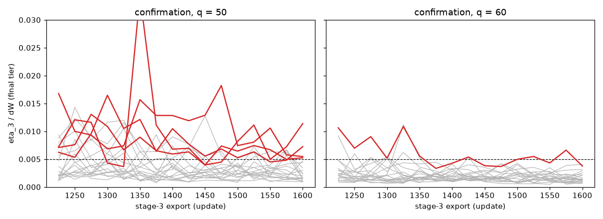

# T3-R2, P2: the T = 3 confirmation of the locked `bw`

Date: 2026-10-19. Branch `t3-r2`. Locked protocol `protocols/v2_T3_locked_v1_0.{json,md}` (T3-1.0; LOCK record, lock commit `72bd773f784f40bcd190113acbeb2dd8450d5b9a`); launched from the commit that holds the LOCK record, `2b63ffe469fd75457938c715c194e944cb735587`. Every table below is generated by `report_scripts/confirmation_tables.py` from the files of `results/t3_r2/confirmation/` (the verdict by `tools/t3/t3c_analysis.py`, recomputed independently by `tools/t3/t3c_blind.py`); the prose is `report_scripts/templates/04_confirmation.tpl.md`, assembled by `report_scripts/assemble.py`, and its numbers come from `tables/confirmation_numbers.json`. Gains are fractions of ΔW = 4 ("/dW").

## 0. Result

**The confirmation fails the pre-registered rule: 34 of 40 runs pass (16 of 20 at q = 50, 18 of 20 at q = 60).** The rule needed at least 36 of 40, at least 17 of 20 at q = 50 and at least 17 of 20 at q = 60. The total (34 < 36) and the q = 50 count (16 < 17) are short; q = 60 meets its part (18 ≥ 17). The blind recomputation agrees (True). Nothing was changed or tried; the next step is the PI's.

All 40 runs finished with exit code 0, no infrastructure event occurred, and every post-launch check passed (section 1). All six failing runs fail at stage 3, the terminal-stage phase (section 5): five are small to moderate excesses of the one-step gain η_3 or of the shape error at stage 3, one (q = 60, seed 60518) is a stage-3 policy that never left a low-effort solution. No failure is a stage-2 stretch (section 6).

## 1. The checks

Post-launch checks (`tools/t3/t3c_checks.py`, `results/t3_r2/confirmation/launch_checks.json`; wall-clock columns are not compared):

| check | runs passing | failing | not evaluated |
|---|---|---|---|
| exit code 0 / status done | 40 | 0 | 0 |
| complete files | 40 | 0 | 0 |
| manifest at the launch commit | 40 | 0 | 0 |
| clean tree (manifest flag) | 40 | 0 | 0 |
| process-global RNG assertions ok | 40 | 0 | 0 |
| config equals the plan (relative hash) | 40 | 0 | 0 |
| config equals the lock (production values) | 40 | 0 | 0 |
| budgets (updates, policy rows, minibatch steps) | 40 | 0 | 0 |
| learning rate at every update | 40 | 0 | 0 |
| snapshot refreshes (phase entries, multiples of 20) | 40 | 0 | 0 |
| 152 exports u00025...u03800 | 40 | 0 | 0 |
| 64 / 64 / 24 checks per stage | 40 | 0 | 0 |
| C-INIT: recorded init digest = planned | 40 | 0 | 0 |
| C-REPLAY: freeze arrays reproduced bit for bit | 40 | 0 | 0 |
| `infra_events.json` present | yes |  |  |

All 14 verdicts pass in all 40 runs (all pass: True). `infra_events.json` exists and is empty (0 events, 0 runs stopped without a verdict). The first invocation of the checks used a relative `--root`; the tool then compares a config hash whose output directory could not be made relative, and reported `config_equals_plan` 0 of 40 (`launch_checks_first_invocation_relative_root.json`, kept). I verified by hand that the written `run_config.json` of a run has exactly the SHA-256 of the plan (as written and relative), then re-ran the same, unchanged tool with an absolute `--root`: 40 of 40 on every check (`launch_checks.json`). The tool is listed in the lock, so it was not edited; a relative `--root` is a robustness defect of `t3c_checks.py` (it would give 0 of 40 on any correct launch), recorded in `03_checks.md`.

## 2. The locked settings and the code version

| item | value |
|---|---|
| HEAD at the launch (the commit that holds the LOCK record) | `2b63ffe469fd75457938c715c194e944cb735587` |
| lock commit (in the LOCK record) | `72bd773f784f40bcd190113acbeb2dd8450d5b9a` |
| lock JSON SHA-256 (LOCK record) | `4f02c7ae89f2578a7510e1f3934caeb4fc6085e851d8898c26fff6fe1487a741` |
| lock MD SHA-256 (LOCK record) | `14f8e2e7e14e4398bf8ca7a46e7a762d7b25581977944580e23e975d2e08a063` |
| code commit recorded by the launcher | `be2b7e9fe3e0aad34f7481a1d8306af7cc2963e7` |
| `git diff --stat be2b7e9f HEAD -- agents envs utils run tools/ms tools/v2` at the launch | empty |
| `git status --porcelain -- . ':(exclude)results'` at the launch (the clean-tree definition) | empty |
| `git status --porcelain` at the launch | `?? results/t3_r2/audit/a7_emat.npz`, `?? results/t3_r2/confirmation/`, `?? results/t3_r2/reruns/q50/seed50504/bw/freeze_stage1_development.npz`, `?? results/t3_r2/reruns/q50/seed50504/bw/freeze_stage1_final.npz`, `?? results/t3_r2/reruns/q50/seed50504/bw/freeze_stage2_development.npz`, `?? results/t3_r2/reruns/q50/seed50504/bw/freeze_stage2_final.npz`, `?? results/t3_r2/reruns/q50/seed50504/bw/freeze_stage3_development.npz`, `?? results/t3_r2/reruns/q50/seed50504/bw/freeze_stage3_final.npz`, `?? results/t3_r2/reruns/q50/seed50504/bw/train_history.json`, `?? results/t3_r2/reruns/q50/seed50504/bw/weights/`, `?? results/t3_r2/reruns/q50/seed50517/bw/freeze_stage1_development.npz`, `?? results/t3_r2/reruns/q50/seed50517/bw/freeze_stage1_final.npz`, `?? results/t3_r2/reruns/q50/seed50517/bw/freeze_stage2_development.npz`, `?? results/t3_r2/reruns/q50/seed50517/bw/freeze_stage2_final.npz`, `?? results/t3_r2/reruns/q50/seed50517/bw/freeze_stage3_development.npz`, `?? results/t3_r2/reruns/q50/seed50517/bw/freeze_stage3_final.npz`, `?? results/t3_r2/reruns/q50/seed50517/bw/train_history.json`, `?? results/t3_r2/reruns/q50/seed50517/bw/weights/`, `?? results/t3_r2/reruns/q60/seed50514/bw/freeze_stage1_development.npz`, `?? results/t3_r2/reruns/q60/seed50514/bw/freeze_stage1_final.npz`, `?? results/t3_r2/reruns/q60/seed50514/bw/freeze_stage2_development.npz`, `?? results/t3_r2/reruns/q60/seed50514/bw/freeze_stage2_final.npz`, `?? results/t3_r2/reruns/q60/seed50514/bw/freeze_stage3_development.npz`, `?? results/t3_r2/reruns/q60/seed50514/bw/freeze_stage3_final.npz`, `?? results/t3_r2/reruns/q60/seed50514/bw/train_history.json`, `?? results/t3_r2/reruns/q60/seed50514/bw/weights/`, `?? results/t3_r2/reruns/q60/seed50517/bw/freeze_stage1_development.npz`, `?? results/t3_r2/reruns/q60/seed50517/bw/freeze_stage1_final.npz`, `?? results/t3_r2/reruns/q60/seed50517/bw/freeze_stage2_development.npz`, `?? results/t3_r2/reruns/q60/seed50517/bw/freeze_stage2_final.npz`, `?? results/t3_r2/reruns/q60/seed50517/bw/freeze_stage3_development.npz`, `?? results/t3_r2/reruns/q60/seed50517/bw/freeze_stage3_final.npz`, `?? results/t3_r2/reruns/q60/seed50517/bw/train_history.json`, `?? results/t3_r2/reruns/q60/seed50517/bw/weights/` |
| workers (single-threaded) | 40 |
| `nproc` | 64 |
| load average at the start | 14.20, 13.88, 14.97 |
| free disk at the start | 879 GB of 5952 GB |
| parameters file SHA-256 | `db5156962a2d7a3eca0b7d0440d995d84dc57bb88c7066e38d7d61e40148e976` |
| planned / finished | 40 / 40 |
| final state of the launch | done |

The 40 configs are those of the plan `reports/t3/r2/confirmation_plan.csv` (SHA-256 of every written `run_config.json` equal to the plan, 40 of 40), each differing from T3-R1's `bw` config of the same q only in `seed`, `run`, `record.run`, `record.seed`, `record.output_dir` and `pilot` (`02_preregistration.md` section 5; the launcher refused otherwise). Budgets {3: 1600, 2: 1600, 1: 600}, learning rate 3e-4 decaying linearly to 3e-5 over local updates 1201-1600 (stages 3 and 2) and 1-600 (stage 1), 512 episodes per update, bin-balanced starts, rule disabled, `init_digest` true; evaluated policy: the last iterate on the final and the development tier.

## 3. Per seed

q = 50 (final-tier values; "its stage, gap d" is the stage and gap of the maximum of the full-domain gain):

| seed | run | eta_3/dW | RMSE_pos/e_3(0)* | tail mean/e_3(0)* | Gmax_full/dW | its stage, gap d | abs(eta_3 dev - final) | abs(Gmax dev - final) | EXP_root/dW |
|---|---|---|---|---|---|---|---|---|---|
| 60501 | **FAIL** (gate_G_A) | 0.00524 | 0.0450 | 0.0019 | 0.00524 | 3, -4 | 0.00000 | 0.00000 | 0.00112 |
| 60502 | pass | 0.00465 | 0.0436 | 0.0053 | 0.00465 | 3, -20 | 0.00000 | 0.00000 | 0.00074 |
| 60503 | pass | 0.00303 | 0.0336 | 0.0053 | 0.00303 | 3, -4 | 0.00000 | 0.00000 | 0.00068 |
| 60504 | pass | 0.00150 | 0.0190 | 0.0049 | 0.00150 | 3, -2 | 0.00014 | 0.00014 | 0.00026 |
| 60505 | pass | 0.00229 | 0.0326 | 0.0038 | 0.00229 | 3, -2 | 0.00003 | 0.00003 | 0.00065 |
| 60506 | **FAIL** (gate_G_A) | 0.00724 | 0.0465 | 0.0032 | 0.00724 | 3, -6 | 0.00001 | 0.00001 | 0.00164 |
| 60507 | pass | 0.00440 | 0.0423 | 0.0022 | 0.00440 | 3, -74 | 0.00004 | 0.00004 | 0.00118 |
| 60508 | pass | 0.00094 | 0.0183 | 0.0050 | 0.00115 | 2, +0 | 0.00000 | 0.00002 | 0.00034 |
| 60509 | pass | 0.00152 | 0.0229 | 0.0055 | 0.00164 | 2, +0 | 0.00000 | 0.00002 | 0.00036 |
| 60510 | pass | 0.00163 | 0.0310 | 0.0044 | 0.00163 | 3, -2 | 0.00021 | 0.00021 | 0.00041 |
| 60511 | pass | 0.00156 | 0.0330 | 0.0057 | 0.00156 | 3, -18 | 0.00002 | 0.00002 | 0.00047 |
| 60512 | pass | 0.00121 | 0.0259 | 0.0045 | 0.00121 | 3, +24 | 0.00000 | 0.00000 | 0.00086 |
| 60513 | **FAIL** (gate_G_A) | 0.00547 | 0.0476 | 0.0035 | 0.00547 | 3, -4 | 0.00000 | 0.00000 | 0.00125 |
| 60514 | pass | 0.00109 | 0.0179 | 0.0057 | 0.00109 | 3, -20 | 0.00000 | 0.00000 | 0.00029 |
| 60515 | **FAIL** (gate_G_A; gate_G_F) | 0.01138 | 0.0667 | 0.0036 | 0.01138 | 3, -36 | 0.00000 | 0.00000 | 0.00225 |
| 60516 | pass | 0.00150 | 0.0242 | 0.0041 | 0.00258 | 2, +0 | 0.00004 | 0.00002 | 0.00078 |
| 60517 | pass | 0.00345 | 0.0369 | 0.0037 | 0.00345 | 3, -30 | 0.00008 | 0.00008 | 0.00087 |
| 60518 | pass | 0.00199 | 0.0359 | 0.0042 | 0.00199 | 3, +74 | 0.00001 | 0.00001 | 0.00078 |
| 60519 | pass | 0.00096 | 0.0228 | 0.0045 | 0.00096 | 3, -82 | 0.00003 | 0.00003 | 0.00025 |
| 60520 | pass | 0.00252 | 0.0259 | 0.0077 | 0.00252 | 3, -4 | 0.00000 | 0.00000 | 0.00039 |

q = 60:

| seed | run | eta_3/dW | RMSE_pos/e_3(0)* | tail mean/e_3(0)* | Gmax_full/dW | its stage, gap d | abs(eta_3 dev - final) | abs(Gmax dev - final) | EXP_root/dW |
|---|---|---|---|---|---|---|---|---|---|
| 60501 | pass | 0.00166 | 0.0220 | 0.0056 | 0.00166 | 3, -2 | 0.00012 | 0.00012 | 0.00017 |
| 60502 | pass | 0.00132 | 0.0257 | 0.0048 | 0.00132 | 3, -2 | 0.00011 | 0.00011 | 0.00028 |
| 60503 | pass | 0.00219 | 0.0340 | 0.0043 | 0.00219 | 3, -2 | 0.00005 | 0.00005 | 0.00039 |
| 60504 | pass | 0.00212 | 0.0306 | 0.0062 | 0.00212 | 3, -2 | 0.00002 | 0.00002 | 0.00030 |
| 60505 | pass | 0.00129 | 0.0267 | 0.0062 | 0.00129 | 3, -2 | 0.00020 | 0.00020 | 0.00021 |
| 60506 | pass | 0.00138 | 0.0342 | 0.0050 | 0.00138 | 3, -30 | 0.00001 | 0.00001 | 0.00034 |
| 60507 | pass | 0.00079 | 0.0243 | 0.0054 | 0.00079 | 3, +38 | 0.00000 | 0.00000 | 0.00041 |
| 60508 | pass | 0.00254 | 0.0427 | 0.0040 | 0.00254 | 3, -28 | 0.00000 | 0.00000 | 0.00067 |
| 60509 | pass | 0.00292 | 0.0437 | 0.0025 | 0.00292 | 3, -32 | 0.00000 | 0.00000 | 0.00075 |
| 60510 | pass | 0.00064 | 0.0237 | 0.0100 | 0.00064 | 3, -2 | 0.00011 | 0.00007 | 0.00024 |
| 60511 | pass | 0.00125 | 0.0254 | 0.0065 | 0.00125 | 3, -2 | 0.00016 | 0.00016 | 0.00025 |
| 60512 | pass | 0.00407 | 0.0479 | 0.0030 | 0.00407 | 3, -4 | 0.00000 | 0.00000 | 0.00077 |
| 60513 | pass | 0.00097 | 0.0243 | 0.0070 | 0.00097 | 3, -2 | 0.00013 | 0.00013 | 0.00028 |
| 60514 | pass | 0.00094 | 0.0178 | 0.0061 | 0.00094 | 3, -2 | 0.00013 | 0.00013 | 0.00024 |
| 60515 | pass | 0.00149 | 0.0344 | 0.0054 | 0.00149 | 3, -28 | 0.00000 | 0.00000 | 0.00061 |
| 60516 | **FAIL** (gate_G_A) | 0.00376 | 0.0538 | 0.0027 | 0.00376 | 3, -4 | 0.00000 | 0.00000 | 0.00078 |
| 60517 | pass | 0.00115 | 0.0338 | 0.0064 | 0.00115 | 3, -22 | 0.00001 | 0.00001 | 0.00034 |
| 60518 | **FAIL** (gate_G_A; gate_G_F) | 0.14468 | 0.4620 | 0.1398 | 0.14468 | 3, -20 | 0.00000 | 0.00000 | 0.08149 |
| 60519 | pass | 0.00314 | 0.0482 | 0.0039 | 0.00314 | 3, -40 | 0.00000 | 0.00000 | 0.00068 |
| 60520 | pass | 0.00118 | 0.0169 | 0.0071 | 0.00118 | 3, -2 | 0.00017 | 0.00017 | 0.00013 |

## 4. The verdict under the rule

| q | runs passing | exact Clopper-Pearson 95 % interval | rule | met |
|---|---|---|---|---|
| 50 | 16 of 20 | [0.563, 0.943] | >= 17 | NO |
| 60 | 18 of 20 | [0.683, 0.988] | >= 17 | yes |
| both | 34 of 40 | [0.702, 0.943] | >= 36 | NO |

Rule (D4): the confirmation passes iff at least 36 of the 40 runs pass, at least 17 of 20 at q = 50 and at least 17 of 20 at q = 60. **Verdict: fail** (not met: total >= 36, q=50 >= 17). `t3c_blind.py`, which shares no code with the analysis tool (it reads the CSVs with the `csv` module and computes the intervals from beta quantiles), gives fail with the same counts and intervals (differences below 1e-9). The pooled rate with T3-R1's 40 development runs (descriptive only, not part of the rule): 70 of 80, exact 95 % interval [0.782, 0.938] (tables in section 7).

How surprising is the outcome? The operating characteristic printed in the pre-registration (`02_preregistration.md` section 3) gives the rule a pass probability of 0.071, 0.249 and 0.607 at per-run pass probabilities 0.80, 0.85 and 0.90. The observed 34 of 40 (0.85) and the pooled 70 of 80 (0.875) sit in that range, so a failure of the rule is the more likely outcome there (probability 0.93, 0.75 and 0.39); this is context and not a test. The intervals of T3-R1's 36 of 40 ([0.763, 0.972]) and of this 34 of 40 ([0.702, 0.943]) overlap widely.

## 5. The failures, diagnosed and classified

Six runs fail: four at q = 50 (seeds 60501, 60506, 60513, 60515) and two at q = 60 (60516, 60518). **All six fail at stage 3** (`Gmax_full` is attained at stage 3 in all six; the stage-2 gain of each failing run except seed 60518 at q = 60 is at most 0.00390 /dW). The values (final tier) and the shape of the policy:

| q | seed | failing gates | eta_3/dW | RMSE_pos/e_3(0)* | tail mean/e_3(0)* | Gmax_full/dW | learned e_3(0) | (e_3(0) - e*(0))/e*(0) | largest effort at |d| >= 2q | G_max,2/dW (stage 2) |
|---|---|---|---|---|---|---|---|---|---|---|
| 50 | 60501 | G-A | 0.00524 | 0.0450 | 0.0019 | 0.00524 | 60.11 (e*(0) = 70.00) | -0.141 | 2.71 | 0.00268 |
| 50 | 60506 | G-A | 0.00724 | 0.0465 | 0.0032 | 0.00724 | 58.55 (e*(0) = 70.00) | -0.164 | 4.78 | 0.00290 |
| 50 | 60513 | G-A | 0.00547 | 0.0476 | 0.0035 | 0.00547 | 60.12 (e*(0) = 70.00) | -0.141 | 4.82 | 0.00235 |
| 50 | 60515 | G-A; G-F | 0.01138 | 0.0667 | 0.0036 | 0.01138 | 64.00 (e*(0) = 70.00) | -0.086 | 5.65 | 0.00390 |
| 60 | 60516 | G-A | 0.00376 | 0.0538 | 0.0027 | 0.00376 | 50.22 (e*(0) = 58.33) | -0.139 | 3.33 | 0.00116 |
| 60 | 60518 | G-A; G-F | 0.14468 | 0.4620 | 0.1398 | 0.14468 | 8.16 (e*(0) = 58.33) | -0.860 | 8.16 | 0.11299 |

The development-tier `Delta` of the stage-3 phase (`ms_checks_stage3.csv`, every 25 local updates, 64 checks; the learning rate decays linearly over local updates 1201-1600), which is η_3 of the stage's own phase:

| q | seed | Delta at local 25 | Delta at local 100 | Delta at local 200 | Delta at local 400 | Delta at local 800 | Delta at local 1200 | Delta at local 1400 | Delta at local 1600 | smallest Delta of the 64 checks |
|---|---|---|---|---|---|---|---|---|---|---|
| 50 | 60501 | 0.10465 | 0.19606 | 0.04128 | 0.00744 | 0.00766 | 0.00237 | 0.00592 | 0.00524 | 0.00237 (local 1200) |
| 50 | 60506 | 0.10690 | 0.19311 | 0.20207 | 0.03484 | 0.01394 | 0.01534 | 0.01029 | 0.00724 | 0.00395 (local 1125) |
| 50 | 60513 | 0.10917 | 0.18917 | 0.04709 | 0.01436 | 0.00829 | 0.01053 | 0.01262 | 0.00547 | 0.00312 (local 775) |
| 50 | 60515 | 0.10763 | 0.19249 | 0.19965 | 0.03248 | 0.01242 | 0.00683 | 0.00672 | 0.01138 | 0.00366 (local 1325) |
| 60 | 60516 | 0.10232 | 0.13810 | 0.02480 | 0.00694 | 0.00636 | 0.00352 | 0.00426 | 0.00376 | 0.00319 (local 1125) |
| 60 | 60518 | 0.09730 | 0.14511 | 0.14610 | 0.15124 | 0.14458 | 0.14558 | 0.14851 | 0.14468 | 0.07855 (local 50) |

Where the evaluated iterate (the export `u01600`) sits among the last 16 exports of the stage-3 phase (`u01225` ... `u01600`; final-tier η_3 of each, `analysis/a8_last16_confirmation.csv`):

| q | seed | min eta_3/dW over the last 16 exports | median | max | at the evaluated iterate (u01600) | exports above 0.005 |
|---|---|---|---|---|---|---|
| 50 | 60501 | 0.00394 | 0.00668 | 0.01304 | 0.00524 | 14 |
| 50 | 60506 | 0.00450 | 0.00662 | 0.01647 | 0.00724 | 14 |
| 50 | 60513 | 0.00547 | 0.01028 | 0.01822 | 0.00547 | 16 |
| 50 | 60515 | 0.00366 | 0.00721 | 0.03449 | 0.01138 | 11 |
| 60 | 60516 | 0.00334 | 0.00527 | 0.01086 | 0.00376 | 9 |
| 60 | 60518 | 0.14398 | 0.14732 | 0.15048 | 0.14468 | 16 |

Diagnosis and class (D2; no implementation error is indicated: all 40 runs pass the budget, schedule, config, C-INIT and C-REPLAY checks, and the audit of section 3 of `01_audit.md` found none for T3-R1's code, which is unchanged):

- **Seeds 60501, 60506, 60513 at q = 50 (η_3 only; (L))** exceed 0.005 by 0.00024, 0.00224 and 0.00047 at the evaluated iterate. In all three the stage-3 policy is a few effort units below the best response over a wide band around d = 0 (learned e_3(0) 58.5 to 60.1 against e*(0) = 70, i.e. 14 to 16 % below; the maximum is at d = −4 to −6 where the best response is about 67.5 to 67.7). η_3 is above 0.005 at 14, 14 and 16 of the last 16 exports respectively: a persistent excess over most of the last 400 updates (for 60513 at every export, minimum 0.00547), as for seed 50504 in T3-R1, not a last-iterate fluctuation.
- **Seed 60515 at q = 50 (G-A and G-F; (L))** has η_3 = Gmax_full = 0.01138 at d = −36, where the learned effort is 53.4 and the best response 30.3: an excess effort, not a deficit. Its RMSE_pos/e_3(0)* is 0.0667 (limit 0.05). Its η_3 ranges from 0.00366 to 0.03449 over the last 16 exports, so the evaluated iterate is not extreme within its own range; it also has a stage-2 stretch of 5 nodes ([−98, −90]) that is not the failing quantity (G_max,2 = 0.0039).
- **Seed 60516 at q = 60 (G-A shape part only; (L))** has RMSE_pos/e_3(0)* = 0.0538 (limit 0.05) while η_3 = 0.00376 and every other gate pass. Its η_3 is above 0.005 at 9 of the last 16 exports, so the policy sits close to the G-A limits on both parts.
- **Seed 60518 at q = 60 (G-A all three parts and G-F; (L), a different kind)** is a stage-3 policy that never formed: `Delta` is between 0.144 and 0.154 at every check from local update 100 to the end (smallest value of the 64 checks 0.0785 at local 50), the learned e_3(0) is 8.16 against 58.33 (86 % below), the tail mean is 14 % of e_3(0)*, η_3 = Gmax_full = 0.1447 at d = −20 (learned 8.2, best response 48.5) and the stage-2 gain it inherits is 0.113. Its `Gmax_full` is the largest of the 80 `bw` runs of the two rounds (T3-R1's largest is 0.0563, a stage-2 stretch). The stage-3 clamp counters and the training signals of this phase were not examined, the audit's tools were not applied to the stage-3 phase, and the mechanism is not tested.
- **The development tier agrees with the final tier in all 40 runs** (largest abs(η_3 dev − final) 0.00021, abs(Gmax dev − final) 0.00021, G-N limit 0.001): none of the failures is a resolution artefact (`analysis/gate_values_vs_t3r1.csv`).

The calculator of the audit (`tools/t3/t3r2_br_calc.py`) was not re-run on the confirmation runs: the confirmation uses the verifier's gates as pre-registered, and the audit had shown the verifier's values to agree with the calculator to about 1e-5 ΔW. Where the stage of the maximum lies, for comparison with T3-R1 (`Gmax_full` stage 3 in 37 of 40 runs here against 36 of 40 there; stage 2 in 3 against 4):

| set | q | runs | Gmax_full at stage 3 | at stage 2 | at stage 1 | median G_max,2/dW | max | median G_max,3/dW | max |
|---|---|---|---|---|---|---|---|---|---|
| confirmation | 50 | 20 | 17 | 3 | 0 | 0.00112 | 0.00390 | 0.00214 | 0.01138 |
| confirmation | 60 | 20 | 20 | 0 | 0 | 0.00044 | 0.11299 | 0.00144 | 0.14468 |
| T3-R1 `bw` | 50 | 20 | 19 | 1 | 0 | 0.00104 | 0.00299 | 0.00200 | 0.00623 |
| T3-R1 `bw` | 60 | 20 | 17 | 3 | 0 | 0.00047 | 0.05628 | 0.00126 | 0.00268 |

## 6. The near-zero stage-2 stretches

A stretch is a run of consecutive in-band stage-2 nodes with learned mean effort below 1 (as in `01_audit.md` section 8). 3 of the 40 runs have one, all at q = 50 and all at the far edge of the band ([−98, −86] to [−98, −90], 5 to 7 nodes), none at q = 60 (T3-R1: 7 of 40 runs, 4 at q = 50 and 3 at q = 60, the longest 28 nodes):

| q | seed | run | in-band stage-2 nodes with learned effort < 1 | in-band nodes | stretches (d) |
|---|---|---|---|---|---|
| 50 | 60501 | **fail** | 0 | 99 | - |
| 50 | 60502 | pass | 0 | 99 | - |
| 50 | 60503 | pass | 0 | 99 | - |
| 50 | 60504 | pass | 0 | 99 | - |
| 50 | 60505 | pass | 0 | 99 | - |
| 50 | 60506 | **fail** | 6 | 99 | [-98, -88] |
| 50 | 60507 | pass | 7 | 99 | [-98, -86] |
| 50 | 60508 | pass | 0 | 99 | - |
| 50 | 60509 | pass | 0 | 99 | - |
| 50 | 60510 | pass | 0 | 99 | - |
| 50 | 60511 | pass | 0 | 99 | - |
| 50 | 60512 | pass | 0 | 99 | - |
| 50 | 60513 | **fail** | 0 | 99 | - |
| 50 | 60514 | pass | 0 | 99 | - |
| 50 | 60515 | **fail** | 5 | 99 | [-98, -90] |
| 50 | 60516 | pass | 0 | 99 | - |
| 50 | 60517 | pass | 0 | 99 | - |
| 50 | 60518 | pass | 0 | 99 | - |
| 50 | 60519 | pass | 0 | 99 | - |
| 50 | 60520 | pass | 0 | 99 | - |
| 60 | 60501 | pass | 0 | 119 | - |
| 60 | 60502 | pass | 0 | 119 | - |
| 60 | 60503 | pass | 0 | 119 | - |
| 60 | 60504 | pass | 0 | 119 | - |
| 60 | 60505 | pass | 0 | 119 | - |
| 60 | 60506 | pass | 0 | 119 | - |
| 60 | 60507 | pass | 0 | 119 | - |
| 60 | 60508 | pass | 0 | 119 | - |
| 60 | 60509 | pass | 0 | 119 | - |
| 60 | 60510 | pass | 0 | 119 | - |
| 60 | 60511 | pass | 0 | 119 | - |
| 60 | 60512 | pass | 0 | 119 | - |
| 60 | 60513 | pass | 0 | 119 | - |
| 60 | 60514 | pass | 0 | 119 | - |
| 60 | 60515 | pass | 0 | 119 | - |
| 60 | 60516 | **fail** | 0 | 119 | - |
| 60 | 60517 | pass | 0 | 119 | - |
| 60 | 60518 | **fail** | 0 | 119 | - |
| 60 | 60519 | pass | 0 | 119 | - |
| 60 | 60520 | pass | 0 | 119 | - |

Two of the three (60506, 60515) are among the failing runs; for the failing runs the A7 analysis of the audit was applied (`analysis/a7_failures.json`): at their 11 stretch nodes the one-step best-response effort is above 1 at all, Q increases at the learned effort at all, there is no local maximum near zero effort, and the nodes were already below 1 at the first stage-2 export (`u01625`): the same picture as the stretches of T3-R1. The stretches do not explain any failure of the confirmation: the failing quantity of both runs is at stage 3, and the stage-2 gain of the stretch runs is at most 0.0039 /dW. No q = 60 run has a stretch, and none of the q = 60 failures is a stage-2 failure (T3-R1's two q = 60 failures were).

## 7. The comparison with T3-R1's 40 `bw` runs (descriptive; the rule uses the 40 new runs only)

Pass counts of the confirmation, of T3-R1 and pooled (exact 95 % intervals):

| set | q | runs | passes | rate | exact 95 % interval |
|---|---|---|---|---|---|
| t3r2_confirmation | all | 40 | 34 | 0.850 | [0.702, 0.943] |
| t3r2_confirmation | 50 | 20 | 16 | 0.800 | [0.563, 0.943] |
| t3r2_confirmation | 60 | 20 | 18 | 0.900 | [0.683, 0.988] |
| t3r1_bw_development | all | 40 | 36 | 0.900 | [0.763, 0.972] |
| t3r1_bw_development | 50 | 20 | 18 | 0.900 | [0.683, 0.988] |
| t3r1_bw_development | 60 | 20 | 18 | 0.900 | [0.683, 0.988] |
| pooled_80_descriptive | all | 80 | 70 | 0.875 | [0.782, 0.938] |
| pooled_80_descriptive | 50 | 40 | 34 | 0.850 | [0.702, 0.943] |
| pooled_80_descriptive | 60 | 40 | 36 | 0.900 | [0.763, 0.972] |

The gate values, run by run summaries (median, maximum, number of runs above the limit):

| q | quantity | limit | confirmation median | max | runs above the limit | T3-R1 `bw` median | max | runs above the limit |
|---|---|---|---|---|---|---|---|---|
| 50 | eta_3/dW | 0.0050 | 0.00214 | 0.01138 | 4 | 0.00200 | 0.00623 | 2 |
| 50 | RMSE_pos/e_3(0)* | 0.0500 | 0.03282 | 0.06669 | 1 | 0.02754 | 0.04917 | 0 |
| 50 | tail mean/e_3(0)* | 0.0200 | 0.00446 | 0.00773 | 0 | 0.00471 | 0.00636 | 0 |
| 50 | Gmax_full/dW | 0.0100 | 0.00241 | 0.01138 | 1 | 0.00200 | 0.00623 | 0 |
| 50 | abs(eta_3 dev - final) | 0.0010 | 0.00000 | 0.00021 | 0 | 0.00002 | 0.00013 | 0 |
| 50 | abs(Gmax dev - final) | 0.0010 | 0.00001 | 0.00021 | 0 | 0.00001 | 0.00013 | 0 |
| 60 | eta_3/dW | 0.0050 | 0.00144 | 0.14468 | 1 | 0.00126 | 0.00268 | 0 |
| 60 | RMSE_pos/e_3(0)* | 0.0500 | 0.03219 | 0.46204 | 2 | 0.02654 | 0.03883 | 0 |
| 60 | tail mean/e_3(0)* | 0.0200 | 0.00551 | 0.13981 | 1 | 0.00542 | 0.00798 | 0 |
| 60 | Gmax_full/dW | 0.0100 | 0.00144 | 0.14468 | 1 | 0.00139 | 0.05628 | 2 |
| 60 | abs(eta_3 dev - final) | 0.0010 | 0.00002 | 0.00020 | 0 | 0.00001 | 0.00019 | 0 |
| 60 | abs(Gmax dev - final) | 0.0010 | 0.00002 | 0.00020 | 0 | 0.00001 | 0.00073 | 0 |

Means of the full-domain gain and of the root gain:

| q | mean Gmax_full/dW, confirmation | T3-R1 `bw` | mean EXP_root/dW, confirmation | T3-R1 `bw` |
|---|---|---|---|---|
| confirmation | 50 | 20 | 17 | 3 | 0 | 0.00112 | 0.00390 | 0.00214 | 0.01138 |
| confirmation | 60 | 20 | 20 | 0 | 0 | 0.00044 | 0.11299 | 0.00144 | 0.14468 |
| T3-R1 `bw` | 50 | 20 | 19 | 1 | 0 | 0.00104 | 0.00299 | 0.00200 | 0.00623 |
| T3-R1 `bw` | 60 | 20 | 17 | 3 | 0 | 0.00047 | 0.05628 | 0.00126 | 0.00268 |

The mean `Gmax_full/dW` is higher in the confirmation at both q (q = 50: 0.00325 against 0.00249; q = 60: 0.00897 against 0.00476), at q = 60 driven by the one gross failure (without seed 60518 the confirmation's mean at q = 60 is 0.00183). The medians are close at both q (0.00241 against 0.00200 at q = 50, 0.00144 against 0.00139 at q = 60). At q = 50 four runs exceed the η_3 limit (T3-R1: two) and 17 of 20 are above 0.005 at one or more of the last 16 exports (T3-R1: 14):

| q | runs | runs with eta_3/dW > 0.005 at one or more of the last 16 exports | at all 16 exports | at the evaluated iterate (u01600) | median over runs of the per-run median |
|---|---|---|---|---|---|
| 50 | 20 | 17 | 1 | 4 | 0.00256 |
| 60 | 20 | 9 | 1 | 1 | 0.00176 |

## 8. Cost

| set | runs | wall s, min | median | max | sum of the runs' wall time, hours |
|---|---|---|---|---|---|
| confirmation (40 workers) | 40 | 577 | 611 | 640 | 6.79 |
| T3-R1 `bw` (wave of 160 runs at 40 workers) | 40 | 503 | 578 | 640 | 6.39 |

The wave of 40 runs took about 11 minutes of wall time at 40 workers (the slowest run 640 s, the median 611 s; load average 14.2 at the start and 39.2 at the end, the machine being shared); the post-launch checks took 6.5 s, the evaluation of the 40 runs 6.3 s, the analysis 17 s. All runs reached update 3800 (1).

## 9. The predictions against the outcome

D4 and D5 gave no prediction of the outcome (CP1: only the operating characteristic, above). The two predictions that can be read on the new runs:

- **AP3** (at q = 50 several runs have η_3 above 0.005 at one or more of the last 16 exports; a G-A failure at q = 50 is last-iterate variability): the first part is again true and stronger: 17 of 20 runs at q = 50 (9 of 20 at q = 60), 4 at the evaluated iterate at q = 50. Only one run is above 0.005 at all 16 exports at each q (1 and 1); the second part holds for the marginal excesses and not for seed 60513 (above at all 16 exports) or for the gross failure of seed 60518.
- **AP2** (stretches are learning failures with a positive slope and no local maximum near zero): holds for the two stretch runs analysed (section 6).

T3-R1's 36 of 40 had the exact interval [0.763, 0.972]; the confirmation's 34 of 40 lies inside it, and the rule asked for 36.

## 10. Deviations and caveats

- The first run of `t3c_checks.py` used a relative `--root` and reported `config_equals_plan` 0 of 40 (section 1); the second, with an absolute root, is the record of the checks; both files are kept; the config identity was verified by hand (the written config SHA-256 equals the plan's).
- The results commit (the 40 runs, checks, evaluation, analysis) was pushed to `origin/t3-r2` (`f6b38354`) right after the analysis, before the reports of P3; the prompt names the push points of §3.1 and §4.3 only. It is a fast-forward of the round's own branch; nothing else was pushed, no tag, no pull request, `main` untouched.
- The weights, freeze arrays and evaluation arrays of the 40 runs are untracked (`results/t3_r2/confirmation/`), like T3-R1's.
- The mechanism of the stage-3 failures is not tested here. No remedy was tried.
